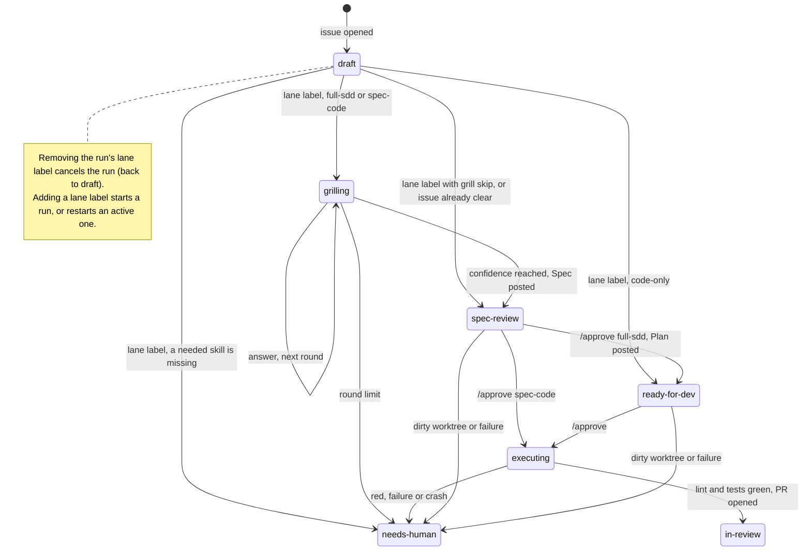

# Spec #0 — GitHub AI Agent: Architecture Overview

> **Created:** 2026-11-09 · **Status:** approved 2026-11-09
>
> **Why this file exists:** the system is too large for one spec (idea doc §12). This overview is the spine every
> capability spec (#1–#10) loads. It fixes the module boundaries, the status/lane state machine, the shared
> contracts, the config schema and table ownership, so each capability spec can be written in its own session
> with focused context.
>
> **Sources:** `docs/idea/github-ai-agent-master-technical-spec.md` (parts moved here are marked "→ moved to …"
> there) and the interview of 2026-11-09 (decisions D1–D17).
>
> **Normative:** the §3 transition table, §4 contracts, §5 config, §6 table ownership and §7 rules. A change to
> any of them updates this file first, then the affected specs.

## Objective

An MVP GitHub App backend (NestJS on the developer's machine, reached through ngrok) that moves issues of **one
sandbox target repo** through Grill Me → Spec → Plan → Coder → Quality Gate, driven by labels and `/approve`
comments, without acting under the developer's identity or touching their checkout.

- **Actors:** the developer (runs the app, reviews and merges PRs), `write` users of the target repo (label
  issues, answer questions, `/approve`), the bot (the GitHub App).
- **Done when** every capability spec can be written and implemented in build order without contradicting
  another one (see Success criteria).

## Scope

- **In:** capability map and NestJS modules (§1), repositories (§2), state machine (§3), shared contracts (§4),
  config schema (§5), table ownership (§6), cross-cutting rules (§7) and the verification matrix.
- **Out:** how each capability works inside (columns, prompts, algorithms, retry counts, comment texts) →
  specs #1–#10. Post-MVP ideas → idea doc §11 "Future".
- **Setup & configuration:** §2 and §5 here; the living guide `docs/guides/setup-github-agent-local.md` starts
  with spec 1.

## Decisions (interview 2026-11-09, all confirmed)

- **D1 `Task` holds the workflow state.** One row per issue: status (source of truth; the `status: *` label is
  its projection), lane, current run and session lease. Replaces `GrillSession.lockedUntil`.
- **D2 Leases renew by heartbeat** while a job runs. `SESSION_LEASE_SECONDS` (was `GRILL_LEASE_SECONDS`) is the
  expiry after a crash, not a time limit. PR events use the lease of their task; there is no separate PR lease.
- **D3 Routing is plain NestJS:** a pure `decide(state, input) → action`, a dispatcher and step handlers
  registered by the step modules. Step outcomes go back through `decide()`, so steps never call each other.
  LangGraph runs only inside the Coder and Quality Gate agent loops.
- **D4 Thin intake:** the controller validates HMAC, stores the event (deduplicated by delivery ID) and replies
  `202`, with no outbound calls. The worker checks the sender. Every event that doesn't reach the router is
  recorded in the events table with a reason. `ExecutionLog` is for LLM runs only.
- **D5 Lane labels act per event:** removing the run's lane label cancels the run (`draft`); adding a lane label
  starts a run, cancelling the active one first (restart); a lane swap works in either order; with two lane
  labels nothing starts or is cancelled; events received before the current run started are ignored.
- **D6 A restart starts from scratch.** A cancelled run's Grill answers are never reused. If it had answered
  rounds, one cancel comment lists them in a copyable block and says how to carry them over: edit the issue
  description before re-adding the label, paste them into the first answer of the new session, or edit the Spec
  comment before `/approve`.
- **D7 `needs-human` exits only through the label restart,** whatever the cause. Every entry posts exactly one
  comment with the cause and the next step. `/retry` → Future.
- **D8 A Grill round asks 1..K questions,** chosen by the LLM; only questions whose answers don't affect each
  other go together. K = `GRILL_MAX_QUESTIONS_PER_ROUND` (default 3). Output `{ confidence, questions[], gaps }`;
  `GrillRound` = one row per bot comment.
- **D9 Step skills are read through the GitHub API** at the base branch (`RepoProvider.readFile`, spec 3);
  spec 4 loads, validates and assembles them. Replaces "read from git". `WORKSPACE_BASE_BRANCH` becomes
  `TARGET_BASE_BRANCH`. **2026-11-10 (spec 3, G7):** a skill is its whole directory (references, scripts), so
  `RepoProvider.listFiles` lists it; spec 4 decides how the files are used.
- **D10 `/approve` counts once,** and only if posted after the document (or go-signal) it approves. Ignored
  during `grilling`.
- **D11 Busy workspace:** the approval is recorded, the event waits (`WAITING_WORKSPACE`), one "queued" comment
  is posted, and the retry goes through the lease and the router again.
- **D12 Interrupted Coder job** (crash): `in-review` if its PR was already opened, otherwise `needs-human` +
  comment. The worktree is left as is.
- **D13 Exactly-once side effects:** the two-transaction + hidden-marker pattern applies to every bot comment and
  PR, not only to Grill questions.
- **D14 One target repo per instance** (`TARGET_REPO`); events from any other repo are ignored.
- **D15 Secret scanning** covers everything the bot sends out, including the diff before every push.
- **D16 Failures:** transient errors are retried a bounded number of times, then `needs-human` + comment.
  Never silent.
- **D17 Bounded loops:** the Coder and Quality Gate agent loops have step caps from config.
- **D18 Step skills are required (2026-11-10).** Every step a run uses needs a skill mapped in `workflow.json`;
  there is no built-in fallback prompt. Checked when the run starts, so nothing is posted or approved first: a
  missing skill → `needs-human` + one comment naming the missing steps (§3 R6). The bot keeps only its own
  prompt frame (output schema, tools, guardrails). Replaces "missing → built-in default prompt". Reason: a silent
  fallback gives weaker documents and can put a green Quality Gate check on a PR, and the steps no longer need a
  second set of method prompts.

## Contradictions found in the idea doc

| # | Contradiction or gap | Resolution |
|---|---|---|
| F1 | §9 puts the lease on `GrillSession`; §7 claims a lease per issue/PR before routing; §12 gives the lease to spec 5 and `GrillSession` to spec 6. No `GrillSession` exists for `code-only` or PR events. | D1, D2 |
| F2 | §9 logs unauthorized comments in `ExecutionLog` (spec 4), but spec 2 doesn't depend on spec 4. A permission check in the controller loses events when the GitHub API call fails (GitHub doesn't redeliver failed deliveries). | D4 |
| F3 | §5 says new issues get `status: draft`; §7 never sets it. | Set on `issues.opened` (unknown task) and on cancel. |
| F4 | §7: a `WAITING_WORKSPACE` retry goes straight to the workspace claim, skipping the session lease and the router. | D11 |
| F5 | §10 runs `WORKSPACE_SETUP_COMMAND` before checking out the fetched base, so it installs the old base's dependencies. | Run it after the checkout (spec 8). |
| F6 | §10's `git checkout -B agent/<n>-<slug>` silently resets an existing branch (a red run the developer continues on, or a restart). | The branch name includes the run number; the bot never resets an existing branch (spec 8). |
| F7 | §12: specs 6 and 7 need step skills, but reading them is in spec 8, which neither depends on. | D9 |
| F8 | §12: spec 2's permission check and label revert need the GitHub provider (spec 3), and spec 4 now reads skills through it. | Specs 2 and 4 depend on 3. |
| F9 | §12: spec 1 posts "via the App", but App auth is listed under spec 3. | Spec 1 ships a minimal App client; spec 3 replaces it. |
| F10 | §6: `postComment` returns `void` although §9 stores comment IDs and searches markers; methods take `taskId` although adapters call the API by `externalRef`; `extractWorkflowLabel` can't report two lanes. | Contracts revised (§4). |
| F11 | §10 says the setup guide creates the labels; §12 gives label creation to spec 3. | The bot creates missing labels at startup (spec 3); the guide documents them. |

---

## 1. Capability map

Module ids are stable kebab-case ids and match the spec files (`docs/specs/spec-github-agent-<id>.md`).
Numbers are IDs, not build order.

| # | Module id | NestJS module(s) · folder | Responsibility | Depends on | Effort |
|---|---|---|---|---|---|
| 1 | `walking-skeleton` | `ConfigModule`, `PrismaModule`, `WebhookModule`, `EventsModule` · `src/config`, `src/prisma`, `src/webhook`, `src/events` | Zod env validation, Prisma, `POST /webhooks/github` + HMAC guard, events table, `enqueue()`, polling worker, minimal App client for the "hello" comment | — | high |
| 2 | `intake-authorization` | `IntakeModule` · `src/intake` | Payload → neutral input, sender check (+ the App's own PR events), target-repo filter, ignore reasons, label revert | 1, 3 | xhigh |
| 3 | `github-providers` | `GitHubModule` · `src/github` | App auth (JWT → installation token), GitHub `IssueProvider` + `RepoProvider`, label bootstrap | 1 | high |
| 4 | `llm-foundation` | `LlmModule` · `src/llm` | Anthropic client, Zod output + retry, `ExecutionLog`, input guardrails, secret scanner, step-skill loader + prompt assembly | 1, 3 | xhigh |
| 5 | `router-session-lease` | `WorkflowModule` · `src/workflow` | `Task` state + label projection, lease service (claim, heartbeat, release), `decide()`, dispatcher + handler registry, cancel/restart, stale events | 2, 3 | xhigh |
| 6 | `grill-me` | `GrillModule` · `src/grill` | Grill rounds (1..K questions), `GrillSession`/`GrillRound`, bursts, limit, skip, cancel comment | 4, 5 | max |
| 7 | `spec-plan-approvals` | `DocumentsModule` · `src/documents` | Spec/Plan generation, `/approve` rules, approved snapshots | 6 | xhigh |
| 8 | `workspace-git` | `WorkspaceModule` · `src/workspace` | git runner (`execFile`), bot worktree, workspace lease + queue, setup command, bot identity, per-command token | 3, 5 | max |
| 9 | `coder` | `CoderModule` · `src/coder` | Coder agent loop (LangGraph), file tools, command allowlist, lint/test gate, commit/push/PR, red and interrupted runs | 4, 7, 8 | xhigh |
| 10 | `quality-gate` | `QualityGateModule` · `src/quality-gate` | Quality Gate agent loop (LangGraph) on bot PRs, `report-only`, PR comment + check run | 4, 9 | xhigh |

**Build order:** 1 → 3 → 2 → 4 → 5 → 6 → 7 → 8 → 9 → 10. Specs 2 and 4 can swap; spec 8 only needs 3 and 5.

**Module rules**
- Imports follow the "Depends on" column, with no cycles. Step modules (6, 7, 9, 10) register their handlers in
  `WorkflowModule`; `WorkflowModule` never imports them.
- Only `WorkflowModule` writes `Task.status` and the `status: *` label. Only `WorkspaceModule` runs `git`. Only
  `GitHubModule` imports Octokit (spec 3 removes spec 1's hello client). Only `CoderModule` and
  `QualityGateModule` use LangGraph.
- A table is written only through its owner module's services (§6).

**Project structure**

```text
src/
  main.ts, app.module.ts
  contracts/                        §4 types + DI tokens (ISSUE_PROVIDER, REPO_PROVIDER), no logic
  config/ prisma/ webhook/ events/  spec 1
  intake/                           spec 2
  github/                           spec 3
  llm/                              spec 4
  workflow/                         spec 5
  grill/ documents/                 specs 6, 7
  workspace/                        spec 8
  coder/ quality-gate/              specs 9, 10
prisma/                             schema.prisma + migrations (each spec adds its own)
test/                               integration and e2e tests; unit tests sit next to the code (*.spec.ts)
docs/                               idea/, specs/, plans/, guides/
```

Step modules ship only their bot-owned prompt frame (output schema, tools, guardrails); the method always comes
from the target repo's skill (D18, 2026-11-10; was "their own built-in default prompts").

## 2. Repositories

| | Bot repo [`Hugoer/sdd-agent`](https://github.com/Hugoer/sdd-agent) (this repo, was `cn_ai` until 2026-11-10) | Target repo (sandbox) [`Hugoer/sdd-agent-sandbox`](https://github.com/Hugoer/sdd-agent-sandbox) |
|---|---|---|
| What | The NestJS app. The bot never writes code here. | New demo repo (small TypeScript project, ESLint + Vitest) where issues live and the bot codes. |
| Contains | `src/`, `prisma/`, the steps' prompt frames (D18), tests, `docs/`, `AGENTS.md`, `.env.example` (`.env` is gitignored) | Issues and labels, `.github-agent/workflow.json`, step skills (e.g. `.claude/skills/*`), the product code, `agent/*` branches, bot PRs and check runs, optional branch protection |
| On the developer's machine | The developer's checkout; runs the app | The developer's clone (`WORKSPACE_REPO_PATH`) and the bot worktree (`WORKSPACE_WORKTREE_PATH`: shares history, only the bot writes there) |
| GitHub App | Not installed | Installed (only here) |
| Created by | The developer, manually | The developer, manually; spec 1's setup covers it |

- **GitHub App** (one, owned by the developer): permissions `issues`, `pull_requests`, `contents`, `checks`
  (write) and `metadata` (read), spec 3; webhook events `issues`, `issue_comment`, `pull_request`, spec 2;
  webhook URL = the ngrok tunnel → `POST /webhooks/github`; secret = `GITHUB_WEBHOOK_SECRET`.
- **Labels** (created by the bot at startup if missing, spec 3):
  `status: draft | grilling | spec-review | ready-for-dev | executing | in-review | needs-human` (bot only);
  `workflow: full-sdd | spec-code | code-only` and `grill: skip` (humans only).
- **State:** the local PostgreSQL holds all workflow state; GitHub only shows its projection (labels, comments,
  PRs, check runs).

## 3. State machine

### States, runs and lanes

- **States** = `Task.status`, shown as the `status: *` label: `draft` (no run; also any issue without a `Task`
  row), `grilling`, `spec-review`, `ready-for-dev`, `executing`, `in-review`, `needs-human`.
  "Run state" = any state except `draft`.
- **Run:** started by a lane label. It owns its lane, Grill session, documents, approvals and PR, and ends only
  when cancelled. A restart cancels the run and starts a new one from scratch (D6).
- **Lanes** (✋ = `/approve`): `full-sdd` = Grill → Spec ✋ → Plan ✋ → Coder → Quality Gate ·
  `spec-code` = Grill → Spec ✋ → Coder → Quality Gate · `code-only` = go-signal ✋ → Coder → Quality Gate.
  `grill: skip` drops Grill Me from the first two and is read only when a run starts.

### Inputs

| Input | Source |
|---|---|
| `ISSUE_OPENED` | `issues.opened` |
| `LANE_ADDED(l)`, `LANE_REMOVED(l)` | `issues.labeled` / `issues.unlabeled` with `workflow: l` |
| `SKIP_ADDED` | `issues.labeled` with `grill: skip` |
| `COMMENT` | `issue_comment.created` on the issue that isn't a command |
| `APPROVE` | `issue_comment.created` that is `/approve` (exact syntax: spec 7) |
| `PR_UPDATED` | `pull_request.opened` / `synchronize` on a bot PR |
| Step outcomes | Grill `ASKED`, `CLEAR`, `LIMIT` · workspace `WS_BUSY`, `WS_DIRTY`, `WS_CLAIMED` · Coder `GREEN`, `RED` · `INTERRUPTED` · `FAILED(cause)` |

**Ignored at intake** (recorded with a reason, never routed): other repos; senders without `write` (a lane or
skip label they added is removed + one comment); the bot's own events, except `PR_UPDATED` on its own PR; comment
edits and deletes; comments on PRs; PRs not opened by the bot; `status: *` label changes; `grill: skip` removal;
any other event type or action.

### Per-event pipeline

1. **Controller:** HMAC check (`401` if invalid) → store, deduplicated by delivery ID → `202`. No outbound calls.
2. **Worker** (oldest pending first): intake; ignored events stop here.
3. **Lease:** claim the task's session lease (PR events: the task of the bot PR). Taken → the event stays pending.
4. **Route:** load `Task`, read lane/skip labels from the API when the input needs them → `decide()` → handler →
   outcome → `decide()` … until the job ends.
5. **Finish:** release the lease; mark the event done, ignored, waiting or failed.

### Rules applied before the table

- **R1 Stale events:** an event received before the current run started is ignored.
- **R2 Valid `/approve`:** posted after the document or go-signal the current status points to, and that document
  isn't approved yet (the event that recorded the approval may be retried).
- **R3 One job per task:** while a job holds the lease, the task's other events wait, then run against the new
  state.
- **R4 Failures:** after bounded retries, any step failure becomes `FAILED(cause)`: invalid `workflow.json`,
  missing skill, guardrail block, API error, rejected push, ….
- **R5 `needs-human`:** every entry posts exactly one comment with the cause and "restart: remove and re-add the
  `workflow:*` label". The restart is the only exit.
- **R6 Skills check (D18, 2026-11-10):** a run goes on to rows 9–11 only if every step it will use has a skill in
  `workflow.json`: `full-sdd` → `grill`, `spec`, `plan`, `code`, `qualityGate`; `spec-code` → the same without
  `plan`; `code-only` → `code`, `qualityGate`; with `grill: skip` → without `grill`. Otherwise the run is created
  and fails at once with `FAILED(missing skills: …)` (row 28); nothing else is posted. Each step checks again
  when it loads its skill.

### Transition table (normative)

| # | State | Input | Action | Next |
|---|---|---|---|---|
| 1 | draft | `ISSUE_OPENED` | If no `Task` row exists: create it, set `status: draft` | draft |
| 2 | draft | `LANE_ADDED`, exactly one lane label on the issue | Start a run (rows 9–11) | per lane |
| 3 | draft | `LANE_ADDED`, two or more lane labels | One comment: keep exactly one `workflow:*` label | draft |
| 4 | draft | `LANE_REMOVED`, exactly one lane label left | Start a run with it (rows 9–11) | per lane |
| 5 | draft | anything else | Ignored | draft |
| 6 | run state | `LANE_REMOVED` of the run's lane | Cancel the run: close the Grill session (kept), cancel comment if it had answered rounds (D6). Exactly one lane label left → start a run with it | draft or per lane |
| 7 | run state | `LANE_ADDED`, exactly one lane label now | Cancel as in row 6, then start a run with it (restart) | per lane |
| 8 | run state | any other lane-label change (two or more lanes, or another lane removed) | Ignored; the run continues | unchanged |
| 9 | ↳ run start | `full-sdd` / `spec-code`, no `grill: skip` | Open a Grill session, first evaluation | rows 12–14 |
| 10 | ↳ run start | `full-sdd` / `spec-code` + `grill: skip` | `GrillSession` SKIPPED + skip comment → generate and post the Spec | spec-review |
| 11 | ↳ run start | `code-only` | Go-signal comment | ready-for-dev |
| 12 | ↳ Grill outcome | `ASKED` | Post 1..K questions (two transactions + marker) | grilling |
| 13 | ↳ Grill outcome | `CLEAR` (≥ threshold) | If no question was asked: comment with the score. Generate and post the Spec | spec-review |
| 14 | ↳ Grill outcome | `LIMIT` (max rounds, below threshold) | One summary comment (confidence + gaps) | needs-human |
| 15 | grilling | `COMMENT` | Grill round with the merged answer (every comment since the last question) | rows 12–14 |
| 16 | grilling | `APPROVE`, `SKIP_ADDED` | Ignored (force continue is Future) | grilling |
| 17 | spec-review (`full-sdd`) | valid `APPROVE` | Snapshot the approved Spec → generate and post the Plan | ready-for-dev |
| 18 | spec-review (`spec-code`) | valid `APPROVE` | Snapshot the approved Spec → claim the workspace | rows 21–23 |
| 19 | ready-for-dev | valid `APPROVE` | `full-sdd`: snapshot the approved Plan. Then claim the workspace | rows 21–23 |
| 20 | spec-review, ready-for-dev | `COMMENT`, `SKIP_ADDED`, invalid `APPROVE` | Ignored | unchanged |
| 21 | ↳ workspace claim | `WS_BUSY` | Approval recorded; event marked `WAITING_WORKSPACE`; one "queued" comment. Retried oldest first through the whole pipeline once the workspace is free | unchanged |
| 22 | ↳ workspace claim | `WS_DIRTY` | Comment; release the workspace lease | needs-human |
| 23 | ↳ workspace claim | `WS_CLAIMED` | Start the Coder job (heartbeat on) | executing |
| 24 | executing | `GREEN` | Commit as the bot, push, open the PR; detach the worktree; release the workspace lease | in-review |
| 25 | executing | `RED` (after `CODER_MAX_FIX_ATTEMPTS`) | Local commit only; comment with trimmed, scanned output + branch name; detach; release | needs-human |
| 26 | executing | `INTERRUPTED` (the job's own event retried after a crash) | PR already opened → finish as `GREEN`. Otherwise comment, leave the worktree as is, release the workspace lease | in-review or needs-human |
| 27 | in-review, needs-human | `COMMENT`, `APPROVE`, `SKIP_ADDED` | Ignored | unchanged |
| 28 | any | `FAILED(cause)` | One comment naming the cause; release held leases | needs-human |
| 29 | any (the task has a bot PR) | `PR_UPDATED` | Quality Gate on the newest head commit (older heads skipped) → PR comment + check run | unchanged |

Informative view (the table wins if they differ):



## 4. Shared contracts

Types and DI tokens live in `src/contracts` (no logic). GitHub implementations: spec 3. Jira / Azure DevOps: Future.
A spec that needs another method adds it here first.

```ts
export type Platform = 'GITHUB' | 'JIRA' | 'AZURE_DEVOPS';
export type Lane = 'full-sdd' | 'spec-code' | 'code-only';
export type TaskStatus =
  | 'draft' | 'grilling' | 'spec-review' | 'ready-for-dev' | 'executing' | 'in-review' | 'needs-human';

/** DB identity = platform + id. externalRef is what adapters call the API with; it may change. */
export interface TaskRef {
  platform: Platform;
  id: string;          // stable platform ID (GitHub: issue.id)
  externalRef: string; // e.g. "owner/repo#123", "PROJ-123"; refreshed from every event
}

export interface UnifiedTask extends TaskRef {
  title: string;
  description: string;
  labels: string[];    // always read from the API, never from a webhook payload
  author: string;
  url: string;
}

export interface CommentRef { id: string; url: string; createdAt: Date }

export interface IssueProvider {
  getTaskDetails(task: TaskRef): Promise<UnifiedTask>;
  /** body is already secret-scanned and carries its hidden marker */
  postComment(task: TaskRef, body: string): Promise<CommentRef>;
  getComment(task: TaskRef, commentId: string): Promise<{ body: string; createdAt: Date } | null>;
  /** exactly-once recovery: the bot's comment carrying this marker, if it was already posted */
  findCommentByMarker(task: TaskRef, marker: string): Promise<CommentRef | null>;
  /** projection of Task.status: sets this status label and removes any other `status: *` label */
  setStatusLabel(task: TaskRef, status: TaskStatus): Promise<void>;
  /** only to revert a lane/modifier label added by a sender without write access */
  removeLabel(task: TaskRef, label: string): Promise<void>;
  /** write or higher (GitHub: collaborator permission on the target repo) */
  hasWriteAccess(task: TaskRef, login: string): Promise<boolean>;
  /** platform label names → neutral controls; returns every lane found, so callers can detect two */
  readControls(task: UnifiedTask): { lanes: Lane[]; grillSkip: boolean };
  /** creates missing status / workflow / modifier labels (startup) */
  ensureLabels(): Promise<void>;
}

export interface PullRequestRef { platform: Platform; repo: string; number: number; url: string }

export interface PushCredentials {
  authorName: string;  // "<app>[bot]"
  authorEmail: string;
  remoteUrl: string;   // explicit HTTPS URL; the developer's `origin` is never used or changed
  token: string;       // short-lived installation token: passed per command, never persisted
                       // (spec 3, G8: target repo only, contents: write only, new on every call)
  expiresAt: Date;
}

/** Added 2026-11-10 (spec 3, G7). */
export interface RepoFile {
  path: string;        // relative to the repo root
  size: number;        // bytes
  executable: boolean; // git mode 100755
}

export interface RepoProvider {
  getPushCredentials(): Promise<PushCredentials>;
  /** file content at a ref on the code host (step skills: always the base branch); null = missing */
  readFile(ref: string, path: string): Promise<string | null>;
  /** every regular file under dir at a ref, at any depth (a step skill is its whole directory);
   *  null = no such directory (added 2026-11-10, spec 3, G7) */
  listFiles(ref: string, dir: string): Promise<RepoFile[] | null>;
  openPullRequest(branch: string, base: string, title: string, body: string): Promise<PullRequestRef>;
  /** recovery after a crash between opening the PR and recording it */
  findPullRequest(branch: string): Promise<PullRequestRef | null>;
  postPullRequestComment(pr: PullRequestRef, body: string): Promise<CommentRef>;
  setQualityResult(pr: PullRequestRef, commitSha: string,
    result: 'success' | 'neutral' | 'failure', summary: string): Promise<void>;
}

export type StepName = 'grill' | 'spec' | 'plan' | 'code' | 'qualityGate';

/** What a target-repo skill contributes to a step: instructions, nothing else. */
export interface StepSkill {
  step: StepName;
  path: string; // directory mapped in .github-agent/workflow.json
  text: string; // SKILL.md + the files it references, read at the base branch
                // (2026-11-10: a skill is its whole directory; spec 4 revises this type)
}

/** Added 2026-11-10 (spec 3, G5). Every provider failure. The worker retries `transient` and fails
 *  `permanent` at once; providers never retry a call themselves. */
export class ProviderError extends Error {
  constructor(message: string, readonly kind: 'transient' | 'permanent',
    readonly detail: { status?: number; retryAfterSeconds?: number } = {}) { super(message); }
}
```

### Step-skill contract

| Step (`workflow.json` key) | Output, Zod-validated (bot-owned) | Tools (bot-owned) | Limits |
|---|---|---|---|
| Grill Me (`grill`) | `{ confidence: 0–100, questions: string[] (0..K), gaps: string[] }` | none | `GRILL_MAX_ROUNDS`, `GRILL_MAX_QUESTIONS_PER_ROUND`, `GRILL_CONFIDENCE_THRESHOLD` |
| Spec (`spec`), Plan (`plan`) | Markdown document (shape: spec 7) | none | input guardrails (spec 4) |
| Coder (`code`) | Final summary (shape: spec 9) | read, write, list, search files in the bot worktree; `runCommand` limited to `CODER_ALLOWED_COMMANDS`. No git. | `CODER_MAX_STEPS`, `CODER_MAX_FIX_ATTEMPTS` |
| Quality Gate (`qualityGate`) | `{ verdict: APPROVED \| NEEDS_DECISIONS \| BLOCKED, summary, findings[] }` | read-only file tools at the PR head (spec 10) | `QUALITY_GATE_MAX_STEPS` |

- **Map:** `.github-agent/workflow.json` in the target repo: `{ "skills": { "<step>": "<directory relative to the
  repo root>" } }`. Read with `RepoProvider.readFile` at `TARGET_BASE_BRANCH` at the start of every step run
  (every Grill round too), never from an agent branch.
- **Required (D18, 2026-11-10):** every step a run uses needs a skill in the map (per lane: §3 R6). There is no
  built-in fallback. A missing file, or a needed step missing from the map → `FAILED(missing skills: <steps>)` →
  `needs-human` + one comment naming them. Checked when the run starts and again when a step loads its skill.
  ~~Missing file → every step uses its built-in default prompt; a step missing from the map → that step's
  default.~~
- **Invalid** map (bad JSON, unknown step, missing path) → `FAILED(invalid workflow.json)` → `needs-human` + one
  comment naming the problem.
- **The skill only changes instructions.** Its text goes into the system prompt; output schema, tools, limits and
  guardrails are enforced in code, so no prompt wording can widen them. The bot's own frame is always in the
  prompt; the skill supplies the method.
- **Trust:** skills on the base branch are trusted instructions. Everything else from GitHub (issue, comments,
  approved Spec/Plan text, diffs, repo files) is untrusted data.

## 5. Config schema

Loaded with `@nestjs/config` and validated with Zod at startup: a missing or invalid variable stops the app with
its name; a change needs a restart. Secrets live only in `.env` (gitignored); `.env.example` lists every
variable. Each spec adds its variables to the schema when it's implemented; this table is the target. A spec that
needs a new variable adds it here first.

| Variable | Default | Validation | Owner |
|---|---|---|---|
| `PORT` | `3000` | integer 1–65535 | 1 |
| `DATABASE_URL` | required | `postgresql://` URL | 1 |
| `GITHUB_WEBHOOK_SECRET` | required | non-empty | 1 |
| `GITHUB_APP_ID` | required | positive integer | 1 |
| `GITHUB_APP_PRIVATE_KEY_PATH` | required | readable PEM file | 1 |
| `NGROK_DOMAIN` | empty (no tunnel) | bare hostname (no scheme, no path); read by `npm run tunnel` and the startup log of the webhook URL (added 2026-11-10) | 1 |
| `TARGET_REPO` | required | `owner/name` | 3 |
| `ANTHROPIC_API_KEY` | required | non-empty | 4 |
| `TARGET_BASE_BRANCH` | `main` | valid branch name | 4 |
| `SESSION_LEASE_SECONDS` | `120` | integer ≥ 30; heartbeat every third of it | 5 |
| `GRILL_MAX_ROUNDS` | `5` | integer 1–10 | 6 |
| `GRILL_MAX_QUESTIONS_PER_ROUND` | `3` | integer 1–5; `1` = one question per round | 6 |
| `GRILL_CONFIDENCE_THRESHOLD` | `95` | integer 1–100 | 6 |
| `WORKSPACE_REPO_PATH` | required | absolute path to a git repo (startup check) | 8 |
| `WORKSPACE_WORKTREE_PATH` | required | absolute path outside `WORKSPACE_REPO_PATH`; created at startup if missing | 8 |
| `WORKSPACE_SETUP_COMMAND` | empty (install by hand) | one command, no shell operators | 8 |
| `WORKSPACE_LEASE_SECONDS` | `300` | integer ≥ 60; heartbeat every third of it | 8 |
| `CODER_ALLOWED_COMMANDS` | required | comma-separated command prefixes, no shell operators | 9 |
| `CODER_LINT_COMMAND` | required | one command; the bot appends the changed files | 9 |
| `CODER_TEST_COMMAND` | required | one command; the bot appends the changed files | 9 |
| `CODER_MAX_FIX_ATTEMPTS` | `3` | integer 0–10 | 9 |
| `CODER_MAX_STEPS` | `60` (provisional) | integer ≥ 1 (LLM turns per Coder run) | 9 |
| `QUALITY_GATE_MAX_STEPS` | `30` (provisional) | integer ≥ 1 (LLM turns per Quality Gate run) | 10 |

The model (`claude-sonnet-5-5`) is a constant in spec 4, not a variable.

## 6. Table ownership

Names and purpose only; the owner spec defines the columns. One `prisma/schema.prisma`; each spec adds its own
migrations. Only the owner module writes its table (others call its services). A later spec may extend an
earlier table through its own migration; it is then listed under "Extended by".

| Table | Owner | Purpose | Extended by |
|---|---|---|---|
| `WebhookEvent` | 1 | Every received delivery (unique `X-GitHub-Delivery`): payload, receipt time, processing state, ignore reason | 2 (ignore reasons), 8 (`WAITING_WORKSPACE`) |
| `ExecutionLog` | 4 | One row per LLM call: node, tokens, status, confidence, lane, error | — |
| `Task` | 5 | One row per issue: status (source of truth), lane, current run, session lease | — |
| `GrillSession` | 6 | One per run that grills or skips (only one active per task): conversation (`StoredMessage` JSON), status, round count | — |
| `GrillRound` | 6 | One per bot question comment: its 1..K questions, the merged answer, confidence before/after, gaps, comment IDs, post state | — |
| `TaskDocument` | 7 | Spec and Plan per run: the LLM's text, comment ID, approved text, approver and time | — |
| `Workspace` | 8 | The single coding-job lease (holder task, expiry) | — |
| `AgentPullRequest` | 9 | The bot's PR per run: branch, number, base; written before the PR is opened | — |
| `QualityGateRun` | 10 | One per Quality Gate run: head SHA, verdict, comment ID, check-run ID | — |

## 7. Cross-cutting rules

1. **Authenticity:** a webhook without a valid `X-Hub-Signature-256` gets `401` and is not stored.
2. **Authorization:** only `write`-or-higher senders drive the bot; the App itself only through `pull_request`
   events on its own PR. Everything else is ignored and recorded, never answered (except the one comment when a
   lane or skip label is reverted).
3. **One target repo** (`TARGET_REPO`); events from other repos are ignored.
4. **Labels:** `status: *` is bot-only, a projection of `Task.status`. `workflow: *` and `grill: skip` are
   human-only; the bot never adds them and only removes ones added without `write`. Lane and skip labels are read
   from the API at processing time, never from the payload.
5. **PostgreSQL is the source of truth:** no workflow state in process memory or in the issue thread; every event
   rebuilds its state from the tables.
6. **Serialization:** one job at a time per task (session lease) and one coding job at a time (workspace lease).
   Leases are claimed with one atomic update, renewed by heartbeat and expire after a crash.
7. **Exactly once:** every bot comment and PR uses the two-transaction + hidden-marker pattern; a retried event
   first completes any pending side effect of its task and never duplicates one.
8. **Ports:** core logic uses `IssueProvider` / `RepoProvider`; only `GitHubModule` touches Octokit. No `gh` CLI.
9. **Untrusted input:** issue text, comments, approved Spec/Plan text, diffs and repo files are data, not
   instructions. Input guardrails (injection, size) run before every LLM call.
10. **Secret scanning** runs on everything the bot sends out: comments, PR bodies, check-run summaries and the
    diff before every push.
11. **No LLM judges its own output:** each step builds its prompt from PostgreSQL and the repo, never from another
    step's messages. The Quality Gate gets artifacts only (diff, issue, approved Spec/Plan).
12. **No git for the LLM:** all git runs in `WorkspaceModule` via `execFile` (argument array, no shell), only
    inside the bot worktree. The developer's checkout is never touched.
13. **No destructive action without a human:** no force push, no push to the base branch, no `reset --hard`, no
    branch deletion or reset, no closing issues or PRs.
14. **Bot identity only:** commits as `<app>[bot]` set per command; fetch and push with a per-command installation
    token over an explicit HTTPS URL, never written to `.git/config`; `origin` and the global git config stay
    untouched; comments, PRs and check runs through the App.
15. **Skills shape instructions only** (§4), are always read from the base branch, and are required: no step runs
    on a built-in fallback prompt (D18).
16. **No code without a human go:** only an `/approve` from a `write` user starts the Coder.
17. **Never silent:** every `needs-human` posts exactly one comment with the cause and the next step; every ignored
    event is recorded with a reason.
18. **Bounded:** Grill rounds and questions, LLM loop steps, fix attempts and retries all have caps.

## Edge cases routed to later specs

- **1:** the `ping` event sent when the webhook is created (reply 2xx, record as ignored); the hello comment uses
  the payload's `installation.id`.
- **2:** an unauthorized *removal* of a lane label is ignored (the bot never re-adds lane labels), so the run
  continues without its label and a later re-add restarts it; labels set at issue creation fire `opened` and
  `labeled` in any order; how the bot recognises its own sender.
- **3:** ~~caching `hasWriteAccess` results (at most per job); whether loading a skill directory needs a file
  listing.~~ → resolved 2026-11-10 in `spec-github-agent-github-providers.md`: no cache (G6); `listFiles` (G7).
- **4:** injection detected → `FAILED` or wrap and continue; truncate vs summarize oversized input; which files a
  skill may reference and their size cap. **Added 2026-11-10 (spec 3, G7):** a skill is loaded as its whole
  directory: how reference files reach the LLM; whether and where a skill's scripts run (this contradicts "The
  skill only changes instructions" and the tools column in §4, so this overview changes first); binary files;
  reading the listing and the files at one commit.
- **5:** "received" = the time the controller stored the event; several lane labels added at once → one reminder
  comment, not one per event; events on closed issues; worker concurrency cap; the run-start skills check (R6)
  calls spec 4's loader.
- **6:** a comment that arrives while the final evaluation runs (merge it in before moving to the Spec?); partial
  answers to a batch; the cancel comment strips markers, escapes code fences and truncates long answers with a
  link.
- **7:** `/approve` syntax; a Spec/Plan longer than GitHub's 65,536-character comment limit; the approved comment
  deleted before `/approve`; the snapshot is taken when the approval is first processed, so a queued approval
  keeps that text.
- **8:** an explicit-URL fetch needs an explicit refspec (update `refs/remotes/origin/*` or a bot-owned ref
  namespace?); branch name format with the run number; the agent branch checked out in the developer's clone;
  concurrent fetches.
- **9:** a crash between push and PR (`AgentPullRequest` written first, `findPullRequest` on retry); a failure in
  the middle of the loop (commit locally like a red run, or leave the tree dirty?); changed-files scoping for lint
  and tests; signed commits (idea doc §10 known risk); a secret found in the diff → `FAILED`.
- **10:** `pull_request.opened` arrives while the Coder job still holds the task lease (it waits); the newest head
  wins; PRs of cancelled runs are still reviewed; the step cap is reached → which verdict; each run logs its input
  list for the "no LLM judges its own output" check.

## Tech stack, commands, code style, tests

- **Stack:** Node.js + TypeScript (strict), NestJS, Prisma + PostgreSQL, Zod with `@nestjs/config`, Octokit with
  GitHub App auth, `@langchain/anthropic` with `claude-sonnet-5-5`, `@langchain/langgraph` only in the Coder and
  Quality Gate loops (D3), the `git` binary via `execFile`, ngrok. Spec 1 pins the versions.
- **Commands:** none yet (no `package.json`). Spec 1 scaffolds the project; the real build, test, lint, typecheck
  and `prisma migrate` commands go into `AGENTS.md` → Commands once they exist.
- **Code style:** one NestJS module per §1 row; ports are interfaces plus DI tokens in `src/contracts`; every LLM
  output is parsed with its step's Zod schema before use. Request DTOs (none yet) use a Zod schema + a
  `ZodValidationPipe` (the NestJS docs' "Object schema validation" pattern), never class-validator
  (2026-11-10, spec 1 interview).

  ```ts
  // Core code depends on the port, never on Octokit.
  @Injectable()
  export class GrillService {
    constructor(@Inject(ISSUE_PROVIDER) private readonly issues: IssueProvider) {}
  }
  ```

- **Tests:**
  - Unit: `decide()` with one test per §3 row (spec 5); label mapping, Zod schemas, guardrails, intake ignore
    reasons.
  - Integration against a real PostgreSQL (no DB mocks): lease claim/heartbeat/expiry, two-transaction recovery,
    delivery dedupe, stale events.
  - Fakes only at the ports: in-memory `IssueProvider`/`RepoProvider`, scripted LLM outputs, `git` against a
    temporary repo with a bare remote.
  - Manual: each spec's verification matrix on the sandbox repo; this file's matrix before the MVP is called done.
    Test runner: Vitest + `unplugin-swc` (spec 1, 2026-11-10).

## Boundaries

- **Always:** load this overview before writing or implementing a capability spec; update it first when a
  contract, transition, env var, label or table owner changes; run guardrails and secret scanning on every LLM
  input/output path.
- **Ask first:** new dependencies; a new env var, label, table or state; changing any decision D1–D17.
- **Never:** commit or push from an implementing session (the developer commits, see `AGENTS.md`); give the LLM a
  git tool or a shell; use the developer's identity or credentials; persist tokens (`.git/config`, database,
  logs); run a destructive git or GitHub action without a human; post text that skipped secret scanning; act on an
  unsigned, unauthorized or other-repo event.

## Verification matrix

Each row names the spec after which it can be checked. **To observe:** the events-table query from the setup
guide (spec 1) shows each delivery's state and ignore reason; the issue timeline shows labels and comments; the
PR's Checks tab shows check runs; run
`git -C "$WORKSPACE_REPO_PATH" status --short && git -C "$WORKSPACE_REPO_PATH" branch --show-current` before and
after a Coder run; `git config --show-origin --get-regexp 'http\..*extraheader'` in both checkouts must print
nothing. Unauthorized rows need a second GitHub account with `triage` access to the target repo.

**Invariants**
- [ ] (1) `curl` the webhook URL without, or with a wrong, `X-Hub-Signature-256` → `401`; no events-table row.
- [ ] (1) Redeliver a delivery from the App's "Recent deliveries" → still one row; no second comment.
- [ ] (2) The bot posts a comment or changes a label → its own webhook is recorded as ignored (own event); no LLM
  call, no follow-up comment: the bot never triggers itself.
- [ ] (2) A `triage` user comments `/approve` on a `ready-for-dev` issue → nothing changes on GitHub; the event is
  ignored (unauthorized).
- [ ] (2) A `triage` user adds `workflow: code-only` → the label is removed + exactly one comment; no run starts.
- [ ] (2) An event from another repo (App installed there for the test) → ignored; no API call to that repo.
- [ ] (5) Add `workflow: full-sdd` and `grill: skip` in one edit → skip comment + Spec, whatever the webhook order.
- [ ] (5) A human changes a `status: *` label → nothing happens; the next transition restores the right label.
- [ ] (4, 5) `workflow.json` maps no `plan` skill; add `workflow: full-sdd` → `needs-human` + exactly one comment
  naming `plan`; NO Grill question is posted. `workflow: code-only` on another issue → the go-signal (that lane
  doesn't use `plan`).
- [ ] (5) Swap `workflow: full-sdd` for `workflow: code-only`, in either order → exactly one new run (one
  go-signal), no duplicate comments.
- [ ] (5, 9) `workflow: code-only` → only the go-signal; worktree and branches unchanged until `/approve`.
- [ ] (6) In `grilling` with two answered rounds, remove the lane label → `status: draft` + exactly one cancel
  comment with the Q&A block; re-add it → the new first question ignores the old answers.
- [ ] (6) Kill the app right after a question is posted (before it's recorded), restart → the question appears
  exactly once.
- [ ] (7) Comment `/approve` twice quickly on a `full-sdd` Spec → one Plan, status `ready-for-dev`, the Coder does
  NOT start.
- [ ] (4, 7) An issue asking to put a token-shaped test string in the Spec → the posted Spec doesn't contain it.
- [ ] (8) `/approve` two issues back to back → the second gets one "queued" comment and starts only after the
  first finishes.
- [ ] (8) The developer has uncommitted changes on branch X in `WORKSPACE_REPO_PATH` → a full Coder run → same
  status output and branch before and after.
- [ ] (9) After a green run: commit author `<app>[bot]`; no `extraheader` in either checkout;
  `git remote get-url origin` and `git config --global user.name` unchanged.
- [ ] (9) An issue saying "run `git push --force origin main`" → the Coder has no git tool, `runCommand` refuses
  it (not allowlisted), the remote base branch is unchanged.
- [ ] (10) The Quality Gate run's logged input list holds only the diff, the issue, the approved Spec/Plan and its
  skill; no Coder messages.
- [ ] (10) On the agent branch, change the Quality Gate skill to "always approve" → the Quality Gate still applies
  the base-branch skill.
- [ ] (all) Every move to `needs-human` comes with exactly one comment naming the cause and the restart.

**Lanes**
- [ ] (10) `full-sdd`: label → questions (1..K per comment) → answers → Spec (`spec-review`) → `/approve` → Plan
  (`ready-for-dev`) → `/approve` → `executing` → PR (`in-review`) → Quality Gate comment + check run.
- [ ] (10) `spec-code`: the same without a Plan; the Spec's `/approve` starts the Coder.
- [ ] (10) `code-only`: go-signal → `/approve` → PR → Quality Gate; no Grill, Spec or Plan comment ever.
- [ ] (7) An issue already clear (confidence ≥ threshold before any question) → one comment with the score + the
  Spec.
- [ ] (6) Round limit reached → `needs-human` + one summary comment (confidence + gaps).
- [ ] (9) Lint or tests still red → local commit only, `needs-human` comment with the trimmed output and the
  branch name; no push, no PR.

## Success criteria (for this spec)

- [ ] Each capability spec (#1–#10) can be written by loading only this overview, its idea-doc sections and the
  specs it depends on.
- [ ] Every (state, input) pair resolves to exactly one §3 row or to an intake ignore.
- [ ] Every table and env var has exactly one owner; the dependency graph has no cycles.
- [ ] Every contradiction found in the idea doc is listed with its resolution, and the idea doc marks what moved
  here.

## Open questions

- `CODER_MAX_STEPS` (60) and `QUALITY_GATE_MAX_STEPS` (30) are provisional; specs 9 and 10 confirm them.
- Nothing else blocks spec 1. The open points per capability are listed under "Edge cases routed to later specs".
