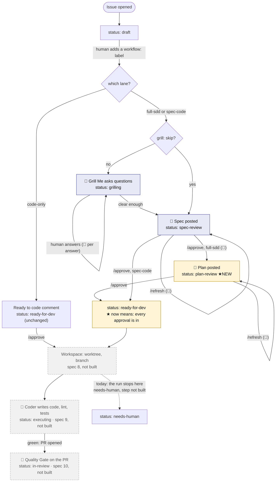
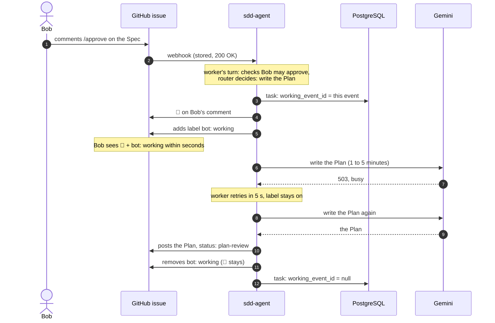
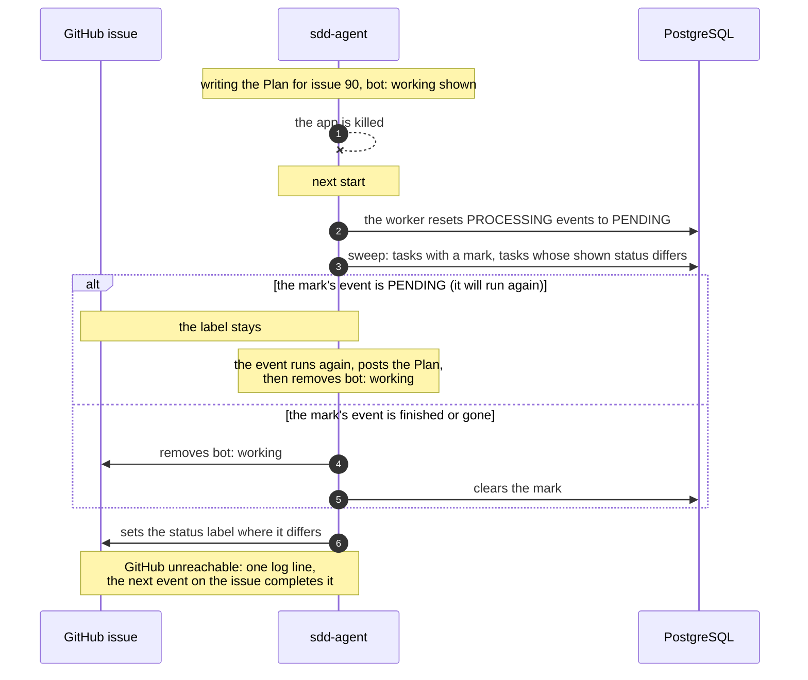

# Spec #13 — GitHub AI Agent: Bot Feedback

> **Created:** 2026-11-26 · **Status:** built and verified 2026-11-27 (the matrix on sandbox issues #90–#100; one
> row, `#F`'s Wi-Fi outage, waits for the developer to toggle the Wi-Fi, written down with the run and the test that
> cover it) · approved 2026-11-26 (draft the same day). BF1–BF10 come from the interview of 2026-11-26 and were
> confirmed by the developer; BFW1–BFW15 were decided while writing (to review). A fresh-context review's fixes are
> applied (marked "2026-11-26, review"); its one choice became BF10. In the write-time interview of 2026-11-26 the
> developer changed BFW7 (label descriptions updated at startup) and BFW8 (the wait stored per event); the other BFW
> decisions follow from rules already settled and are reviewed with this spec. 2026-11-26, plan: built from
> `docs/plans/spec-github-agent-bot-feedback.md`; its fixes with no choice and its confirmed FP1–FP3, FP23, FP24 are
> written in below, each marked "2026-11-26, plan".
>
> **Repos:** bot [`Hugoer/sdd-agent`](https://github.com/Hugoer/sdd-agent) (this repo) · target
> [`Hugoer/sdd-agent-sandbox`](https://github.com/Hugoer/sdd-agent-sandbox)
>
> **Why this file exists:** overview D33 (2026-11-23, decided by the developer during spec 7's build, after sandbox
> issue #55) and §1 row 13 (module id `bot-feedback`). A model step takes minutes (a Spec or a Plan 1–5, the Coder
> more) and the bot shows nothing until its answer is posted, so people think nothing happened and act again (#55: an
> `/approve`, then a second one, then deleting both). This spec adds a quick visible signal while the bot works on a
> human action, and makes the `status:` labels say where the issue stands: `status: plan-review` while the Plan
> waits, `ready-for-dev` only after the last approval. Built after spec 12 (`bot-data-protection`, built and verified
> 2026-11-26) and before spec 8 (`workspace-git`), so the long steps (8, 9) are tested with it. It is one spec and one
> plan that change the code of specs 3, 5, 6 and 7; no new module.
>
> **Sources:**
> - `docs/specs/spec-github-agent-architecture-overview.md` (normative): D33, §1 row 13, §3 (states, rows 11, 17–20,
>   30, 32–36 and the diagram).
> - `docs/specs/spec-github-agent-spec-plan-approvals.md` (spec 7): "Agreed for later specs" → spec 13, plan P15
>   (the waiting document by status), P42 (moved here).
> - `docs/specs/spec-github-agent-up-to-date-approvals.md` (spec 14): UA6 and "Agreed for later specs" → spec 13.
> - The code it changes: `src/workflow/router.service.ts`, `src/workflow/decide.ts`,
>   `src/workflow/step-handler.registry.ts` (the step context), `src/workflow/task.service.ts`, `src/github/labels.ts`,
>   `src/github/github-issue.provider.ts`, `src/contracts/issue-provider.ts`, `src/grill/grill.handler.ts`,
>   `src/grill/grill-evaluation.service.ts`, `src/documents/spec.handler.ts`, `src/documents/plan.handler.ts`,
>   `src/documents/document-refresh.ts`, `src/documents/documents.store.ts`, `prisma/schema.prisma`; 2026-11-26,
>   review: also `src/documents/approval-check.ts`, `src/documents/documents.handler.ts`, `src/workflow/stop-cause.ts`,
>   `src/events/events.worker.ts` (the recovery hook).
> - The interview of 2026-11-26.

## Objective

People on an issue see within seconds that the bot got their action and is working on it, and the status label
always says where the issue stands:

- **the working sign:** when a human action makes the bot call the model, the bot puts 🚀 on the comment that
  triggered it (when there is one) and the label `bot: working` on the issue, next to the status label. The label
  comes off in code when the event is finished for good, also after a crash; the 🚀 stays as a record.
- **the statuses:** in `full-sdd` the Plan waits under the new `status: plan-review`; `status: ready-for-dev` means
  "every approval is in, the run waits for the Coder" (`code-only`'s go-signal still waits under it).

Who benefits: everyone on an issue the bot works on, above all an Approver waiting for a Plan after `/approve`.

## Scope

- **In:**
  - The working sign (🚀 + `bot: working`) around every model call a human action starts: a run start, a Grill
    answer, `grill: skip` added while asking, `/approve` that leads to the Plan, `/refresh`, `/retry` that continues
    a model step; later the Coder and the Quality Gate (specs 9, 10) through the same seam.
  - Its lifetime: on before the first model call of the event, off when the event is finished for good (through the
    worker's retries), a mark in the database, a startup sweep after a crash.
  - Grill Me's 👀 replaces the bot's 🚀 on the comment it marks.
  - `status: plan-review`, the new meaning of `status: ready-for-dev`, §3's rows, spec 7's waiting document.
  - The label bootstrap: 18 bot labels.
  - A migration for issues already waiting, and the startup repair of status labels.
- **Out:**
  - A sign while an event waits in the queue behind another issue's work (BF1).
  - A sign for replies that don't call the model, spec 14's question included (BF2, spec 14 UA6).
  - A new status for `code-only`'s go-signal (BF6).
  - The Coder's and the Quality Gate's own use of the seam (specs 9, 10).

## Decisions (interview 2026-11-26, all confirmed)

- **D33's two statuses (decided by the developer on 2026-11-23, the starting point of this spec):** `status:
  plan-review` while a `full-sdd` Plan waits for `/approve`; `ready-for-dev` only after the last approval.
- **BF1 The sign appears when the bot starts working on the event, after the sender and the action are checked.**
  - The worker takes one event at a time; at the webhook's arrival the bot hasn't checked who sent it or what it
    is. The sign comes on the worker's turn, once intake accepted the event and the router decided.
  - #55 (`/approve`, nothing queued) gets the sign within seconds. A comment on issue B waiting behind issue A's
    Spec shows nothing until its turn.
  - Alternative (rejected): at the webhook's arrival, before any check: instant, but every comment, plain discussion
    and senders with no access included, would get it.
- **BF2 Only when the bot is about to call the model** (later also the Coder and the Quality Gate).
  - A reply without a model call (nothing to approve, nothing to retry, a near-miss `/approve`, a lane conflict
    reminder, spec 14's question) comes within seconds and is its own answer.
  - Alternative (rejected): every accepted action; the label would flash on and off, each change costing GitHub
    calls and a webhook event back to the bot.
- **BF3 🚀 means "working on it"; 👀 keeps spec 6's meaning** ("read, nothing to add yet"). Both are reactions on
  the human's comment and stay after the work (BF8 is the one exception). GitHub offers eight reactions; 🚀 is free.
- **BF4 A separate label `bot: working`, next to the status label.** Bot-managed like `status: *`. The status label
  keeps saying where the issue stands, `bot: working` only says "busy". The label bootstrap goes from 16 to 18 labels
  (`bot: working`, `status: plan-review`). Alternative (rejected): a temporary `status: working` that replaces the
  status label.
- **BF5 The label stays on through the worker's retries and comes off once the event is finished for good** (done,
  ignored or failed).
  - Example: 10:00 Bob `/approve`s; 10:01 Google answers 503; 10:01:30 the retry works; 10:03 the Plan is posted and
    the label comes off.
  - After a crash: the bot stores the mark on the task before adding the label; at the next startup it removes the
    label from every task still marked whose event is finished; when GitHub can't be reached then, the next event on
    that issue removes it (as spec 5's pending status label, RL5).
  - Alternative (rejected): off after every attempt, back on at the retry (a flicker, more webhook events).
- **BF6 `code-only` keeps `ready-for-dev` while its go-signal waits.** There is nothing to review in `code-only`;
  "ready for dev, say go" is accurate. The label's description becomes "Bot-managed: approved and ready for the
  Coder; in code-only, waiting for /approve to start it." Alternative (rejected): a new `status: awaiting-go`.
- **BF7 Issues already waiting when this ships:** a migration moves them to `plan-review` (a `full-sdd` run whose
  current Plan isn't approved; a stopped run's status before the stop the same way). At startup the bot repairs every
  status label that differs from the database, in the same sweep that removes leftover `bot: working` labels. The
  developer: "I don't care too much for the created issues" (the sandbox's); the sweep also repairs a status label a
  crash left behind.
- **BF8 When Grill Me adds 👀 to a comment, it removes the bot's own 🚀 from it,** so a waiting answer ends with 👀
  only, exactly as in spec 6 (the answer whose event called the model got 🚀 first; BFW4). Alternative (rejected):
  both stay ("worked on it; nothing to add yet").
- **BF9 Module id `bot-feedback`, no new module, effort `high`.** The sign belongs to the event's lifetime, which the
  router owns, and only `WorkflowModule` writes the status (overview §1 module rules): the sign, the mark, the sweep
  and `plan-review` live in `src/workflow` (spec 5); the label and reaction calls in `src/github` (spec 3); Grill Me
  (spec 6) and the documents code (spec 7) only say "about to call the model" and Grill Me removes its 🚀. Effort as
  spec 14's: a new status in the router's table, a migration, a startup sweep, small changes in four modules, no new
  model behavior.

- **BF10 An accepted `/retry` gets 🚀 at once** (2026-11-26, from the review, confirmed by the developer).
  - A `/retry` never calls the model itself: spec 5's `acceptRetry` puts the status back and queues the stopped event
    again, which calls the model a few seconds later (with the label; its own comment already has its 🚀).
  - The bot adds 🚀 to the `/retry` when it accepts it, whatever step the run stopped at; a refused `/retry` gets
    its reply as today, no 🚀. Example: Bob comments `/retry` → within seconds 🚀 on it, ~~`needs-human` →
    `plan-review`, then `bot: working` and the Plan~~ (2026-11-26, plan: a stop during the Plan's call happens before
    `plan-review` is set, since row 17 sets it after the Plan is posted) `needs-human` → `spec-review`, then `bot:
    working`, the Plan, `plan-review`.
  - Alternative (rejected): no reaction on the `/retry`; the status label and `bot: working` a few seconds later.
    The person who typed it looks at their own comment first.

### Decided while writing (to review)

- **BFW1 Where the sign starts: a `working()` call on the step context, right before the model call.**
  - `StepContext` (spec 5) gains `working(): Promise<void>`, made by the router for each job. Every handler that
    calls the model calls it right before its first `LlmService.call()` of the event: Grill Me's evaluation, the
    Spec (generate, refresh), the Plan (generate, refresh). A second call in the same job does nothing. Specs 9 and 10
    call it before the Coder's and the Quality Gate's loops.
  - Why there and not in `LlmService`: `src/llm` knows nothing of issues, comments or labels; a call reached without
    a human action (none today) shouldn't show anything; and the Coder's sign must come on before its first command,
    not its first model request.
  - What it does (BFW2): the mark, then 🚀 on the event's comment (BFW4), then the label.
- **BFW2 The mark: `tasks.working_event_id`.**
  - The `webhook_events.id` of the event that showed the sign; null when none. Order on: mark → 🚀 → label. Order off:
    label removed → mark cleared. A crash between two steps leaves a mark with no label (removing a missing label is
    no error) or a label with its mark, never a label without a mark.
  - ~~Another event of the same issue that calls the model takes the mark over~~ (2026-11-26, review: that made the
    label flicker). Another event of the same issue that calls the model while the marked event is unfinished (e.g.
    `PENDING` between two tries) leaves the mark as it is: the label is already on, and it ends without removing it.
    The marked event's own end removes it (it can't run while the other holds the issue's lease). Example: 10:00 the
    Plan's call gets a 503 (retry in 30 s); 10:00:10 a `/refresh` writes a refresh and ends, the label stays; 10:00:40
    the Plan's retry ends and removes it: one label added, one removed.
- **BFW3 When it comes off, and in which order.**
  - At the end of the event that holds the mark: when `route()` returns `DONE` or `IGNORED`, and in the failure hook
    when the event ends `FAILED` (spec 5's `failed()`, after the stop's comment and label). A thrown error the worker
    will retry leaves it on (BF5). `WAIT` (the lease is taken) never follows a model call.
  - Last of the event's GitHub writes: the document or question comment and the status label come first, so nobody
    sees "not working" before the answer is there.
  - A pending side effect (spec 5 RL5): every event on the issue first removes a label whose mark points to an event
    that is finished (`DONE`, `IGNORED`, `FAILED`), before anything else, like a pending status label.
  - Removing the label fails (GitHub unreachable): the mark stays, the event's own outcome is unchanged (a log line);
    the sweep or the next event removes it.
- **BFW4 Which comment gets 🚀.**
  - The comment of the event being processed: `COMMENT` (a Grill answer), `APPROVE`, `REFRESH`. ~~`RETRY` (a `/retry`
    that continues a model step; the 🚀 goes on the `/retry`, not on the failed event's comment)~~ 2026-11-26, review
    (BF10): a `/retry` never calls the model itself; it gets its 🚀 when it is accepted. `LANE_ADDED`,
    `LANE_REMOVED` (a run start) and `SKIP_ADDED` have no comment: the label only.
  - Comments read in the same call (a burst of Grill answers, spec 6 GM4) get no 🚀: they are answered by the next
    question round, or by 👀.
  - A comment deleted meanwhile: skipped (`404`), as spec 6's 👀.
- **BFW5 Removing 🚀 looks it up; no reaction id is stored.** Spec 6's `acknowledgeComment` (the 👀) also removes the
  bot's own 🚀 from that comment, if there is one: one `GET …/reactions?content=rocket`, a `DELETE` of the bot's one.
  Robust when the 🚀 came from an earlier attempt or a `/retry`. (My recap in the interview said "stores the reaction
  id"; this needs no column.)
- **BFW6 `ready-for-dev` is set after the last approval is saved, before the workspace claim.**
  - Row 18 (`spec-code`'s Spec) and row 19 (`full-sdd`'s Plan, `code-only`'s go-signal): the approval, then the
    status `ready-for-dev`, then the workspace claim. Until spec 8 that claim stops the run (`step-not-built`) with
    `ready-for-dev` as the status before the stop; spec 8 then shows `ready-for-dev` while an approval waits for the
    workspace (`WS_BUSY`) and `executing` once claimed.
  - The waiting document (spec 7 plan P15): `plan-review` → the run's current Plan; `ready-for-dev` → the go-signal in
    `code-only`, nothing in the other lanes (every approval is in). An `/approve` in `ready-for-dev` with nothing
    waiting gets spec 7's `already-approved` reply, or, for the event that made the approval (a retried `/approve`,
    spec 7's `done`), goes on to the workspace claim. `/refresh` and `/restore` there get spec 7's "nothing waits"
    reply (row 35).
  - 2026-11-26, review: how, in the code spec 7 built.
    - The status between two calls: `decide()`'s `steps` action sets a status only before every call or after all of
      them; setting `ready-for-dev` first would show it before the approval is saved. The approval call's own outcome
      (the plan names it) goes back into `decide()`, which answers with `ready-for-dev` and the workspace claim.
    - The gate (`src/documents/approval-check.ts`) throws today when nothing waits. In `ready-for-dev` with nothing
      waiting it answers from `approvedByEvent` and the run's last approved document: this event made it → `done`,
      which in `ready-for-dev` leads to the workspace claim (in `plan-review`, spec 7's `done` stays "nothing, the
      event ends `DONE`"); otherwise → `already-approved`, its reply naming that document.
    - Also changed: the router's `approvalOf` asks the gate in `plan-review` too; `waitingStep` (`stop-cause.ts`):
      `plan-review` → `plan`, `ready-for-dev` → `go-signal` in `code-only`, `workspace` otherwise; `NOTHING_WAITS`
      (`documents.handler.ts`) gives `ready-for-dev`'s reply by lane, not always `code-only`'s; the Spec refresh and
      the Plan read the waiting Plan under `plan-review` (`spec.handler.ts`, `plan.handler.ts`, both hard-code
      `ready-for-dev` today).
    - 2026-11-26, plan (FP1, confirmed): row 35's replies in `ready-for-dev` after every approval, worded like spec 7's
    `executing` replies: `/refresh` → "Your `/refresh` comes too late: every approval of run 1 is in, and the bot codes
    from the approved texts."; `/restore` → "Your `/restore` has nothing to restore: every approval of run 1 is in, and
    the bot keeps the approved texts." (`code-only`'s go-signal keeps spec 7's `code-only` replies.)
  - The path people can test today: the Plan's `/approve` → the `workspace` stop (status before it `ready-for-dev`);
      `/retry` → back to `ready-for-dev`, the `/approve` runs again → `done` → the claim → the same stop, NO
      "already approved" reply. Row 35's replies in `ready-for-dev` can't last on the sandbox before spec 8: tests.
- **BFW7 The bootstrap updates the description of a bot-managed label that differs** (write-time interview
  2026-11-26, the developer chose it; was "existing repos keep the old description", spec 3 G10).
  - At startup, after creating the missing labels: a `status: *` label or `bot: working` whose description differs
    from `BOT_LABELS` gets the new description (`PATCH /repos/{owner}/{repo}/labels/{name}`, description only). Never
    the colour or the name (a team that recoloured a label keeps it), never a human-assigned label.
  - Why: a wrong description on a status label is the "the label says the wrong thing" problem D33 fixes; later
    specs that change a description get it for free. The startup log line counts them ("2 created, 1 updated, 15
    already present").
- **BFW8 How long people wait: `webhook_events.working_started_at` and `working_ended_at`** (write-time interview
  2026-11-26, the developer chose it; was "no new usage data").
  - `working_started_at`: the event's first `working()` (kept through the worker's retries, so a retried event counts
    from its first attempt). `working_ended_at`: when that event is finished for good (`DONE`, `IGNORED`, `FAILED`),
    whether or not it was the one that removed the label (BFW2). Both null for an event that never called the model.
  - What it measures that `execution_logs.duration_ms` doesn't: the whole wait a person feels, with the bot's GitHub
    calls, Grill's re-asks and the 5 s / 30 s retries. A dashboard can show e.g. "`/approve` → Plan: median 95 s,
    longest 6 min, 3 through a retry". No command (project rule: stored in tables, a dashboard later).
  - Written through spec 1's `EventsService` (the table's owner); never by the worker's status update.
  - 2026-11-26, plan (FP3, confirmed): a re-queue (an accepted `/retry`, or spec 2's redelivery of a `FAILED` row)
    clears both, so the re-run's wait starts at its own first `working()`.
- **BFW9 Labels:** `bot: working`, colour `d93f0b` (orange, unlike every status), "Bot-managed: the bot is working on
  this issue; removed when it ends."; `status: plan-review`, colour `bfd4f2` (next to `spec-review`'s `c5def5`),
  "Bot-managed: Plan posted, waiting for /approve."; `ready-for-dev`'s new description (BF6).
- **BFW10 The startup sweep** (`WorkflowModule`, at application bootstrap, before the worker claims its first event;
  2026-11-26, review: the worker's bootstrap resets interrupted events, then ~~awaits the registered processor's
  recovery hook, the sweep, and only then schedules its first tick~~ (2026-11-26, plan FP23, confirmed: schedules its
  first tick as today, and that first tick awaits the registered processor's recovery hook, the sweep, before its
  first claim, so the webhook port opens at once), so `src/events` still imports no feature module.
  The lease: a task's lease is taken by the sweep ~~as the marked event (or, for a status repair, as a new id)~~
  (2026-11-26, plan FP9: as a new id in both cases; the mark is cleared only if it still names the event the sweep
  read) when it
  is free, expired, or owned by an event that isn't `PROCESSING`; after a `kill -9` the dead job's lease belongs to an
  event the worker just reset to `PENDING`, so the sweep isn't held up for `SESSION_LEASE_SECONDS`. A crash inside
  the failure hook, after the event became `FAILED`, leaves a mark whose event is finished: the sweep removes it):
  - for every task with a mark whose event is finished or gone: remove `bot: working`, clear the mark. A mark whose
    event is `PENDING` (the worker reset an interrupted `PROCESSING` row) stays: that event runs again and ends it.
  - for every task whose `shown_status` differs from `status`: set the status label (spec 5's `setStatusLabel`).
  - Each task under its session lease (a lease held by a live job of another instance is skipped). A GitHub failure is one log line per
    task and never stops the app; the next event on the issue completes it (BFW3). One summary log line.
- **BFW11 The migration:** tasks with `status = 'ready-for-dev'` whose current run is `full-sdd` and whose current Plan
  isn't approved → `plan-review`; runs with `status_before_stop = 'ready-for-dev'` under the same rule →
  `plan-review`. `shown_status` is left as is, so the sweep repairs the label (BF7). `code-only` and approved Plans
  keep `ready-for-dev`.
- **BFW12 The issue port (overview §4):** `TaskStatus` gains `plan-review`; `IssueProvider` gains
  `reactWorking(task, commentId)` (🚀; `404` skipped) and `setWorkingLabel(task, shown: boolean)` (add, or remove with
  `404` as removed); `acknowledgeComment` also removes the bot's 🚀 (BFW5). `removeLabel` still refuses every
  bot-managed label (spec 3 A4). The secret-scanning wrapper (spec 4) passes both through.
- **BFW13 People touching `bot: working`:** removed by a person while the bot works → the bot doesn't put it back
  (2026-11-26, plan FP2, confirmed: within one attempt; when the event is tried again, the retried attempt's
  `working()` adds the label again, which is what repairs a crash between the mark and the label, BFW2);
  its own removal at the end finds it gone. Added by a person → intake ignores the event (`other-label`, spec 2), as
  today for any label the bot doesn't use; it stays until the bot's next sign on that issue ends. The bot's own label
  events come back as webhooks and end `IGNORED` `own-event` (spec 2); GitHub sends no webhook for a reaction.
- **BFW14 The invariant script `scripts/bot-feedback-invariants.mjs <issues>`** (read-only, `gh` as the developer,
  as spec 11's): four invariants (see "Verification matrix").
- **BFW15 Nothing else posts or reacts:** the injection warning, the 🔑 notice, the run-ended and stop comments keep
  their wording; no comment says "working on it".

## Behavior

### The lanes and their statuses (informative; overview §3's table wins)

🤖 marks a model call: that is where the working sign shows. Dashed: specs 8–10, not built.



### The working sign (BF1–BF5, BF8, BFW1–BFW5)

1. The worker claims the event; intake accepts it; the router takes the session lease and decides (as today).
2. A handler about to call the model calls `working()`: the mark (`tasks.working_event_id`), 🚀 on the event's
   comment (if it has one), `bot: working` on the issue. Within seconds of the worker's turn.
3. The model call(s). A retriable failure: the worker tries the event again later; the sign stays.
4. The answer is posted (questions, Spec, Plan, refresh, or a stop comment) and the status label set.
5. The label comes off and the mark is cleared. The 🚀 stays, except where Grill Me's 👀 replaces it.

Which actions show it (every row of overview §3 with a model call):

| Human action | When it calls the model | 🚀 on | Label |
|---|---|---|---|
| `workflow:` label added or removed (run start or restart) | Grill Me's first evaluation, or the Spec (`grill: skip`, or nothing to ask) | — | yes |
| A Grill answer | Grill Me reads it (then a question round, the Spec, or 👀 which replaces the 🚀) | the answer | yes |
| `grill: skip` added while asking | the Spec | — | yes |
| `/approve` on a `full-sdd` Spec | the Plan | the `/approve` | yes |
| `/refresh` (Spec, or Spec and Plan) | the refresh | the `/refresh` | yes |
| `/retry` of a stop at a model step | the step again, in the queued event | the `/retry`, when accepted (BF10) | yes, with the queued event |
| Later: the last `/approve` once spec 8–9 exist | the Coder (spec 9) | the `/approve` | yes |
| Anything answered by a reply, an ignored event, spec 14's question, the last `/approve` today (the `workspace` stop) | never | — | — |



### After a crash (BF5, BF7, BFW10)



### The statuses (D33, BF6, BFW6)

| Status | Means | Waiting document (spec 7 P15) | Label description |
|---|---|---|---|
| `spec-review` | a Spec waits for `/approve` | the current Spec | unchanged |
| `plan-review` (new) | a `full-sdd` Plan waits for `/approve` | the current Plan | "Bot-managed: Plan posted, waiting for /approve." |
| `ready-for-dev` | every approval is in, the run waits for the Coder; `code-only`: its go-signal waits | `code-only`: the go-signal; otherwise none | "Bot-managed: approved and ready for the Coder; in code-only, waiting for /approve to start it." |

Changed rows of overview §3:

- **Row 17** (`spec-review`, `full-sdd`, valid `APPROVE`): next `plan-review` (was `ready-for-dev`).
- **Row 18** (`spec-review`, `spec-code`, valid `APPROVE`): the approval, then `ready-for-dev`, then the workspace
  claim (BFW6).
- **Row 19** splits: `plan-review` (`full-sdd`) valid `APPROVE` → snapshot the Plan, `ready-for-dev`, the workspace
  claim; `ready-for-dev` (`code-only`) valid `APPROVE` → the go-signal's approval, the workspace claim.
- **Rows 20, 32, 33, 34:** `ready-for-dev (full-sdd)` → `plan-review`. Row 32: a Spec v2 while the Plan waits still
  goes back to `spec-review`.
- **Row 35:** `ready-for-dev` in any lane: `/refresh`, `/restore` → one reply why (nothing waits but a go-signal).
- **Row 30:** `/retry` goes back to the status before the stop, `plan-review` included.
- The diagram: `specReview --> planReview: /approve full-sdd, Plan posted`; `planReview --> readyForDev: /approve`;
  `planReview --> specReview: /refresh, Spec v2 posted`; `planReview --> needsHuman: failure`.

### Retries and failures

- A model call that fails briefly: the worker's retries (spec 1, spec 4) with the sign on (BF5).
- A final failure: spec 5's stop comment and `needs-human`, then the label off (BFW3).
- A failure while adding the sign (GitHub unreachable): the event fails like any GitHub write (spec 3's rule) and is
  retried; the mark is already stored, so the sweep or the next event cleans up after a final failure.
- A model call that hangs: the sign stays on as long as the call (spec 4's 300 s limit, then the worker's retries).

### Logging

One line when the sign goes on (`#90 working on (event <delivery>)`), one when it comes off (`#90 working off`), one
per sweep (~~`startup sweep: 2 working labels removed, 1 status label repaired, 0 failed`~~ 2026-11-26, plan FP10:
`startup sweep: 2 working labels removed, 1 left for its event, 1 status label repaired, 0 skipped (lease held), 0
failed`). Also `#90 working off failed: <message>` (the mark stays) and, from the sweep, `#90 working label left for
event <delivery> (pending)`.

## Contracts

- `TaskStatus` (overview §4): adds `plan-review`.
- `IssueProvider` (overview §4): `reactWorking(task, commentId)`, `setWorkingLabel(task, shown)`; `acknowledgeComment`
  also removes the bot's 🚀 (BFW5, BFW12).
- `StepContext` (spec 5): `working(): Promise<void>` (BFW1).
- `BOT_LABELS` (spec 3): 18 labels (BFW9).

## Owned tables (changes)

- `tasks.working_event_id` (uuid, nullable, no foreign key: a deleted event is "gone", BFW10), owned by spec 5's
  `TaskService`; written under the lease like every task column.
- `webhook_events.working_started_at`, `working_ended_at` (timestamptz, nullable; BFW8), spec 1's table, written
  through `EventsService`.
- Migration (BFW11): the data change and the three columns in one migration.

## Usage data

- The wait per human action (BFW8): `working_ended_at - working_started_at` per event, by input type and step;
  `execution_logs` keeps every model call as before.
- Query to look at it:

```sh
docker compose exec -T postgres psql -U sdd_agent -d sdd_agent -c "SELECT external_ref, event_name, action, attempts, working_started_at::time(0) AS started, round(extract(epoch FROM working_ended_at - working_started_at)) AS wait_s FROM webhook_events WHERE working_started_at IS NOT NULL ORDER BY received_at DESC LIMIT 10"
```

## Configuration

None.

## Commands

None new. ~~`npm run db:runs` shows `plan-review` like any status.~~ 2026-11-26, plan: `npm run db:runs` has no status
column; the task query ("Verification matrix" → "Setup") shows `plan-review` like any status.

## Testing strategy

- Unit: `decide()` for every changed row (17–20, 30, 32–35) and both lanes in `ready-for-dev`; the waiting document
  per status; the label list (18, names, `isStatusLabel`, `removeLabel` refusing `bot: working`).
- Integration (fake `IssueProvider`, test database): the sign on and off around each model-call path (run start,
  Grill answer, `grill: skip`, `/approve` → Plan, `/refresh`, `/retry`); no sign on reply-only paths and on spec 14's
  question; a retriable error keeps it, a final failure removes it after the stop comment; ~~a second event taking over
  the mark~~ a second event leaving the mark (2026-11-26, plan; BFW2 after the review); the pending removal on the next event; the sweep (finished, pending, gone events; status repair; a
  GitHub failure); Grill's 👀 removing the 🚀; the migration's rule on seeded rows.
- Existing suites that assert `ready-for-dev` after a `full-sdd` Plan, the 16 labels or `acknowledgeComment`'s
  calls change with the task that changes them (the plan lists them).

## Setup & configuration → `docs/guides/setup-github-agent-local.md`

- The two new labels are created at startup, and `ready-for-dev`'s description is updated (BFW7); no manual step.
- `npm run db:migrate` after pulling (the column and the migration).

## Changes to earlier specs' behavior

- **Spec 1 (`walking-skeleton`):** `webhook_events` gains `working_started_at`, `working_ended_at` (BFW8); the worker
  awaits the processor's recovery hook before its first tick (BFW10).
- **Spec 3 (`github-providers`):** 18 labels; two port methods; `acknowledgeComment` removes the bot's 🚀; G10 ("never
  edits a label") → bot-managed labels get their description updated (BFW7).
- **Spec 5 (`router-session-lease`):** the step context's `working()`; the mark and its pending removal; the label
  off at the end of the event and in `failed()`; the startup sweep; `plan-review` in `decide()` (rows above); 🚀 on
  an accepted `/retry` (BF10).
- **Spec 6 (`grill-me`):** the evaluation calls `working()`; its 👀 replaces the 🚀 (BF8).
- **Spec 7 (`spec-plan-approvals`):** the Spec and Plan handlers and the refresh call `working()`; the Plan waits under
  `plan-review`; the waiting document by status (P15); the go-signal is approved under `ready-for-dev` as before.
  "Agreed for later specs" → spec 13 and plan P42 get a pointer here.
- **Spec 14 (`up-to-date-approvals`):** its question gets no sign (UA6); "`status: plan-review` once spec 13 adds it"
  becomes true.
- Each gets dated notes pointing here when this spec is approved.

## Changes to the overview (made with this spec, applied when it is approved)

- **D33:** a closing line: resolved by spec 13 (BF1–BF9).
- **§1 row 13:** the id confirmed, folders `src/workflow`, `src/github`, `src/grill`, `src/documents` (changes to
  their code), effort `high`, the responsibility in final words.
- **§3:** the state list gains `plan-review`; rows 17–20, 30, 32–35 and the diagram as above.
- **§4:** `TaskStatus`, the two `IssueProvider` methods, `acknowledgeComment`'s note.
- **§6:** `Task` and `WebhookEvent` "extended by 13".

## Edge cases

- **Two `/approve` on the Spec, ten seconds apart:** the first gets 🚀 and the label; the worker takes one event at a
  time, so the second is claimed only after the Plan is posted and gets spec 7's `before-document` reply; no 🚀 on
  it (2026-11-26, review: not `WAIT`).
- **A comment written while the Spec is being written** (spec 7 SP12): no 🚀; the label already shows; the
  late-comment reply comes after the Spec.
- **The lane label removed while the bot writes the Spec:** the cancel waits for the lease; the Spec is posted, the
  label comes off, then the cancel runs (as today).
- **A Grill answer that ends Grill Me:** one sign for the evaluation and the Spec it writes (one event).
- **A burst of three Grill answers:** 🚀 on the first only; the round answers all three (BFW4).
- **The triggering comment deleted before its turn:** the reaction is skipped (`404`), the label still shows.
- **A `/retry` of a stop at the Plan:** 🚀 on the `/retry` when accepted (BF10); the queued `/approve` then shows the
  label; the original `/approve` keeps its old 🚀.
- **A `/retry` of the `workspace` stop:** 🚀 on the `/retry` too (BF10: every accepted `/retry`), no label (no model
  call until spec 9).
- **The issue closed while the bot works:** the work ends as today (spec 5 D26 applies to the next event); the label
  comes off at the end.
- **The app killed and never restarted:** the label stays on GitHub until the next start (BFW10).
- **Two instances on one database** (spec 5 P10): the sweep skips tasks whose lease is held.

## Boundaries

- **Always:** take the sign down in code (never rely on a person); mark before the label; the label last of the
  event's writes; the sign only after intake accepted the event.
- **Ask first:** any change to the overview's rows beyond those above; a sign on actions without a model call.
- **Never:** remove a reaction other than the bot's own 🚀; remove or add a human-assigned label; post a comment as
  the sign; let `ready-for-dev` show while a `full-sdd` Plan waits for `/approve`.

## Verification matrix

**Setup to observe:** the issue's timeline and sidebar (reactions, labels); `npm run db:events`; `npm run db:runs`;
the mark:

```sh
docker compose exec -T postgres psql -U sdd_agent -d sdd_agent -c "SELECT t.external_ref, t.status, t.shown_status, t.working_event_id, r.status_before_stop FROM tasks t LEFT JOIN runs r ON r.id = t.current_run_id ORDER BY t.updated_at DESC LIMIT 10"
```

(2026-11-26, plan: the query gains `runs.status_before_stop`, since `npm run db:runs` has no status column.)

Each row: a sandbox issue named in the plan's checkpoints; "within seconds": the 🚀 and the label appear before the
model's answer, at most ~10 s after the event's `received_at` when nothing else is queued (2026-11-26, plan: measured
from `webhook_events.received_at` to the `created_at` of the issue's `labeled bot: working` event, `gh api
…/issues/<n>/events`, and of the bot's 🚀, `…/reactions`).

**The working sign** (`#A`, `full-sdd`)
- [x] Add `workflow: full-sdd` → `bot: working` within seconds, NO reaction anywhere; the questions posted; then `bot:
  working` gone; `working_event_id` null. (2026-11-27, #92: the label event received 23:58:29, `bot: working`
  23:58:32, the questions, the label gone 23:59:36; mark null.)
- [x] Answer every question in one comment → 🚀 on it within seconds + `bot: working`; the Spec posted under `status:
  spec-review`; then `bot: working` gone, 🚀 still there. (2026-11-27, #92: received 00:21:22, 🚀 and the label
  00:21:26.)
- [x] (`#B`, `full-sdd`, asking) Answer one question only, saying the rest comes later → 🚀 then 👀; at the end the
  comment has 👀 only (NO 🚀 by the bot); `bot: working` gone. (2026-11-27, #93: the evaluation WAITING,
  "acknowledgeComment … (🚀 removed)"; 👀 only at the end.)
- [x] `#A`: `/approve` the Spec → 🚀 + `bot: working` within seconds; the Plan posted; the status label `status:
  plan-review` (NOT `ready-for-dev`); then `bot: working` gone. (2026-11-27, #92: received 00:24:49, 🚀 00:24:54; Plan
  v1; `status: plan-review`.)
- [x] `#A`: `/refresh` → 🚀 + `bot: working`; "still up to date" or v2; then gone. (2026-11-26, plan: with `main`
  unmoved since the Plan, `/refresh` answers "nothing changed" with no model call and no sign, so the row first
  commits a file no document read, `docs/bot-feedback-matrix.md`.) (2026-11-27, #92: after the commit of
  `docs/bot-feedback-matrix.md`; received 00:26:20, 🚀 + label 00:26:26; "both still up to date"; the label gone
  00:27:01.)
- [x] `#A`: a plain comment while the Plan waits → NO 🚀, NO label (row 20). (2026-11-27, #92: `no-transition`, no
  reaction, no working time.)
- [x] The usage query (see "Usage data"): one row per event above that showed the sign, with a `wait_s`; NO row for
  the plain comment. (2026-11-27: 13 rows on #92–#100, none for the plain comment, the `/retry` comments or #96; #95
  counts from its first attempt, 890 s over 3 attempts, #99 80 s over 3.)

**No sign without a model call**
- [x] `#B` while asking: `/approve` → spec 7's reply, NO 🚀, NO `bot: working` at any time (timeline). (2026-11-27,
  #93: spec 6's reply "There's nothing to approve yet …"; no label event after the partial answer's.)
- [x] An issue with no run: `/retry` → the reply, NO 🚀, NO label. (2026-11-27, #100.)
- [x] (`#C`, a Spec waiting) Push a change to a file it read, `/approve` → spec 14's question, NO 🚀, NO label.
  (2026-11-27, #94: `eslint.config.mjs`, read only by its Spec and two waiting Plans that got no `/approve`;
  `approve-asked`; put back after the matrix.)

**The statuses**
- [x] `#A`: `/approve` the Plan → `status: ready-for-dev`, then the `workspace` stop: `status: needs-human`, the stop
  comment; ~~`db:runs` "before stop"~~ the task query's `status_before_stop` (2026-11-26, plan) `ready-for-dev`; NO
  sign. (2026-11-27, #92: `ready-for-dev` 00:27:29, `needs-human` 00:27:31; no reaction on the `/approve`.)
- [x] (`#D`, `spec-code`) `/approve` the Spec → `ready-for-dev`, then the `workspace` stop; NO Plan. (2026-11-27, #95.)
- [x] (`#E`, `code-only`) Add the lane → "Ready to code" under `status: ready-for-dev`; `/approve` → the `workspace`
  stop. (2026-11-27, #96.)
- [x] `#A` after the stop: `/retry` → 🚀 on the `/retry` (BF10), `status: ready-for-dev` again, the `/approve` runs
  again → the same `workspace` stop; NO "already approved" reply; NO `bot: working` (2026-11-26, review; was a
  `/refresh` row, which tests `needs-human`). (2026-11-27, #92: received 00:27:45.8, 🚀 00:27:46; stop 2; no
  `approve-refused` comment; no `bot: working` event after the refresh.)
- [x] `#A` stopped: `/refresh` → spec 7's "nothing waits" reply (the approved Plan). (2026-11-27, #92: "has nothing to
  refresh now: run 1 is stopped …".)

**Retries, failures, crashes**
- [ ] (`#F`, Spec waiting) Wi-Fi off right after `/approve` (the waiting script), back within ~20 s → the label stays
  on through the retry (timeline: ONE `bot: working` added and ONE removed); the Plan posted; the usage query: the
  `/approve`'s ~~`attempts` 2~~ `attempts` ≥ 2, `wait_s` from the first attempt to the Plan (BFW8). (2026-11-26, plan:
  the worker retries 5 s, then 30 s after a failure, so with Wi-Fi back within ~20 s the Plan comes at attempt 2 or 3.
  The waiting script, in the plan's Checkpoint 5: it waits for `#F working on` after the `/approve`, says "Wi-Fi off",
  waits for `attempt 1/3 failed` (at most 60 s), says "Wi-Fi on", waits for `#F working off` and writes the issue
  events, `attempts` and `wait_s` to a file.) (2026-11-27: not run yet: it needs the developer to turn the Wi-Fi off
  and on. #97 waits with its Spec for it. The same behaviour happened by itself on #95: the model gave no answer
  twice, the label stayed on through both retries, `attempts` 3, `wait_s` 890 from the first attempt; and
  `test/bot-feedback.integration.spec.ts` "a transient error after working() → the label stays …" covers it.)
- [x] (`#G`) Break the `plan` model in `workflow.json` (one sandbox commit), `/approve` the Spec → 🚀 + label; the stop
  comment; then `bot: working` gone; status `needs-human`. Fix the commit, `/retry` → 🚀 on the `/retry` within seconds
  (BF10), ~~`plan-review`, then the label, the Plan, the label gone~~ (2026-11-26, plan: the stop came before
  `plan-review` was set) `spec-review`, then the label, the Plan under `plan-review`, the label gone. (2026-11-27,
  #98: `gemini-bot-feedback-missing`, `unknown-model`, `status_before_stop` `spec-review`; `/retry` received
  00:30:05.6, 🚀 00:30:07, then the label 00:30:13, Plan v1 under `plan-review` 00:31:05, the label gone 00:31:07.)
- [x] (`#H`) Kill the app (`kill -9`) while the Plan is written → the label stays on GitHub; restart → the sweep log
  leaves it (event `PENDING`); the Plan posted; then the label gone. (2026-11-27, #99: `kill -9` with the label on and
  the event `PROCESSING`; the next start: "reset 1 interrupted event(s)", "#99 working label left for event …
  (pending)", "0 working labels removed, 1 left for its event"; Plan v1 under `plan-review`, the label gone.)
- [x] Leftover: set a task's mark to a `DONE` event with SQL and add `bot: working` with `gh` → restart → the sweep
  removes it; `working_event_id` null; the log's summary line. (2026-11-27, Checkpoint 3, #90: "startup sweep: 1
  working label removed, 0 left for its event, 0 status labels repaired, 0 skipped (lease held), 0 failed".)
- [x] Status repair: set a task's `shown_status` to `spec-review` and the issue's label to `status: spec-review` with
  `gh` while its `status` is `plan-review` → restart → `status: plan-review` shown. (2026-11-27, Checkpoint 3, #90: "1
  status label repaired".)

**Migration and bootstrap**
- [x] Before migrating: an issue with a `full-sdd` Plan waiting under `ready-for-dev` (`#I`) → after `db:migrate` and
  a start: `status: plan-review`; `/approve` → `ready-for-dev` and the stop, as above. (2026-11-27, Checkpoint 3, #90:
  the first start repaired 8 labels, #90 and seven older issues; `/approve` → `status: ready-for-dev` at 23:39:04Z,
  `status: needs-human` at 23:39:05Z, the stop comment, `status_before_stop` `ready-for-dev`; the webhook URL line was
  logged before the sweep's lines, FP23.)
- [x] Startup log: "2 created, 1 updated, 15 already present"; the repo's labels list `bot: working` and `status:
  plan-review`; `status: ready-for-dev`'s description is BF6's, its colour unchanged. Edit that description by hand
  and restart → back to BF6's, "1 updated"; recolour it → the colour stays. (2026-11-26, Checkpoint 1: as written;
  "0 created, 1 updated, 17 already present" after the hand edit, "0 updated" after recolouring to `0e8a17`, which
  stayed; `0e8a16` put back; `npm run github:smoke -- --issue 91`: every line `PASS`.)
- [x] A person removes `bot: working` during work → NOT put back; the work ends normally. A person adds it to an idle
  issue → `db:events` `IGNORED` `other-label`. (2026-11-27, #95: removed by hand at 00:04:44 while the Spec was
  written, NOT put back in that attempt; the sandbox's model then hung twice (300 s each, `provider-unavailable`), and
  each retried attempt showed it again, as FP2 says; the third attempt posted the Spec and removed it. The person's
  `unlabeled` event `IGNORED` `other-label`. Added by hand on #100 → `other-label`.)

**Invariants** (`node scripts/bot-feedback-invariants.mjs <issues>`, with the app idle)
- [x] No issue carries `bot: working`, and no task has a mark. (2026-11-27: `node --env-file-if-exists=.env
  scripts/bot-feedback-invariants.mjs 92 93 94 95 96 97 98 99 100`, all four passed: 43 comments, 62 model rows.)
- [x] No comment carries both 🚀 and 👀 by the bot.
- [x] Every 🚀 by the bot is on a comment whose event (`webhook_events`, by the comment id in its payload) has
  `execution_logs` rows of the same task ~~between its `received_at` and its `processed_at` (2026-11-26, review:
  `execution_logs` has no event id; one event at a time makes the window exact)~~ within its own `working_started_at`
  … `working_ended_at` (2026-11-26, plan FP24, confirmed: `execution_logs` has no event id, and an event's
  `received_at` … `processed_at` includes its wait behind another event of the issue, so a 🚀 wrongly put on the
  second comment of a burst would pass), or is an accepted `/retry` (BF10).
- [x] No `full-sdd` issue shows `status: ready-for-dev` while its current Plan isn't approved.

## Success criteria

- Every verification row passes on the sandbox; `npm run typecheck && npm run lint && npm test && npm run
  test:integration` pass.
- The overview, the earlier specs' notes, the setup guide, `AGENTS.md` (State) and the README reflect this spec.
- No human action that leads to a model call goes without a visible sign within seconds of its turn, and no issue
  keeps `bot: working` after its work ended.

## Out of scope (deferred)

- **A sign while queued** (BF1): if the Coder makes queues long, a later spec could react at the webhook's arrival
  for commands only.
- **A "working" comment with progress** (which step, how long): not asked; the label and the 🚀 are enough for now.

## Agreed for later specs

- **Spec 8 (`workspace-git`):** `ready-for-dev` while an approval waits for the workspace (`WS_BUSY`); the queued
  comment of row 21 is its own answer (no model call, no sign).
- **Spec 9 (`coder`):** calls `working()` before its first command; the sign stays through the Coder's job and its
  retries; an interrupted job (row 26) is a crash the sweep and the retried event handle.
- **Spec 10 (`quality-gate`):** a PR event has no human comment: the label only, on the issue the PR belongs to.

## Open questions

None blocks this spec. The write-time interview (2026-11-26) is done: BFW7 and BFW8 changed (descriptions updated at
startup; the wait stored per event); the other BFW decisions follow from rules already settled and are reviewed with
this spec.
