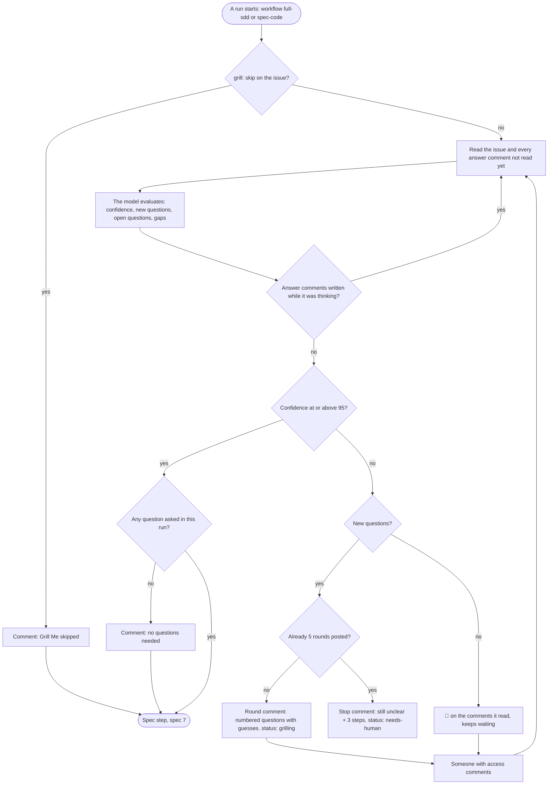
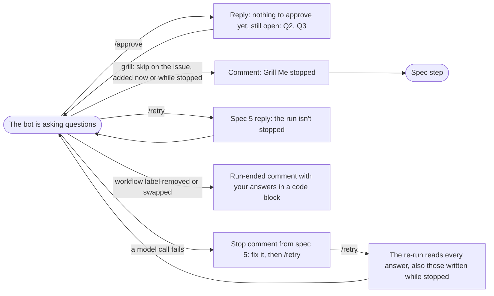
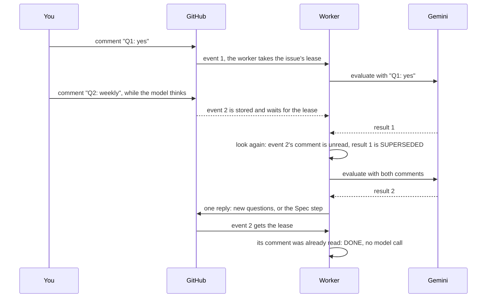
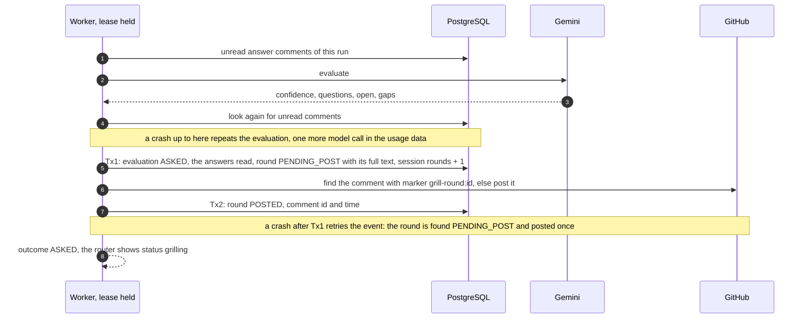

# Spec #6 — GitHub AI Agent: Grill Me

> **Created:** 2026-11-17 · **Status:** approved 2026-11-17 (interview 2026-11-17: GM1–GM12 confirmed by
> the developer; GMW1–GMW10 decided while writing, to review; GM13 from the draft's open question and GM14–GM17
> from an independent review of the draft, both confirmed the same day) · plan:
> `docs/plans/spec-github-agent-grill-me.md`, approved 2026-11-17; its decisions P1–P3 and P5–P7 are written into
> this spec, each marked "plan Pn"
>
> **Repos:** bot [`Hugoer/sdd-agent`](https://github.com/Hugoer/sdd-agent) (this repo) · target
> [`Hugoer/sdd-agent-sandbox`](https://github.com/Hugoer/sdd-agent-sandbox)
>
> **Why this file exists:** sixth capability spec in build order (overview §1 row 6, module id `grill-me`). Today
> every `full-sdd` or `spec-code` run stops at its first step (`grill`, `step-not-built`). This spec builds Grill
> Me: the bot judges whether an issue says enough to write a Spec, and if it doesn't, it asks the issue's people a
> few numbered questions per comment, reads their answers, and hands over to the Spec step (spec 7) once it is
> sure enough, or stops at the round limit. It also defines the sandbox's first real skill, adapted from
> `interview-me`.
>
> **Sources:** `docs/specs/spec-github-agent-architecture-overview.md` (normative: D6, D8, D13, D23, D25; §1
> row 6; §3 "States, runs and lanes", "Step outcomes", rows 6, 9–16, 27; §4 "Step-skill contract"; §5 `GRILL_*`;
> §6 `GrillSession`, `GrillRound`; "Edge cases routed to later specs" item 6; the verification rows marked 6),
> `docs/specs/spec-github-agent-router-session-lease.md` ("Step-handler registry", "Run start", "Cancel and
> restart", "`/retry`", RL17, RL18, RLW3, "Agreed for later specs"), `docs/specs/spec-github-agent-llm-foundation.md`
> (`LlmService.call()`, L16, L17, "Agreed for later specs" → spec 6), `docs/specs/spec-github-agent-intake-authorization.md`
> (classification, access levels), idea doc `docs/idea/github-ai-agent-master-technical-spec.md` §9 (the Grill Me
> parts not yet moved), the `interview-me` skill (addyosmani/agent-skills 0.6.15, MIT), and the interview of
> 2026-11-17.

## Objective

One NestJS module, `GrillModule` (`src/grill`), registered as the `grill` step handler, so that on a `full-sdd` or
`spec-code` issue:

- **a clear issue costs nothing:** the bot says so in one comment and moves on to the Spec;
- **an unclear issue gets a short interview on the issue itself:** a few numbered questions per comment, each with
  the bot's guess, so people can answer "Q1: yes, Q2: no, admins only";
- **every answer counts exactly once and nobody waits for nothing:** a comment written while the bot is thinking
  is read before it acts; a comment that adds nothing new gets 👀 instead of noise; a crash never posts a question
  twice;
- **people stay in control:** `grill: skip` stops the questions at any time, `/approve` gets an explanation, and
  a run that hits the round limit says exactly how to continue;
- **nothing is lost on a restart:** the run-ended comment lists every answer, ready to paste into the description;
- **the usage is measurable:** every model evaluation is stored with what the bot did with it.

**Actors:** Participants and Approvers (answers, `grill: skip`, `/approve`, labels), the developer (runs the app,
commits the sandbox skill, queries the tables), the bot (question comments, reactions, the comments below).

## Scope

- **In:**
  - `GrillModule` (`src/grill`): the `grill` handler (`start`, `round`, `skip`, `approve`) and its cancel hook;
    the evaluation (frame, prompt, output schema), the answer reader, the comments and the 👀 reaction, the four
    Grill tables, recovery of a question comment, the answers block for the run-ended comment.
  - The sandbox's real `grill` skill (text only), adapted from `interview-me`, which the developer commits.
  - Changes to earlier specs' code (one spec, one plan): a query for an issue's comment events (spec 1), the
    answer-comment reader and `TaskComment.url` (spec 2), `IssueProvider.acknowledgeComment` (spec 3), two
    `decide()` rows, `StepRun.startEventReceivedAt`, `assertHeld` exported and the round-limit stop comment
    (spec 5).
  - Config: `GRILL_MAX_ROUNDS`, `GRILL_MAX_QUESTIONS_PER_ROUND`, `GRILL_CONFIDENCE_THRESHOLD`.
- **Out (later specs):** writing the Spec, and everything after it (spec 7 onwards). Until spec 7 is built, a Grill
  Me that ends (clear, skipped or stopped) hands over to `spec`, which stops the run with `step-not-built`; `/retry`
  continues it once spec 7 exists.
- **Out (Future, idea doc §11):** "Force continue" after the round limit (moving on below the threshold); Rewind;
  the checklist-based confidence (rubric); a usage command or dashboard for these tables (GM11).

## Decisions (interview 2026-11-17, all confirmed)

Each decision is told as what someone does on the issue and what the bot then shows.

- **GM1 Every question comes with the bot's guess** (2026-11-17). The bot asks "Who can split a bill: only its
  creator, or any group member?" and adds "*Guess:* only the creator, since the issue says 'my bills'", so you can
  answer "Q1: yes". The step's output becomes `questions: { question, guess }[]`; the guess carries the reasoning
  behind it. There is no confidence per question: the one overall score already decides when to stop, the guess's
  reasoning shows how solid it is, and a "sure" tag invites a quick "yes" without thinking. The sandbox skill
  adapts `interview-me` without its last step (restate the intent and wait for an explicit "yes"): the Spec and
  `/approve` already do that.
- **GM2 The three Grill settings are in `.env.example`** (2026-11-17), with their defaults (5 rounds, 3 questions
  per comment, 95%) and one comment line each, like spec 5's `SESSION_LEASE_SECONDS`. A lower `GRILL_MAX_ROUNDS`
  (and a restart) makes the round limit quick to check by hand.
- **GM3 Several questions per comment, but only ones that don't depend on each other** (2026-11-17; amends D8).
  The bot is 80% sure and still needs "What's the maximum file size?" and "Who can export?": both go in one
  comment. With "Should exports run on a schedule?" and "How often?", only the first is asked; the second waits
  for its answer. At most `GRILL_MAX_QUESTIONS_PER_ROUND` (default 3; allowed 1–10, was 1–5) per comment, most
  important first; if the model sends more, the bot posts the first ones. Rejected: one question per comment once
  the bot is 70% sure. A reply on GitHub can take hours, so splitting unrelated questions costs days, and the
  confidence is the model's own guess, so a rule on it would be blunter, not more reliable. `GRILL_MAX_ROUNDS`
  stays 5. The usage data shows whether the model narrows down to fewer questions as it gets surer.
- **GM4 A comment written while the bot is thinking is read before it acts** (2026-11-17; resolves overview "Edge
  cases routed to later specs" item 6). You answer Q1; while the model evaluates it, you add "Q2: weekly". Before
  the bot acts on an evaluation (posts questions, hands over to the Spec, or stops at the round limit), it looks
  for answer comments written in the meantime; if there are any, it evaluates again with all of them. You get one
  reply that covers both comments, and that second evaluation isn't a round. The first result is recorded as
  `SUPERSEDED`. The number of model calls is the same as without the check, because your second comment would
  otherwise have needed its own evaluation; what changes is one reply instead of two, one round used instead of
  two, and no late comment missing from the Spec. Removing the check later touches one step and no stored data.
- **GM5 Questions are numbered Q1, Q2, …** (2026-11-17). Numbering continues across a run's rounds (round 2
  starts at Q4 after three questions) and starts again at Q1 in a new run. You can answer "Q1: …, Q2: …" in one
  comment or in several. Not `#1`: GitHub turns `#1` into a link to issue 1 and adds an entry to that issue's
  history. The model reads the numbers; the code never parses them, so an answer without a number still counts.
- **GM6 A comment that adds nothing new gets 👀, and the bot waits** (2026-11-17). You reply "Q1: yes" and will
  answer Q2 later, or a teammate writes "@bob can you check this?": the bot reads the comment, adds a 👀 reaction
  to it (a reaction notifies nobody) and posts nothing. It posts again only when it has something new: the Spec
  once it is sure enough, or new questions, with a line naming the earlier ones still open. Waiting doesn't count
  toward the round limit. The model reports which earlier questions are still open; below the threshold, an
  answer that asks nothing new and lists nothing open is invalid and the model is asked again. Rejected: a short
  "still waiting for Q2" comment (a comment and a notification per partial answer), and a full new round per
  comment (noisy, and every partial answer would use up a round).
- **GM7 The question comment names its round, its confidence and how to answer, and mentions nobody**
  (2026-11-17). Layout in "Comments and reactions". People are notified by GitHub's normal subscriptions (the
  issue's author and everyone who commented). Rejected: `@`-mentioning the person who added the `workflow:`
  label in round 1.
- **GM8 While the bot is asking, `/approve` gets a reply and `grill: skip` stops the questions** (2026-11-17;
  amends overview row 16, the lanes line "`grill: skip` … is read only when a run starts", and the idea doc's
  "Added after Grill Me started: … no comment"). An Approver comments `/approve` while Q2 and Q3 are open → one
  reply: "There's nothing to approve yet: the bot is still asking questions (still open: Q2, Q3). It writes the
  Spec once it's sure enough, and you approve that. To stop the questions now, add `grill: skip`." Someone adds
  `grill: skip` while the bot is asking → "Grill Me stopped by `alice` (`grill: skip` added): writing the Spec from
  the issue and the answers so far." and the run moves on to the Spec. A `code-only` run never asks questions, so
  neither can happen there.
- **GM9 The round-limit comment says how to continue, step by step** (2026-11-17). After round 5 the bot is still
  below 95% and would need a sixth round → `status: needs-human` and one comment: how sure it is, what's still
  unclear (the model's gaps) and three numbered steps: remove the label (the bot then posts your answers), add
  them and the missing points to the description, add the label again. These steps replace spec 5's generic
  "remove the label and add it again" line for this stop, because doing both at once would skip the edit. The
  questions the bot would have asked in round 6 are not listed.
- **GM10 Your answers, word for word, in the run-ended comment** (2026-11-17; D6 inside spec 5's RL18 comment).
  You remove the label after two answered rounds → spec 5's "Run 2 (`full-sdd`) was cancelled …" comment ends with
  a block: each answered round's questions with their guesses, then every answer comment with its author's login,
  inside a code block (GitHub's copy button; an `@name` or `#12` inside doesn't notify or link again). No model
  call: a summary written at cancel time could fail or misread an answer. An answer longer than 2,000 characters
  is cut, with a link to the full comment. Rejected: a model-written list of decisions.
- **GM11 No usage command for Grill Me** (2026-11-17). The developer will build a dashboard later; the tables keep
  what it needs ("Usage data").
- **GM12 After `/retry`, the re-run reads the comments written while the run was stopped** (2026-11-17; spec 5
  left this to spec 6). A model call fails (say the Google quota runs out) and the run stops with spec 5's comment
  ("fix the cause, then `/retry`"). You add "Q3: weekly" (no reply at the time: spec 5's row 27), then `/retry` →
  the re-run reads every answer since the bot's last questions, including "Q3: weekly", and you get one reply.
  Rejected: reading only the comments from before the stop.
- **GM13 A skill with injection-like text is logged, not refused** (2026-11-17, at the draft's open question;
  settles spec 4's item "decide before spec 6 writes the first real skill"). When a step loads its skill,
  `skill-loader.ts` runs spec 4's injection patterns (`findInjectionKinds`) over each file and, on a match, writes
  one warning line to the app log (step, file path, kinds; never the text). The skill still loads: a skill on the
  base branch stays trusted (overview §4 "Trust"). Nothing is posted on the issue. Rejected: refusing the skill (a
  maintainer's legitimate wording could stop every run).
- **GM14 After a crash, the bot finishes what was left, then does what your action asked** (2026-11-17, from the
  draft's review). Round 1 is posted, but setting the `status: grilling` label fails and the run-start event is
  retried → the bot doesn't ask the model again: it confirms the round already posted (and reads any answer
  written meanwhile). A question comment is saved but not yet on GitHub when `grill: skip` or `/approve` arrives →
  the bot posts that question once, then stops the questions or replies as usual. A comment that arrives while a
  question is half-posted is still read right after. Rejected: the drafted rules, where a GitHub error at that
  moment could ask twice, drop the action, or leave the issue in `draft` until a restart.
- **GM15 The bot checks `grill: skip` on the issue whenever it is about to ask** (2026-11-17, from the draft's
  review). The run stops on a failure; you add `grill: skip` while it is stopped (no reply then, spec 5), and
  comment `/retry` → instead of asking round 3, the bot posts "Grill Me stopped (`grill: skip` is on): writing the
  Spec from the issue and the answers so far." and moves on to the Spec. The same after reopening a closed issue,
  and at a retried run start. The label's own event stops the questions only if the label is still on the issue:
  added and removed right away, nothing stops. When the label's event does the stop, the comment names its sender
  (GM8). Rejected: only the label's own event counts (a label added while the run is stopped or the issue closed
  would be lost).
- **GM16 The answers block holds every answer, also those the bot hadn't read yet** (2026-11-17, from the draft's
  review). You answer "Q4: …", the model call fails and the run stops; you remove the label → the block still has
  "Q4: …": when the run ends, the bot first reads the answers it hadn't read (no model call), then builds the
  block. Rejected: only the answers an evaluation had read.
- **GM17 A swapped label gets its own header** (2026-11-17, from the draft's review). You change `workflow:
  full-sdd` to `workflow: spec-code` → the new run has already started, so the block says: "**Your Grill Me answers
  from run 2.** Run 3 started from the issue description and won't see them: paste them into your first reply to
  its questions, or edit them into its Spec before `/approve`." A plain cancel keeps GM10's wording.

### Decided while writing (to review)

- **GMW1 Answers are read from the stored events, as written.** The bot reads answer comments from
  `webhook_events` (the payload GitHub sent when the comment was created), never GitHub's current text. An edit is
  never read (the idea doc's rule; `TaskComment` is "a comment as it was created"), so the question comment says:
  "Edits to a comment aren't read: to change an answer, write a new comment." Every read applies intake's rules
  again: a plain comment (not `/approve`, not `/retry`, not the bot's own), written by someone who is a Participant
  or Approver now.
- **GMW2 Every evaluation starts from PostgreSQL and the issue as it is now.** The title and description are read
  with `getTaskDetails` (an edit to the description counts from the next evaluation); the skill and model with
  `StepConfigService.prepare` (D23: a `model: max-grill` label counts from the next evaluation). The prompt is
  rebuilt from the Grill tables every time (spec 4's agreement: stored raw, wrapped per call), so `GrillSession`
  keeps no conversation JSON (changes overview §6). `ExecutionLog.prompt` keeps what was sent.
- **GMW3 Model text is posted safely.** In the model's questions, guesses and gaps the bot wraps every `@name` in
  backticks (no notification, GM7) and removes hidden `sdd-agent` markers; the scanner redacts secrets at the
  port as before (spec 4).
- **GMW4 How the bot reads a contradictory answer.** At or above the threshold → clear; any questions are
  dropped. More than K questions → the first K. Asked again (spec 4's re-ask, up to two more times, then
  `invalid-answer` → `needs-human` with `/retry`): an open number that was never asked; below the threshold with
  no new question and nothing open; a question or guess over 600 characters, a gap over 200, more than 10 gaps or
  20 questions.
- **GMW5 The skip comment at run start names nobody.** The bot knows that `grill: skip` is on, not who added it
  (that needs another API call; the issue's timeline shows it). Mid-way it names the sender of the label event
  (GM8).
- **GMW6 Four tables** (changes overview §6): a session per run, an evaluation per model evaluation (with what the
  bot did with it), a round per question comment, an answer per comment read.
- **GMW7 Questions are written in the issue's language** (the skill says so); the frame and the bot's own texts
  stay English.
- **GMW8 License.** The adapted skill opens with one attribution line; the MIT notice lives in
  `.github-agent/skills/THIRD-PARTY-NOTICES.md`, outside the skill's folder, so it is never sent to the model.
- **GMW9 Platform-neutral names.** `IssueProvider.acknowledgeComment(task, commentId)` = "read, nothing to add"
  (GitHub: the 👀 reaction). `TaskComment.url` is optional: spec 2's signed test requests have none, and a cut
  answer then says "the full comment is on the issue".
- **GMW10 The texts of the "already clear" and skip comments** come from the idea doc (score comment; "writing the
  Spec from the issue description"); see "Comments and reactions".

## Behavior

### Where Grill Me runs

Only in two lanes (overview "States, runs and lanes"): `workflow: full-sdd` (Grill Me → Spec → Plan → Coder →
Quality Gate) and `workflow: spec-code` (Grill Me → Spec → Coder → Quality Gate). In both, the step after Grill Me
is the Spec. `workflow: code-only` has neither.

| On GitHub | Handler op (spec 5's registry) | Overview row |
|---|---|---|
| A run starts without `grill: skip` | `start`: open the session, first evaluation | 9 |
| A run starts with `grill: skip` | `skip`: skip comment, then the Spec | 10 |
| A comment while the bot is asking (`status: grilling`) | `round`: read the new answers, evaluate | 15 |
| `/approve` by an Approver while asking | `approve`: one reply | 16 (changed) |
| `grill: skip` added while asking | `skip`: stopped comment, then the Spec | 16 (changed) |
| The run is cancelled or replaced | cancel hook: the answers block | 6, 7 |



What else can happen while the bot is asking:



### Which comments are answers (GMW1, GM4, GM12)

An answer is a comment on the issue that:

1. was received after the run started (`webhook_events.received_at` ≥ the run's `startEventReceivedAt`): comments
   from before the run are never read (D6);
2. intake classifies as a plain comment (`COMMENT`): not `/approve`, not `/retry` (RLW3), not the bot's own, not on
   a pull request, not an edit or a deletion;
3. was written by someone who is a Participant or Approver now (one `getAccessLevel` per distinct author per
   evaluation; a comment from anyone else is never read, and gets no reply, D21);
4. has not been read by an earlier evaluation of this run's session (`grill_answers` holds one row per comment
   read).

They are read in creation order (then by comment id). The event's own processing state doesn't matter: a comment
whose event still waits in the queue (GM4), was ignored while the run was stopped (GM12) or while the issue was
closed, or failed, is read the same way. When the comment that triggered a `round` was already read by an earlier
evaluation, the round ends with nothing to do: no model call, the event `DONE`.

### One evaluation

1. **Read.** The unread answers (above); for `start` the list may be empty.
2. **Prepare.** `getTaskDetails` (title and description as they are now), `StepConfigService.prepare('grill',
   task)` (skill and model at one base-branch commit; `model: max-grill` → `max`).
3. **Ask the model** (`LlmService.call`, "Model, skill and prompt" below): the issue, every round so far with its
   questions, guesses and answers, and the unread comments as new.
4. **Look again (GM4).** If answer comments arrived during the call that are not in the list, the result is
   recorded as `SUPERSEDED`, they join the list, and the bot goes back to 2. Each repetition needs a new comment,
   so an evaluation never costs more model calls than one plus the comments it reads.
5. **Act** on the result:

| The model says | Rounds posted | The bot | Outcome → overview row | Status after |
|---|---|---|---|---|
| confidence ≥ `GRILL_CONFIDENCE_THRESHOLD` | 0 | posts "no questions needed" (questions dropped, GMW4) | `CLEAR` → 13 | `spec-review` once the Spec is posted |
| confidence ≥ threshold | ≥ 1 | posts nothing (the Spec is the reply) | `CLEAR` → 13 | `spec-review` once the Spec is posted |
| below, new questions | < `GRILL_MAX_ROUNDS` | posts round r + 1 with the first K questions | `ASKED` → 12 | `grilling` |
| below, new questions | = `GRILL_MAX_ROUNDS` | records the stop body | `LIMIT` → 14 | `needs-human` |
| below, no new question, some open | any | 👀 on each comment it just read | none (waits) | unchanged (`grilling`) |
| below, no new question, nothing open | — | invalid answer: spec 4 asks again (GMW4) | — | — |

Waiting never triggers the limit: the limit is about asking. Every evaluation is one `grill_evaluations` row with
its result (`ASKED`, `CLEAR`, `LIMIT`, `WAITING`, `SUPERSEDED`), its confidence and its `ExecutionLog` id (L16).

### A comment written while the bot is thinking (GM4)



The same holds for the first evaluation at run start and for the evaluation that ends Grill Me: a comment written
while the bot decides "clear" reaches the Spec, and one written while it decides "limit" can still make it clear.
A comment written after the bot posted its reply is an answer to the new round.

### Exactly once and recovery (D13)

The question comment uses the overview's two transactions and a marker; every write starts with spec 5's
`assertHeld` (the issue's lease is still this job's).



Every op first finishes what a crash left, then does its own work (GM14):

1. **Finish.** A round `PENDING_POST` → find its marker, else post its stored text; Tx2. Answers read by a
   `WAITING` evaluation without their 👀 → add the reactions (adding one twice changes nothing).
2. **Own work.**
   - Grill Me already ended (2026-11-17, plan P1: for every op, so a `/retry` after the Spec step failed reaches the
     Spec again and Grill Me is never asked again): the session `CLEAR`, `SKIPPED` or `STOPPED` → post its closing
     comment if it is missing (marker): "no questions needed" when `CLEAR` with no round posted, the skipped
     comment, or the stopped comment rebuilt with the stored `stoppedBy`; then return `CLEAR`, with no model call.
     The session `LIMIT` → return `LIMIT` with the same body, rebuilt from the stored evaluation.
   - The session `CANCELLED` → nothing (its run has ended, so no step is called for it).
   - `start` with no session → create it and evaluate; with a session and no round posted → evaluate, reusing it;
     with a round posted (a retried run-start event) → act as `round`.
   - `round` → read the unread answers; evaluate them if there are any.
   - `skip` → stop the questions (or skip at run start) as usual; `approve` → its reply.
3. **Return.** `start` and `round`: the outcome of their evaluation when it is `CLEAR`, `LIMIT` or `ASKED`;
   otherwise (a wait, or nothing unread) `ASKED` when step 1 posted a round or the op is a `start` with a round
   posted, so the status shows `grilling` without a model call; else nothing. `skip` and `approve` return nothing
   (after `skip` the router runs the Spec step). An ended session returns `CLEAR` or `LIMIT` to every op (step 2,
   plan P1).

Every other comment the bot posts is "find the marker, else post" (spec 5's `postOnce` rule) with the markers in
"Comments and reactions".

### `/approve`, `grill: skip` and `/retry` while the bot is asking (GM8, GM12)

- **`/approve`** (an Approver; a Participant's `/approve` still gets spec 2's reply): `decide()` routes it to
  `grill` `approve`, which posts one reply per `/approve` comment (marker `grill-approve:<commentId>`) listing the
  questions open now, from the latest evaluation that acted: after a question comment, its questions plus the
  earlier ones it lists as still open; after a 👀 wait, the ones that evaluation lists as open. Nothing else
  changes.
- **`grill: skip` on the issue** (GM8, GM15; adding it needs a Participant or Approver, spec 2 reverts it for
  anyone else): `decide()` reads it from the labels it already reads for every event (`grillSkipOnIssue`) and,
  whenever the bot would ask, takes the skip path instead: `grill` `skip` then `spec` `generate` (→
  `spec-review`). That is: a run start (also a retried one) when the run started with the label or it is on now;
  a comment while `grilling` when it is on; its own `SKIP_ADDED` event while `grilling` only when it is still on
  (otherwise, 2026-11-17, plan P1: read like a comment, `grill` `round`, which usually finds nothing new: no reply,
  the event `DONE`). The skip op reads the unread answers into the session without a model call
  (so the Spec sees them) and closes the session: `STOPPED` with the stopped comment (and the sender's login when
  the label's own event did it), or `SKIPPED` with the skipped comment when no question was posted yet. In a later
  state the label changes nothing, as before (rows 20, 27).
- **`/retry`** is never an answer (RLW3). While the bot is asking, spec 5 replies that the run isn't stopped. After
  a failure stop, spec 5 re-queues the stopped event; the re-run reads every unread answer, including the ones
  written while the run was stopped (GM12), and acts once.

### Round limit (GM9)

The limit is reached when the bot is below the threshold, has new questions, and `GRILL_MAX_ROUNDS` question
comments were already posted. The handler records the `LIMIT` evaluation, closes the session as `LIMIT` and
returns `LIMIT` with the body (text below). Spec 5 stops the run with it (`grill-limit`, not retryable): its stop
comment adds the marker and, for this cause only, leaves out its generic restart line, since the body brings its
own steps. `/retry` gets spec 5's reply ("… stopped because the Grill round limit was reached, so it needs a
restart …").

### Cancel and restart: the answers block (GM10)

Spec 5 calls the cancel hook when it posts the run-ended comment, and may call it twice for one cancel (plan Q1).
The hook:

1. reads the answers not read yet that were received before the event that ended the run (`Run.endEventId`; the
   router passes its `received_at` and how the run ended, plan P6), with no model call (GM16); a second call finds
   them read and adds nothing;
2. closes an `ASKING` session as `CANCELLED` (one update; a second call finds it closed and changes nothing; a
   session already `CLEAR`, `LIMIT`, `STOPPED` or `SKIPPED` keeps its status);
3. returns the block built from the session's rounds and answers, with the header for a cancel or for a
   replacement (GM17; the router's `cancelled`, or `replaced` with the new run, plan P6), or `null` when there is
   no answer. The same rows give the same block, so a
   second call returns the same text.

The block lists the rounds that have at least one answer, in order; answers read before the first question (a
comment written during the first evaluation) come first. Each round: its questions with their guesses, then each
answer comment as `<login>: <text as written>`. A restart (row 7) gets the same block in its "replaced" comment;
the new run's first evaluation reads only the issue (D6).

### Model, skill and prompt

**Bot-owned frame** (`src/grill/grill-frame.ts`; `{…}` filled per call):

```text
You are Grill Me, the first step of a spec-driven workflow on a GitHub issue. Before a Spec is written for this
issue, you judge whether the issue says enough to write a Spec that its people would accept without changes, and
if it doesn't, you choose the next questions to ask them in a comment.

Each call gives you the issue, every question asked so far with its guess and the answers people wrote, and the
comments that are new since the last call. People may answer in one comment or several, answer only some
questions, refer to questions by number ("Q2: weekly"), accept a guess ("Q1: yes"), or talk among themselves. Use
what tells you something about the issue and ignore the rest.

Answer with:
- confidence: 0 to 100, how sure you are that you could write that Spec now.
- questions: the next questions, most important first, at most {K}. Each has a guess at the answer with the
  reasoning behind it. Add a question only if you would ask it whatever the answers to the other questions are; a
  question whose need depends on another answer waits for a later round. Never ask what is already answered, and
  never ask an open question again: list it in open. Don't number the questions and don't @-mention anyone.
- open: the numbers of earlier questions that are still unanswered and that you still need. Leave out any that an
  answer made unnecessary.
- gaps: what is still unclear, a few words each, at most 10.

At {threshold} or more the bot writes the Spec and nothing more is asked. Below {threshold} you must either ask at
least one new question or list the open questions you are waiting for. Question comments posted so far: {rounds}
of at most {max}; after the last one the bot stops and a person completes the issue.
```

**Turns:** one user turn. Bot text in plain blocks; everything from GitHub in untrusted blocks (spec 4 guards,
cuts and wraps them, and posts its injection warning once per source key):

```text
Issue title:          [untrusted: key title, label "the issue title"]
Issue description:    [untrusted: key description, label "the issue description"]
Comments before the first questions:   [untrusted: key comment-<id>, …]   (only when there are any)
Round 1 (Q1–Q3):      Q1. <question>  Guess: <guess>  …
  Answers:            [untrusted: key comment-<id>, label "the comment by <login>"] …
Round 2 (Q4–Q5):      …
New comments since the last call:   [untrusted: key comment-<id>, label "the comment by <login>"] …
                      (or: "None. This is the first evaluation." / "None.")
```

**Output** (Zod, built per call with K, the threshold and the last question number; Gemini gets it as a JSON
schema, Zod judges the answer, spec 4 re-asks on a mismatch):

```ts
z.object({
  confidence: z.number().int().min(0).max(100),
  questions: z.array(z.object({ question: z.string().trim().min(1).max(600),
                                guess: z.string().trim().min(1).max(600) })).max(20),
  open: z.array(z.number().int()),
  gaps: z.array(z.string().trim().min(1).max(200)).max(10),
}).superRefine(/* GMW4: open ⊆ 1..lastAsked; below the threshold → questions or open */)
```

Re-ask messages name the rule ("open lists Q7, but only Q1–Q5 were asked"; "below 95 you must ask at least one new
question or list the open questions you are waiting for"). The posted comment ends with `withNotes` (the model
line, and a line per cut text, L5).

**Sandbox skill** (`.github-agent/skills/grill/SKILL.md`, text only, the method; written by this spec's build, the
developer commits it to the sandbox's `main`): adapted from `interview-me`:

- Kept: form a one-sentence hypothesis of what the issue's people want; an honest confidence, tested by "could I
  predict their reactions to the next three questions I would ask?"; every question with a guess and its
  reasoning; be visibly willing to be wrong, and now and then guess in a direction they will push back on (polite
  agreement is the risk); listen for "want versus should want" (answers that sound like best practice, defer to
  convention or use buzzwords as goals: ask what they would want if they didn't have to justify it); always learn
  what is out of scope.
- Changed: several questions per comment, with GM3's test instead of one at a time (GitHub is not a live chat);
  the stop is the threshold the frame gives; questions in the issue's language (GMW7).
- Dropped: restating the intent and waiting for an explicit "yes" (the Spec and `/approve`), the terminal-turn
  rule, the non-interactive caveat, saving the intent to a file.
- First line: "Adapted from `interview-me` in addyosmani/agent-skills (MIT, Copyright (c) 2025 Addy Osmani); see
  `.github-agent/skills/THIRD-PARTY-NOTICES.md`." That file holds the MIT text (GMW8).

### Comments and reactions the bot posts

All in English; a login in backticks without `@` (spec 5's RL18 rule); model text with every `@name` in backticks
and no `sdd-agent` markers (GMW3).

**Question comment** (marker `grill-round:<roundId>`; its full text is stored with the round before it is posted):

```markdown
<!-- sdd-agent:grill-round:<roundId> -->
**Grill Me, round 2 of 5** · confidence 70% (the bot writes the Spec at 95%)
A few more questions before the bot writes the Spec. Still open from before: Q2.

**Q4.** Who approves a split over 100 €?
*Guess:* the group admin, since the issue says admins manage the group.

**Q5.** Should a split show up in the monthly export?
*Guess:* yes, as one line per member.

Answer with `Q4: …`, `Q5: …`, in one comment or several. `Q4: yes` accepts a guess. Edits to a comment aren't
read: to change an answer, write a new comment. Anyone with Triage access or more can answer.

---
<sub>Model: `gemini-4-hydrogen` (standard)</sub>
```

Round 1 says "A few questions before the bot writes the Spec:" and has no "Still open" line; the line is left out
whenever nothing earlier is open. The example numbers are the round's own.

Singular forms only where the number is 1 (2026-11-17, plan P3; every other word as approved): a round with one
question says "One question before the bot writes the Spec:" (round 1) or "One more question before the bot
writes the Spec." (later rounds), and its footer starts "Answer with `Q4: …`. `Q4: yes` accepts the guess."; with
`GRILL_MAX_ROUNDS=1` the round-limit comment starts "⚠️ **Grill Me used its only round and is 80% sure** …".

**Already clear** (marker `grill-clear:<sessionId>`; only when no question was asked in the run):

```markdown
**Grill Me: no questions needed.** The issue is clear enough (confidence 97%; the bot writes the Spec at 95%):
writing the Spec now.

---
<sub>Model: `gemini-4-hydrogen` (standard)</sub>
```

**Skipped at run start** (marker `grill-skipped:<sessionId>`): "Grill Me skipped (`grill: skip` is on): writing the
Spec from the issue description."

**Stopped by `grill: skip`** (marker `grill-stopped:<sessionId>`): "Grill Me stopped by `alice` (`grill: skip`
added): writing the Spec from the issue and the answers so far." When no label event says who added it (GM15):
"Grill Me stopped (`grill: skip` is on): writing the Spec from the issue and the answers so far."

**`/approve` while asking** (marker `grill-approve:<commentId>`): "There's nothing to approve yet: the bot is still
asking questions (still open: Q2, Q3). It writes the Spec once it's sure enough, and you approve that. To stop the
questions now, add `grill: skip`."

**Round limit** (the body of spec 5's stop comment; spec 5 adds its marker `needs-human:<runId>:<stops>`):

```markdown
⚠️ **Grill Me used all 5 rounds and is 80% sure** (it writes the Spec at 95%), so run 2 stopped here.

**Still unclear:**
- who approves a split over 100 €
- whether a split shows up in the monthly export

**To continue:**
1. Remove the `workflow: full-sdd` label. The bot then posts your answers so far, ready to copy.
2. Add those answers and the points above to the issue description.
3. Add the label again. The new run starts from the updated description.

---
<sub>Model: `gemini-4-hydrogen` (standard)</sub>
```

With no gaps, the "Still unclear" list is left out and step 2 reads "Add those answers to the issue description."

**Answers block** (appended by spec 5 to the run-ended comment, marker `run-ended:<runId>`):

````markdown
**Your Grill Me answers from run 2.** The next run starts from the issue description and won't see them. Add them
to the description before a new run starts, paste them into your first reply to its questions, or edit them into
its Spec before `/approve`.
```text
Q1. Who can split a bill: only its creator, or any group member?
    Guess: only the creator, since the issue says "my bills".
Q2. Can a bill be split after it's paid?
    Guess: no; the issue only talks about open bills.
alice: Q1: yes. Q2: no, but admins can.

Q3. Who approves a split over 100 €?
    Guess: the group admin.
bob: Q3: the bill's creator, not the admin.
```
````

- After a label swap (row 7), the first paragraph reads instead (GM17): "**Your Grill Me answers from run 2.** Run 3
  started from the issue description and won't see them: paste them into your first reply to its questions, or
  edit them into its Spec before `/approve`."
- The fence is one backtick longer than the longest run of backticks inside (at least three), so an answer with
  a code block can't break it. Hidden `sdd-agent` markers are removed from the text (they would confuse the
  exactly-once search).
- An answer over 2,000 characters keeps its first 2,000, then "… (cut; full comment: <url>)", or "… (cut; the full
  comment is on the issue)" without a URL.
- If the block would pass 60,000 characters (the run-ended comment must stay under GitHub's 65,536), the oldest
  answers are left out and a first line says how many.

**👀 reaction:** `acknowledgeComment` on each comment a `WAITING` evaluation read. Nothing else gets a reaction.

### Logging

One line per evaluation and per comment, no issue text: `#12 run 2 grill: evaluation → ASKED (round 2, 2 of 3
questions, confidence 70)`, `… → WAITING (open Q2, Q3; 👀 on 1 comment)`, `… → SUPERSEDED (1 newer comment)`,
`… → CLEAR (confidence 96)`, `… → LIMIT (confidence 80)`, `#12 run 2 grill: nothing new (comment 123 already read)`,
`#12 run 2 grill: round 2 posted (recovered)`, `#12 run 2 grill: stopped by grill: skip`.

## Contracts

Changes to overview §4 (the overview is updated with this spec):

```ts
// Step-skill contract, Grill row (GM1, GM5, GM6)
{ confidence: number /* 0–100 */,
  questions: { question: string; guess: string }[] /* the bot posts at most K */,
  open: number[] /* earlier question numbers still unanswered and still needed */,
  gaps: string[] }

// IssueProvider (GM6, GMW9)
/** marks a human comment as read, with nothing to add (GitHub: the 👀 reaction); doing it twice changes nothing,
 *  and a comment that no longer exists is not an error */
acknowledgeComment(task: TaskRef, commentId: string): Promise<void>;

// TaskComment (GM10, GMW9)
export interface TaskComment { id: string; body: string; createdAt: Date; url?: string } // url: 2026-11-17, spec 6
```

`src/workflow` (spec 5's seam, not a platform contract): `StepRun` gains `startEventReceivedAt: Date`; `decide()`:
grilling + `APPROVE` → `steps([grill approve])`; the skip path `steps([grill skip, spec generate], 'spec-review')`
for grilling + `SKIP_ADDED` with `grillSkipOnIssue` (without it: `steps([grill round])`, 2026-11-17, plan P1), for
grilling + `COMMENT` with `grillSkipOnIssue`, and for `RUN_START` when `run.grillSkip` or `grillSkipOnIssue`
(GM15); `StepOutcome` unchanged (`ASKED`, `CLEAR`, `LIMIT` with its body; a waiting evaluation returns nothing).
The cancel hook's context gains how the run ended (`cancelled`, or `replaced` with the new run's number and lane)
and the ending event's `receivedAt`, also when a later event posts the pending run-ended comment
(`RunService.endedBy` returns the time with the login) (2026-11-17, plan P6).

`src/grill` exports `GrillService.transcript(runId)` for spec 7: the run's rounds (questions with guesses) and
answers (author, text as written, comment id, url), in order.

## Owned tables

Mapped to snake_case. Migration: `prisma/migrations/<ts>_grill`. Statuses are text, like `tasks.status`.

**`GrillSession`** (`grill_sessions`): one per run that grills or skips.

| Column | Type | Notes |
|---|---|---|
| `id` | uuid, PK | |
| `taskId` | uuid, FK `tasks` | |
| `runId` | uuid, FK `runs`, unique | one session per run (spec 5 agreement) |
| `status` | text | `ASKING`, `CLEAR`, `LIMIT`, `SKIPPED` (at run start), `STOPPED` (`grill: skip` while asking), `CANCELLED` (run ended while asking) |
| `rounds` | int, default 0 | question comments posted (Tx1 counts it) |
| `lastQuestion` | int, default 0 | the last question number used (GM5) |
| `firstConfidence`, `lastConfidence` | int, nullable | from the first and the latest acting evaluation; null when skipped |
| `stoppedBy` | text, nullable | the login that added `grill: skip` while asking |
| `startedAt` | timestamptz, default now | |
| `endedAt` | timestamptz, nullable | set with the final status |

**`GrillEvaluation`** (`grill_evaluations`): one per model evaluation that returned a valid answer.

| Column | Type | Notes |
|---|---|---|
| `id` | uuid, PK | |
| `sessionId` | uuid, FK `grill_sessions` | |
| `logId` | uuid | `ExecutionLog` id of the call's last attempt (L16; no FK, like `execution_logs.run_id`) |
| `model`, `modelLevel` | text | as in `LlmResult.model` (usage data; the comments' model line is in `notes`) |
| `afterRound` | int | question comments posted when it ran (0 = before the first) |
| `result` | text | `ASKED`, `CLEAR`, `LIMIT`, `WAITING`, `SUPERSEDED` |
| `confidence` | int | |
| `questionsProposed` | int | how many the model returned, before the cap K |
| `open` | int[] | the model's open numbers |
| `gaps` | text[] | |
| `notes` | text[] | the lines under the comment's rule (`LlmResult.notes`: the model line, one line per cut text), so the clear comment and the limit body are rebuilt from the row, the same on a retry (2026-11-17, plan P2) |
| `createdAt` | timestamptz, default now | |

**`GrillRound`** (`grill_rounds`): one per question comment.

| Column | Type | Notes |
|---|---|---|
| `id` | uuid, PK | in the marker |
| `sessionId` | uuid, FK `grill_sessions` | |
| `number` | int | 1, 2, … unique with `sessionId` |
| `evaluationId` | uuid, FK `grill_evaluations`, unique | the evaluation that asked |
| `logId` | uuid | that evaluation's call (L16) |
| `questions` | jsonb | `[{ number, question, guess }]` as posted (model text cleaned, GMW3) |
| `stillOpen` | int[] | earlier numbers shown as "Still open" |
| `body` | text | the comment's full text with its marker, stored in Tx1, posted as is (recovery) |
| `postState` | text | `PENDING_POST` or `POSTED` |
| `commentId`, `commentUrl` | text, nullable | set in Tx2 |
| `postedAt` | timestamptz, nullable | the comment's creation time on GitHub |
| `createdAt` | timestamptz, default now | |

**`GrillAnswer`** (`grill_answers`): one per comment read as an answer.

| Column | Type | Notes |
|---|---|---|
| `id` | uuid, PK | |
| `sessionId` | uuid, FK `grill_sessions` | unique with `commentId` (a comment is read once) |
| `evaluationId` | uuid, nullable, FK `grill_evaluations` | the evaluation that read it; null when read by the skip op |
| `afterRound` | int | the round open when it was read (0 = before the first question) |
| `commentId` | text | |
| `author` | text | login |
| `body` | text | as written (raw; wrapped per call) |
| `url` | text, nullable | |
| `createdAt` | timestamptz | the comment's creation time on GitHub |
| `readAt` | timestamptz, default now | |
| `acknowledged` | bool, default false | 👀 added |

Indexes: `grill_sessions (task_id, started_at)`; `grill_evaluations (session_id, created_at)`; `grill_rounds
(session_id, number)` unique; `grill_answers (session_id, comment_id)` unique.

Writes: only `GrillStore` (`src/grill/grill.store.ts`); every transaction starts with `assertHeld` (spec 5). The
Tx of an acting evaluation writes the evaluation, its answers and the session (and, for `ASKED`, the round)
together. A `SUPERSEDED` evaluation is its own small transaction and writes no answers.

## Usage data (GM11)

No command. What a dashboard can read, provider-neutral (numbers and times; tokens stay in `execution_logs`,
joined by `logId` or by `run_id` and `step = 'grill'`):

| Question | Where |
|---|---|
| How does Grill Me end, how often is an issue already clear, how often is the limit hit? | `grill_sessions.status`, `rounds` (`CLEAR` with 0 rounds = already clear) |
| How many rounds and questions per issue; fewer questions as confidence rises (GM3)? | `grill_rounds.questions` per `number`, with its evaluation's `confidence` |
| Confidence trajectory | `grill_evaluations.confidence` by `created_at`, without `SUPERSEDED` |
| What each model call achieved; wasted calls | `grill_evaluations.result` (`SUPERSEDED` = thrown away, `WAITING` = 👀); re-asks and errors in `execution_logs` |
| Questions cut by K | `questionsProposed` minus the posted count |
| Time waiting for people | first `grill_answers.created_at` after each `grill_rounds.posted_at` |
| Grill Me's tokens per issue | `execution_logs` by `run_id`, `step = 'grill'` |

## Configuration

| Variable | Default | Validation |
|---|---|---|
| `GRILL_MAX_ROUNDS` | `5` | integer 1–10 (overview §5, unchanged) |
| `GRILL_MAX_QUESTIONS_PER_ROUND` | `3` | integer 1–10 (GM3; was 1–5) |
| `GRILL_CONFIDENCE_THRESHOLD` | `95` | integer 1–100 (unchanged) |

Added to `src/config/env.schema.ts`, `.env.example` (GM2) and the test environment. A wrong value stops the app at
startup, naming the variable.

## Tech stack and dependencies

No new package. NestJS, Prisma 7, Zod, LangChain (through spec 4's `LlmService` only), Vitest as before. The GitHub
App needs no new permission: reactions on issue comments are part of "Issues: read and write".

## Commands

None new (GM11). `npm run llm:smoke -- --issue <n> --step grill` (spec 4) still runs the grill skill and model once
on a real issue.

## Project structure (spec 6's part of overview §1)

```text
src/grill/
  grill.module.ts               imports LlmModule, IntakeModule, WorkflowModule, GitHubModule (the issue port) and
                                EventsModule (commentEventsSince) (plan P7); registers the handler in onModuleInit
  grill.handler.ts              StepHandler: start, round, skip, approve, onCancel; the recovery on entry
  grill-evaluation.service.ts   one evaluation: read, prepare, call, look again, act (the table above)
  grill-frame.ts                the frame text
  grill-prompt.ts               the turns from the tables and the issue
  grill-output.ts               the Zod schema per call (GMW4)
  answer-reader.service.ts      the answer rules: stored events → unread answers
  grill-comments.ts             markers and every text above (pure)
  answers-block.ts              the run-ended block (pure: fence, markers, cuts, budget)
  grill.store.ts                the four tables (only writer)
  grill.service.ts              transcript(runId) for spec 7
src/events/events.service.ts    + commentEventsSince(externalRef, since)
src/intake/intake.service.ts    + answerComments(task, events)
src/github/…                    + acknowledgeComment (adapter, fake, scanning wrapper, smoke script)
```

## Code style

- `grill-comments.ts`, `answers-block.ts`, `grill-output.ts` and `grill-prompt.ts` are pure (no Prisma, no ports,
  no clock); the services pass what they read.
- The handler never calls `NeedsHumanService.stop` (spec 5): the limit is returned as `LIMIT` with its body.
- Comments go through `IssueProvider` (scanned by spec 4's wrapper), marker first, after the database says they are
  due (D13).
- Untrusted text only reaches the model as `untrusted` blocks; the frame and the plain blocks hold bot text only.

## Testing strategy

- **Unit:**
  - `grill-output.ts`: every GMW4 rule (open numbers, below the threshold with nothing, lengths), K cap, CLEAR
    wins.
  - `grill-comments.ts`: each text above, round 1 versus later, "Still open" present or not, `@` and marker
    cleaning, the limit body with and without gaps.
  - `answers-block.ts`: fence longer than any backtick run, markers removed, 2,000-character cut with and without
    a URL, the 60,000 budget, rounds without answers left out, answers before round 1 first.
  - `grill-prompt.ts`: round grouping, labels and keys, "new comments" versus "read".
  - `answer-reader.service.ts` with stored events: commands, the bot's own, edits, other issues, before the run,
    no access, already read, order.
  - `decide()`: grilling + `APPROVE` and + `SKIP_ADDED`; every other state unchanged.
- **Integration** (test database, `FakeIssueProvider`, a fake chat model with scripted answers):
  - run start → `ASKED`, then an answer → `CLEAR` → the `spec` step (`step-not-built` stop, as until spec 7);
  - already clear at start; skipped at start; stopped mid-way (answers read without a call);
  - two answer events in a row → one evaluation, the second event `DONE` with no call;
  - a comment stored during the fake model's call → `SUPERSEDED` + one reply;
  - a partial answer → `WAITING`, 👀 on the fake, no comment; then the rest → one reply;
  - the limit with `GRILL_MAX_ROUNDS=1` → `LIMIT` stop, comment without spec 5's generic line;
  - crash after Tx1 (fake `postComment` throws once) → retry → one comment; crash after posting (Tx2 fails once) →
    retry → found by marker, one comment; crash before Tx1 → one more model call, one comment;
  - a failure stop, a comment while stopped, `/retry` → the re-run reads both (GM12);
  - the cancel hook called twice → same block, the session closed once; no answers → `null`;
  - `/approve` while asking → one reply per `/approve` comment;
  - an invalid answer three times → `invalid-answer` stop with `/retry`.
- **Not mocked away:** the Zod judging and spec 4's re-ask (the fake chat model returns raw JSON).

## Setup & configuration → `docs/guides/setup-github-agent-local.md`

When built: the three variables in `.env.example` and in section 5 (GM2); section 3 replaces the `grill`
placeholder line with a link to the real skill and to `THIRD-PARTY-NOTICES.md` in the reference sandbox (committed
by the developer to its `main`; no copy in this repo, 2026-11-17, plan P5); a new section "When the bot asks questions" (how to answer, Q-numbers, 👀, `grill: skip`, the round limit
and how to continue); "Reference: labels" (`grill: skip` also stops the questions); "Usage data" (the Grill tables
with one example query); "Reference: what the bot never posts" (no `@` mention in Grill Me comments).

## Changes to earlier specs' behavior

- **Spec 1 (`walking-skeleton`):** `EventsService.commentEventsSince(externalRef, since)`, the issue's
  `issue_comment` events received since a time, any status (the overview: the first spec that needs an issue's
  events adds the query).
- **Spec 2 (`intake-authorization`):** `TaskComment.url` from `comment.html_url` (optional);
  `IntakeService.answerComments(task, events)`: classifies stored events with the same rules and keeps the plain
  comments of Participants and Approvers, with no side effect (no reply, no revert), one access lookup per author.
- **Spec 3 (`github-providers`):** `IssueProvider.acknowledgeComment`: GitHub adapter (reaction `eyes` on the issue
  comment; `200` and `201` are success, `404` is ignored), the fake records it, the scanning wrapper passes it
  through, `npm run github:smoke` calls it once.
- **Spec 4 (`llm-foundation`):** `skill-loader.ts` logs one warning line per skill file that matches an injection
  pattern, and still loads it (GM13).
- **Spec 5 (`router-session-lease`):** `decide()` row 16 and the skip path (above; a retried run start now also
  honours a `grill: skip` added after the run started, which amends RLW9's "stored lane and skip" for the skip);
  `StepRun.startEventReceivedAt`;
  `SessionLeaseService` exported (`assertHeld`); the stop comment for `grill-limit` has no generic restart line.
- **Overview:** D8 amended (GM3, GM5); §1 row 6 depends on 2, 3, 4, 5; §3 "States, runs and lanes" (`grill: skip`
  also while asking), "Step outcomes", rows 9, 10, 12–16; §4 the Grill row of the step-skill contract,
  `IssueProvider.acknowledgeComment`, `TaskComment.url`; §5 `GRILL_MAX_QUESTIONS_PER_ROUND` 1–10; §6 the four Grill
  tables (no conversation JSON); "Edge cases routed to later specs" item 6 resolved; the verification rows marked 6.
- **Idea doc §9:** the Grill Me parts are marked "→ moved to `docs/specs/spec-github-agent-grill-me.md`".

## Edge cases

- **A burst of answers** (several comments before the bot replies): one evaluation reads them all; the later events
  find nothing unread and end `DONE` with no call.
- **A comment during the first evaluation:** read before the first question comment (or before "clear"); in the
  answers block it comes before round 1.
- **A comment during the evaluation that ends Grill Me:** read first (GM4); it can turn "clear" into new questions,
  or "limit" into "clear".
- **A side remark or a partial answer:** 👀, no comment (GM6). If the model finds nothing open and nothing to ask
  while below the threshold, it is asked again (GMW4).
- **A comment from someone without access** (spec 2's signed request as `octocat`): never read, never answered.
- **An edited or deleted answer:** the text as created counts (GMW1); a deleted comment stays in the block; 👀 on a
  deleted comment is skipped.
- **The issue description edited while asking:** the next evaluation reads the new text; the edit itself triggers
  nothing.
- **`model: max-grill` added while asking:** the next evaluation uses `max`; the question comment's model line says
  so.
- **The model asks more than K questions:** the first K are posted; the rest may come back later if still needed.
- **Confidence at or above the threshold with questions:** clear; the questions are dropped.
- **Invalid answers three times in a row:** spec 4's `invalid-answer` → `needs-human` with `/retry`.
- **Google fails during an evaluation:** spec 5's failure stop; comments written meanwhile are read after `/retry`
  (GM12).
- **The label removed while the bot is thinking:** the cancel event waits for the lease; the question comment may
  be posted first, then the run-ended comment with the block (one event at a time).
- **The label swapped while asking** (row 7): the "replaced" comment carries the block; the new run starts at Q1.
- **The issue closed while asking:** comments are ignored (spec 5); after reopening, the next comment's evaluation
  reads them too. A `grill: skip` added while closed counts at that next comment (GM15).
- **`grill: skip` while stopped at the limit** (`needs-human`): ignored as before (row 27); the stop comment already
  says how to continue. While stopped on a failure: ignored then, and honoured by the re-run after `/retry` (GM15).
- **`grill: skip` added and removed right away:** both events are processed later; the add finds the label gone and
  is read like a comment (nothing new, no reply, the event `DONE`; plan P1); the questions go on (GM15).
- **`grill: skip` and `workflow: full-sdd` in one edit:** run start reads both (spec 5): skipped comment, no model
  call.
- **A crash at any point:** "Exactly once and recovery"; at most one extra model call (before Tx1), never a second
  question comment.
- **A very long description or answer:** cut by spec 4 at 65,536 characters with a note on the next comment.
- **An injection attempt in an answer:** spec 4's warning comment once per comment (key `comment-<id>`); the text
  stays data.
- **The answers block too long:** the oldest answers are left out, with a line saying how many.

## Boundaries

- **Always:** read answers from the stored events with intake's rules; write the four tables only through
  `GrillStore` with `assertHeld` first; marker first for every comment; return `LIMIT` instead of stopping.
- **Ask first:** a new table or a column outside these four; a new `IssueProvider` method beyond
  `acknowledgeComment`; changing a text the developer approved (GM7–GM10).
- **Never:** commit or push (the developer does), including the sandbox skill; `@`-mention anyone; read GitHub's
  current comment text for an answer; post a question comment twice; put untrusted text in the frame; add or remove
  a `workflow:`, `grill: skip` or `model:` label.

## Verification matrix

**Setup to observe:** `npm run db:runs`; `npm run db:events`; `npm run db:usage`; the issue timeline, labels and
reactions; the Grill tables:

```sh
docker compose exec -T postgres psql -U sdd_agent -d sdd_agent -c "SELECT s.status, s.rounds, e.after_round AS r, e.result, e.confidence AS conf, e.open, e.created_at FROM grill_evaluations e JOIN grill_sessions s ON s.id = e.session_id ORDER BY e.created_at DESC LIMIT 15"
gh api repos/Hugoer/sdd-agent-sandbox/issues/comments/<comment id>/reactions --jq '.[] | .user.login + " " + .content'
gh api repos/Hugoer/sdd-agent-sandbox/issues/<N>/comments --jq '.[] | select(.body | contains("sdd-agent:")) | .body[0:80]'
```

**Preconditions:** the sandbox's `main` has the real `grill` skill and `THIRD-PARTY-NOTICES.md`; spec 7 is not built,
so every Grill Me that ends clear, skipped or stopped then stops at `spec` (`step-not-built`), which is expected;
`GRILL_*` at their defaults unless a row says otherwise. The model's answers vary: rows say what must hold whatever
it decides.

**Startup**
- [x] `GRILL_MAX_QUESTIONS_PER_ROUND=11` → the app refuses to start, naming it; `10` → it starts.
- [x] `GRILL_MAX_ROUNDS=0` → refuses to start, naming it.

**Questions and answers** (issue `#A`, vague: "Let people split bills")
- [x] Add `workflow: full-sdd` → `status: grilling`; exactly ONE bot comment "**Grill Me, round 1 of 5** ·
  confidence N% (the bot writes the Spec at 95%)" with 1–3 questions numbered from Q1, each with a *Guess*; the
  footer; the model line; NO `@` anywhere; one evaluation `ASKED`; its `log_id` is an `execution_logs` row for
  `grill` and this run. (2026-11-18, #22: Google's HTTP 503 first stopped run 1 at `grill` with spec 5's stop
  comment; after `/retry`, the one round comment.)
- [x] Answer every question in one comment ("Q1: …, Q2: …") → exactly ONE reply: round 2 numbered on from the last
  question, or the `spec` stop (clear); NO 👀 on your comment. (2026-11-18, #22: one comment answering Q2–Q6 →
  round 3 from Q7, no 👀.)
- [x] In a round with two or more questions, answer only Q1 → 👀 by the bot on your comment and NO new bot
  comment, or (if your answer raised a new question) one round comment with "Still open from before: …". Status
  stays `grilling`; with 👀, the round counter does not move. (2026-11-18, #22: round 2 with "Still open from
  before: Q2, Q3"; the 👀 branch on the side remark below.)
- [x] Then answer the rest → exactly ONE reply. (2026-11-18, #22: the comment two rows up.)
- [x] Two answer comments within a few seconds → ONE reply covering both; the second event `DONE`; no second
  `ASKED` for it. (2026-11-18, #25: the issue's lease held for 45 s, so both were stored first; one evaluation
  read both; the second event logged "nothing new (comment … already read)".)
- [x] Comment, then a second comment while the model is still thinking (watch the log) → one evaluation
  `SUPERSEDED`, then ONE reply; its prompt in `execution_logs` holds both comments. (2026-11-18, `#F` = #27: the
  same event asked again and posted round 2; the second event logged "nothing new (comment … already read)". A
  first try on #25 got a 503 on the second call, so the second comment's event made the evaluation there.)
- [x] A side remark ("@someone can you check this?") while questions are open → 👀 or a new round, never silence and
  never two bot comments. (2026-11-18, #22, mentioning your own login: 👀, `WAITING`, the round counter unchanged.)
- [x] Edit an earlier answer → nothing (event `IGNORED` `comment-edited`); the next evaluation's prompt has the
  original text.
- [x] While asking, add a missing detail to the issue description, then answer → nothing happens on the edit; the
  next evaluation's prompt (`execution_logs.prompt`) has the new description (GMW2). (2026-11-18, #22: the edit's
  event `IGNORED` `unsupported-event`.)
- [x] Issue `#E` written in Spanish + `workflow: spec-code` → the questions and guesses are in Spanish; the header,
  the footer and the model line are in English (GMW7).
- [x] Signed comment from `octocat` while questions are open (developer sends it), then your real answer → the
  `octocat` event `IGNORED` `unauthorized`; the next prompt does NOT contain its text; no reaction on it.

**Commands while asking** (`#A`)
- [x] `/approve` → exactly ONE reply "There's nothing to approve yet: … (still open: …) … add `grill: skip`."; a
  second `/approve` comment → its own ONE reply; nothing else changes. (2026-11-18, on `#G` = #28: `#A` had ended
  clear, and restarting it before plan T18 would post a run-ended comment without the answers block.)
- [x] `/retry` → spec 5's "Run 1 isn't stopped" reply; NOT read as an answer.
- [x] Add `model: max-grill`, then answer → the next evaluation's `execution_logs` row has `gemini-4-carbon`, level
  `max`; if it posts a question comment, its model line says `gemini-4-carbon` (max). (2026-11-18, #22: `WAITING`,
  so no question comment.)
- [x] Add `grill: skip` → ONE comment "Grill Me stopped by `<you>` (`grill: skip` added): writing the Spec from the
  issue and the answers so far."; then the stop at `spec`; session `STOPPED`, rounds kept; no model call for it.
  (2026-11-18, #28.)
- [x] On another asking issue, add `grill: skip` and remove it within a second → no stopped comment; the add's
  event `DONE` with no reply (read like a comment, plan P1); your next answer gets a normal reply (GM15).
  (2026-11-18, #28 before the row above, with the issue's lease held for 30 s so both label events were stored
  first: the add's event logged "nothing new"; the removal's event `IGNORED` `skip-removed`; the next answer got
  round 2.)

**Clear and skipped**
- [x] Issue `#B` with a complete description (who, what, done, out of scope) + `workflow: spec-code` → ONE comment
  "**Grill Me: no questions needed.** …"; then the stop at `spec`; session `CLEAR`, rounds 0.
- [x] Issue `#C`: `grill: skip` and `workflow: full-sdd` in one edit → ONE "Grill Me skipped (`grill: skip` is on):
  …" comment, then the stop at `spec`; NO `execution_logs` row for `grill`.

**Round limit** (`GRILL_MAX_ROUNDS=1`, issue `#D` vague; answer so that new topics open, e.g. "Q1: it depends,
it must also sync with the bank and handle three currencies", and again if the bot only reacts with 👀: the limit
needs the bot to want a new question)
- [x] → `status: needs-human`; ONE stop comment as in "Round limit", starting "⚠️ **Grill Me used its only round
  and is N% sure**" (plan P3), with the three numbered steps and NO "To start again from scratch" line; the model
  line last; `db:runs`: stop `grill: grill-limit`, not retryable. (2026-11-18, `#D` = #26: 20% sure, ten gaps.)
- [x] `/retry` → spec 5's reply "… stopped because the Grill round limit was reached, so it needs a restart …".
- [x] Remove `workflow: full-sdd` → ONE run-ended comment ending with the answers block (code block; Q1 … with
  *Guess* lines; `<you>: …` with your answers as written); nobody notified by it. (2026-11-18, #26; the session
  stays `LIMIT`.)
- [x] Paste the answers into the description, add the label again → run 2's first comment starts at Q1 (or is
  "no questions needed"). (2026-11-18, #26: Q1 builds on the pasted answers.)

**Cancel, restart and the block** (`#A`, two answered rounds)
- [x] Remove the label → `status: draft`; exactly ONE run-ended comment with a block listing both rounds; re-add →
  the new first question ignores the old answers (overview row). (2026-11-18, #22: three answered rounds, the
  edited answer as first written; run 2's prompt has none of them.)
- [x] While asking, swap `workflow: full-sdd` for `workflow: spec-code` → ONE "replaced" comment with the block,
  whose header says "Run N started from the issue description and won't see them: paste them into your first
  reply …" (GM17); the new run's first comment starts at Q1. (2026-11-18, #22, run 2 → run 3; run 2's round
  with no answer left out.)
- [x] A run cancelled before anyone answered → the run-ended comment has NO block. (2026-11-18, #22 run 3.)
- [x] Answers with a ``` fence, a `<!-- sdd-agent:test -->` line and 2,500 characters → the block renders as one
  code block, has no marker, and cuts the long answer with a link to it. (2026-11-18, #22 run 4: a four-backtick
  fence.)

**Failure and `/retry`** (GM12)
- [x] Set a wrong `GOOGLE_API_KEY`, restart, answer → the run stops (`bad-api-key`, with `/retry`); add "Q3: weekly"
  while stopped → no reply; fix the key, restart, `/retry` → ONE reply; its prompt holds both comments.
  (2026-11-18, #22: Q8 with the wrong key, Q9 while stopped; with the key fixed, Google's 503 stopped the run once
  more, and the next `/retry` gave the one reply: `CLEAR` at 96%, the `spec` stop.)
- [x] The same stop again; add `grill: skip` while stopped → no reply; fix the key, `/retry` → ONE "Grill Me stopped
  (`grill: skip` is on): …" comment and the stop at `spec`; NO question comment (GM15). (2026-11-18, `#H` = #29:
  the unread answer read without a model call.)
- [x] The same stop with your answer "Q4: …" unread; remove the label instead of `/retry` → the run-ended block
  includes "Q4: …" (GM16). (2026-11-18, #22 run 4, the label removed while my instance still had the wrong key:
  the block needs no model call.)

**Recovery**
- [x] Kill the app while the model is thinking (between your answer and the reply), start it again → exactly ONE
  reply; `execution_logs` may show one extra call. (2026-11-18, #27: killed 5 s into the call reading an answer;
  on restart the worker took the event up again and posted the one reply, the `spec` stop after `CLEAR` at 96% on
  `gemini-4-carbon` (`model: max-grill`); a killed call leaves no `execution_logs` row. Two earlier tries, on #23
  and #27, ended in Google stops after the restart.)
- [ ] The overview's row "kill right after a question is posted, before it's recorded" → covered by the
  integration test (the window is too short by hand).

**Invariants**
- [ ] No bot comment marker appears twice on an issue; no round number appears twice in a run.
- [ ] Every answer comment from someone with access ends with a bot reply after it or a 👀 on it, except while the
  run is stopped (answered after `/retry`) or after the run ended.
- [ ] Question numbers never repeat within a run and start at Q1 in every run.
- [ ] No Grill Me comment contains an `@` mention.
- [ ] Waiting never moves "round N of M"; the limit comment appears only when the bot wanted another round.

**Not checked by hand, covered by automated tests:** the crash windows around Tx1 and Tx2; the cancel hook called
twice; invalid answers three times; a Participant-only sender (a personal repo has no Triage role, overview).

## Success criteria

- Every verification row passes on the sandbox; `npm run typecheck && npm run lint && npm test && npm run
  test:integration` pass.
- The overview, the idea doc's moved parts, the setup guide, `.env.example`, `AGENTS.md` (State) and README reflect
  this spec; the sandbox has the real skill and its notice.
- No question comment is ever posted twice; every evaluation is in `grill_evaluations` with its `logId`.

## Agreed for later specs

- **Spec 7:** builds the Spec's prompt from `GrillService.transcript(runId)` (answers as untrusted blocks, keys
  `comment-<id>`), never from GitHub; a `SKIPPED` session holds the answers its skip read (usually none: a plain run
  start has nothing unread yet; a retried run start reads the comments written meanwhile; 2026-11-17, plan review);
  a `STOPPED` one has the answers read at the stop. `/approve` while asking is answered here; spec 7 decides the reply for an `/approve` that no document waits
  for in its own states and in `needs-human` (RL17). Spec 7's `/approve` validity check (R2, asked by the router
  before `decide()`, spec 5 plan Checkpoint 2) must not end an `/approve` during `grilling`: today the router reads
  it only for the rows that approve a document (17–20), and it stays that way, or GM8's reply is lost.
- **Spec 11 (`skill-discovery`, 2026-11-18, overview D27):** switches Grill Me over to the target repo's skill and
  `AGENTS.md` lists and their loading tool. Spec 6 is built as approved, without them.
- **Dashboard (no spec yet):** reads the four Grill tables ("Usage data") and `execution_logs`.

## Open questions

None. (Spec 4's pending skill check was settled on 2026-11-17: GM13, log only.)
