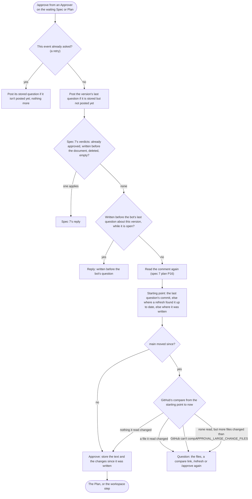
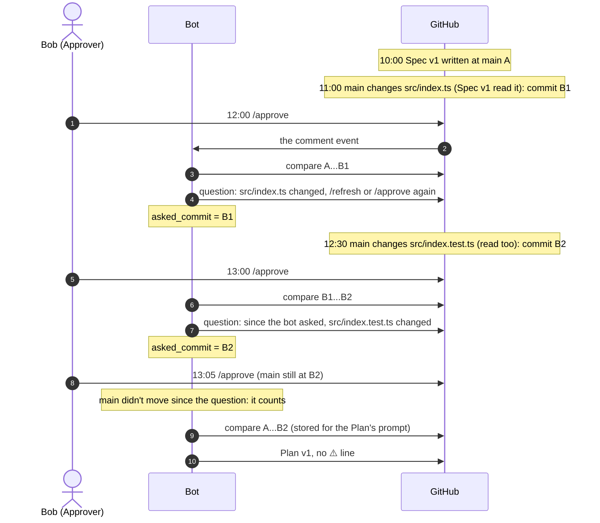

# Spec #14 — GitHub AI Agent: Up-to-date Approvals

> **Created:** 2026-11-23 · **Status:** approved 2026-11-23 (draft the same day); not built. UA1–UA7 come from the interview of 2026-11-23
> and were confirmed by the developer; UAW1–UAW12 were decided while writing. A fresh-context review's fixes are
> applied (marked "2026-11-23, review"). In the write-time interview of 2026-11-23 the developer confirmed UAW4 and
> changed UAW5 (a large change asks too, with a setting); the other UAW decisions follow from rules already settled
> and are reviewed with this spec. The plan's decisions UP1–UP4, UP13 and UP19–UP21 and two fixes to matrix `#H` are
> applied (marked "plan UPn, 2026-11-23"; plan `docs/plans/spec-github-agent-up-to-date-approvals.md`, Task 0).
>
> **Repos:** bot [`Hugoer/sdd-agent`](https://github.com/Hugoer/sdd-agent) (this repo) · target
> [`Hugoer/sdd-agent-sandbox`](https://github.com/Hugoer/sdd-agent-sandbox)
>
> **Why this file exists:** overview D34 (2026-11-23, decided by the developer during spec 7's build, after sandbox
> issue #60) and §1 row 14 (module id `up-to-date-approvals`), built right after spec 7 (`spec-plan-approvals`,
> built and verified 2026-11-23) while its approval code is fresh, and before spec 8 makes an approval lead to real
> work. Spec 7 approves at once and only tells people afterwards: a `full-sdd` Spec's approval writes the Plan with
> a ⚠️ line, and the last document before code gets a warning reply after the approval, with a restart as the only
> way back. This spec moves the check before the next step: when `main` changed files the document read, the
> `/approve` doesn't count yet, and the bot asks first. Plain code, no model call. It is one spec and one plan that
> change spec 7's code (`src/documents`).
>
> **Sources:**
> - `docs/specs/spec-github-agent-architecture-overview.md` (normative): D34, §1 row 14, §3 R2 and rows 17–20.
> - `docs/specs/spec-github-agent-spec-plan-approvals.md` (spec 7): SP3, SPW11, SPW13, SPW22, "`/approve`",
>   "Approving", "The document comment" (the Plan's ⚠️ line), the refresh frame, plan P4, P32, P33, P39, P41, "Agreed
>   for later specs" → spec 14.
> - The code it changes: `src/documents/approval-check.ts` (the verdict), `src/documents/document-approval.ts` (the
>   approval and its commit check), `src/documents/commit-check.ts`, `src/documents/document-comments.ts`,
>   `src/documents/plan.handler.ts` (the ⚠️ line), `src/documents/refresh-frame.ts`.
> - The interview of 2026-11-23.

## Objective

An Approver's `/approve` on a Spec or a Plan moves the issue to the next step (the Plan, or the code) only when
the document is up to date with `main`, or when an Approver has seen what changed and approved it anyway:

- **the bot asks before it moves on:** when `main` changed files the document read since it was written (or last
  found up to date, or since the bot last asked), the `/approve` doesn't count yet. One reply names the files, links
  GitHub's compare page and offers two ways on: `/refresh` (bring it up to date) or `/approve` again (approve it as
  it is);
- **the method counts too:** a change to the step skill the document was written with (its `SKILL.md` or another of
  its files the call read) asks as well, and `/refresh` then also follows the new method;
- **can't tell is treated like changed:** when GitHub can't compare the two commits, the bot asks too;
- **a large change counts too:** when more files changed on `main` than a setting allows
  (`APPROVAL_LARGE_CHANGE_FILES`, 15 by default), the bot asks even if the document read none of them: a big
  backend change can matter to a frontend Spec that never opened it;
- **no step is taken on a stale document by accident:** the next step's comment (the Plan, spec 8's step) is the
  answer only to an `/approve` that counted, and no warning comes after an approval any more;
- **it costs nothing:** the check is deterministic code (GitHub's compare and the database), with no model call,
  and the reply comes within seconds;
- **the usage is measurable:** every question is a row with its files, so a dashboard can tell how often a question
  was worth it.

**Actors:**
- Approvers (Write access): `/approve`, `/approve` again after a question;
- Participants and Approvers: `/refresh`;
- the bot: the question reply.

## Scope

- **In:**
  - The commit check of spec 7's approval (its "Approving" step 2) becomes a question when it finds a change: rows
    17, 18 and 19 of the overview's transition table.
  - R2 gains one rule: an `/approve` written before the bot's last question about the waiting document doesn't count.
  - Where the next check starts after a question (`task_documents.asked_commit`), and the range an approval stored
    (`approved_from_commit`).
  - The question reply and its `document_actions` row (`approve-asked`); the new refusal `before-question`.
  - The setting `APPROVAL_LARGE_CHANGE_FILES` (UAW5).
  - The refresh frame's sentence about a changed method.
  - Removing spec 7's warning reply (SPW13) and the Plan header's ⚠️ line.
  - An invariant script, `scripts/up-to-date-approvals-invariants.mjs`, and the setup guide's section.
- **Out (later specs):**
  - A quick signal while the bot works after an `/approve` that counted: spec 13 (`bot-feedback`).
  - What the Coder does with files changed after the last approval: spec 9 (`coder`).
- **Out (Future):** the bot noticing pushes to `main` on its own (the App receives no `push` events; the check runs
  at `/approve` and `/refresh`, as in spec 7); a list of files that never ask (e.g. a lockfile), if the usage data
  shows false alarms (UA7).

## Decisions (interview 2026-11-23, all confirmed)

- **UA1 Every file the document read counts, the step skill's own files included.**
  - As spec 7 (SP3, plan P4): the files of the `context_loads` rows with outcome `loaded` and a path, from the
    version's own call and from every version it is based on (`basedOnId`, back to the first writer; a Plan's chain
    goes on into its approved Spec's). That is the repo files read with `read_file`, the root and folder
    `AGENTS.md` files, the repo skills' files and the step skill's `SKILL.md` and its files the call loaded. Folder
    listings don't count (a listing of the root would flag every new file).
  - Only a change between the document's writing and its `/approve` matters: a document always reads the skill as
    it is on `main` when it is written.
  - A changed step skill means the document follows an old method (e.g. the new `spec` skill asks for a "Risks"
    section; Spec v1 has none), so the bot asks, and `/refresh` then also brings the document in line with the new
    method (UAW7).
  - Reason (the developer): the Spec must never stay stale. My first guess left the step skill out, because spec
    7's refresh keeps the text and fixes only what new code made wrong, so it couldn't apply a new method; the
    refresh learns that instead (one sentence in its prompt, no extra model call).
- **UA2 After a question, the next `/approve` asks again only about changes since the question.**
  - The question moves the starting point of the next check to the commit it compared to (UAW3). An `/approve`
    after it compares from there: files the document read that changed since → a new question naming only those;
    none → the `/approve` counts.
  - Example: 10:00 Spec v1 at `A`; 11:00 `main` changes `src/index.ts` (read); 12:00 `/approve` → question; 12:30
    `main` changes `src/index.test.ts` (read too); 13:00 `/approve` → a second question naming only
    `src/index.test.ts`; 13:05 `/approve` → counts.
  - Busy repos: each question is short and names only what changed since the last one, and `/refresh` ends the
    loop. Reason: the developer's "never stale"; the gap between a question and the next `/approve` is minutes, so a
    second question is rare. The alternative (any `/approve` after a question counts) never loops but lets a change
    made after the question go unseen.
- **UA3 When GitHub can't compare, the bot asks too.** The commit the document read is no longer on GitHub (e.g.
  after a force-push that rewrote `main`; spec 7 plan P32: GitHub's 404 or 422 only). The question says the bot
  can't tell whether files it read changed. The next `/approve` compares from the question's commit, which exists.
  `/refresh` already works without the comparison (spec 7 plan P32: the model is told to read what it needs).
  Replaces spec 7's SPW22 ("a failed comparison never blocks"). Reason: "can't tell" is no safer than "changed",
  and a rewritten `main` is when people should look.
- **UA4 The Plan's header loses its ⚠️ line** (spec 7 "The document comment"), in both forms (files changed, and
  "couldn't compare"). A Plan is only written after the Spec's `/approve` counted: nothing it read changed, or an
  Approver saw the question and approved it as it is. The question is the record on the issue, right above the
  Plan. The Plan's prompt still gets the changed files (spec 7 plan P33; without the hidden paths, plan P41), so the
  model follows the code where the Spec's facts no longer hold.
- **UA5 Only an `/approve` written after the bot's question counts as "again".** Any Approver's, not only the one
  whose `/approve` was asked. An `/approve` written before the question was posted (two quick `/approve`, or two
  people at once) gets one reply: "[Your `/approve`](…) was written before [the bot's question](…), so it didn't
  count: read it, then comment `/refresh`, or `/approve` again." Spec 7 has the same rule for documents
  (`before-document`). Reason: its writer couldn't have read the question; counting it would approve a stale
  document nobody chose to approve, which is what this spec stops.
- **UA6 The question needs no quick signal and no new label.** It is plain code and comes within seconds, so it is
  its own quick answer. The `status:` label stays (`spec-review`, or the Plan's waiting status: `ready-for-dev`
  today, `status: plan-review` from spec 13): the issue still waits for the same document. The `/approve` that
  counts and leads to a model call (the Plan) or to the code gets spec 13's signal like any other `/approve`.
  Recorded in "Agreed for later specs" → spec 13. The alternative (a `status: needs-refresh` label) adds a label for
  a state a reply already shows.
- **UA7 One row per question, with its files.** A `document_actions` row `approve-asked` holds the version, why it
  asked (`stale`, `not-compared`, `large-change`), the files it named with who read each, and the two commits. The
  rest comes from rows spec 7 already stores ("Usage data"). Reason: the false-alarm measure (a `/refresh` after a
  question that found the document still up to date) needs the file names to show which files cause them, e.g.
  `package.json`, which almost every call reads.

### Decided while writing (to review)

- **UAW1 Module and effort.** The id `up-to-date-approvals` is kept (overview §1 row 14 said "to confirm"); the code
  stays in `DocumentsModule` (`src/documents`); no new module, no new dependency. Effort: `high` (a change to fresh
  code: one verdict, one branch in the approval, one sentence in a prompt, one migration, the replies; spec 7 was
  `xhigh`).
- **UAW2 Where each check runs.**
  - The time rule (UA5) is a gate verdict, `before-question`, checked by spec 7's approval check before `decide()`
    (R2), after spec 7's verdicts (already approved, written before the document, deleted, empty), so a deleted or
    empty document gets its own reply first. It is pure: it compares the `/approve`'s creation time with the posting
    time of the version's last question (GitHub's second: the same second counts, as spec 7's `before-document`).
    It applies only while that question is open (`asked_commit` set): once a `/refresh` found the version up to date,
    the question no longer applies (2026-11-23, review).
  - This event's own question comes first, like spec 7's "this event already approved" (2026-11-23, review): a
    retried event that already asked goes straight to its stored question (UAW9), whatever happened to the document
    since, so one `/approve` never gets a refusal and a question.
  - The file check (UA1–UA3) stays inside the approval (rows 17–19, spec 7's "Approving" step 2), after the comment
    is read again (spec 7 plan P16): it already compares there. A question ends the approval before anything is
    stored: no snapshot, no next step. The event ends `IGNORED` with the new router ignore reason `approve-asked`
    (spec 7's refusals end `IGNORED` `approve-refused`); the status and the labels stay.
- **UAW3 Where a check starts, and what an approval stores.**
  - An `/approve`'s starting point is `asked_commit ?? checked_commit ?? commit`: the commit the version's last
    question compared to; else the latest commit a `/refresh` found it up to date at (spec 7 SPW11); else the commit
    it was written at. Only `/approve` reads `asked_commit`: `/refresh` keeps spec 7's `checked_commit ?? commit`
    (`src/documents/document-refresh.ts`), so a refresh right after a question still compares from where the document
    was written or last checked, and runs (2026-11-23, review).
  - `task_documents.asked_commit` (new, nullable) is set by a question and cleared when a `/refresh` moves
    `checked_commit` (a refresh that changes the document makes a new version, which starts with neither). On an
    approved version it is only a record: nothing reads it.
  - An `/approve` that counts still stores spec 7's full range, from `checked_commit ?? commit` to now
    (`stale_files`, `changed_paths`, `changed_complete`), so the Plan's paragraph (plan P33) and spec 9 see every
    change since the document was written, and now also that range's start, `approved_from_commit` (new, nullable),
    because a later `/refresh` while the Plan waits moves the approved Spec's `checked_commit` (spec 7) and the range
    could no longer be told from the row (2026-11-23, review; the Plan's paragraph and the invariants read it). So an
    `/approve` after a question compares twice when `main` moved since the question: the question's commit → now (to
    decide), and the full range (to store). When `main` didn't move, the decision needs no compare.
  - The Plan's prompt, when the Spec's approval couldn't compare: "The Spec was written at commit {specCommit}; the
    bot couldn't list the files changed on the base branch since. Where the Spec's facts about the code no longer
    hold, follow the code at {commit}; what to build still comes from the Spec." (spec 7 gave no paragraph then, and
    its ⚠️ line told people; with UA4 the model gets the same hint the refresh frame gives, plan P32; 2026-11-23,
    review).
- **UAW4 A file is named again only when it changed again.** UA2 read literally: a question names the read files
  changed since the starting point. `src/index.ts` named at 12:00 and changed again at 12:30 is named again at
  13:00; unchanged since 12:00, it isn't.
- **UAW5 A large change asks too, above a setting (`large-change`)** (2026-11-23, write-time interview: the
  developer changed it).
  - `APPROVAL_LARGE_CHANGE_FILES` (`.env`, an integer from 15 to 150, default 15): when more files than that
    changed on `main` since the starting point and none of them is a file the document read, the bot asks anyway.
    Files the document read come first: any of them changed → the `stale` question, which names them.
  - Reason (the developer): a big change can matter even to files the document never opened; a backend (Java)
    change can make the planned frontend (JS) work easier or different. Checking "files it read" can't see that.
  - It also settles GitHub's 300-file cut (spec 7: `complete` false): more than 300 is always above the setting, so
    a cut list with none of the read files in it asks too ("more than 300 files changed"). A read file in the cut
    list → the `stale` question, its list ending "… and possibly more".
  - Busy repos: 15 files can change within an hour, so many approvals get one question first. The next `/approve`
    compares from the question's commit (usually minutes of changes) and counts: one extra `/approve`, not a loop.
    A deployment can raise the setting up to 150.
  - The count is every changed path GitHub lists (both sides of a rename, spec 7), the read tools' hidden paths
    included.
  - Replaced my first draft (ask only when GitHub cut the list and none of the read files was listed; or check each
    read file's fingerprint at both commits, which a cut list no longer needs).
- **UAW6 The question's wording.**
  - The files are named as spec 7's warning reply named them (at most 5, then "and N more"; plan P4's grouping:
    "which it read", "which the approved Spec read", "which it and the approved Spec read").
  - The paths the read tools hide (`.github-agent/`, other tools' instruction files) are named: people read the
    question, the model never does (spec 7 plan P41).
  - A step skill's file among them → the `/refresh` offer says so: "Comment `/refresh` to bring it up to date with
    `main` and its `spec` skill".
  - After a question, the next one says "since [the bot asked](…) (`b71e4d8`)"; after a refresh found it up to
    date, "since Spec v1 was last checked (`c3d9a10`)" (spec 7's wording).
- **UAW7 The refresh's method sentence covers every file of the step skill.** The refresh frame gets one sentence
  when any file under the refreshed kind's step-skill folder (`workflow.json`'s `skills.spec` or `skills.plan` at
  the refresh's commit) changed between the refresh's two commits, read or not: the refresh reads the new skill
  anyway (spec 11's `prepare` at the new commit), and the sentence only says it changed. The files line still never
  names those paths (plan P41). The sentence lifts the frame's "keep the same sections, wording and order" for what
  the new method asks (a section added, renamed or dropped), so a refresh can follow it (2026-11-23, review). When
  the bot can't tell (GitHub couldn't compare, or cut the list with none of the skill's files in it), it says "may
  have changed" instead (UA3's rule).
- **UAW8 Where no question is ever asked.** The go-signal (`code-only`): it read no files. A retried event or a
  `/retry` whose approval is already recorded (spec 7: the same event's approval → nothing more), and from spec 8 an
  approval queued for the workspace: the approval counted; what changes after it is spec 9's.
- **UAW9 The question follows spec 7's reply pattern.** Its row and reply are written in one transaction, posted,
  then marked posted with the reply's GitHub creation time (`reply_posted_at`, which UA5's time rule reads; marker
  `approve-asked:<commentId>`). A retried event finds its row (unique `action`, `source_comment_id`) and posts the
  stored reply if it isn't posted yet; it never compares again. A question that answers this same `/approve` never
  makes it `before-question`. A question stored but not posted (GitHub failed between the two steps, and the worker
  waits before retrying that event) is posted by the next `/approve` on the version before it is judged, as spec 7
  posts a stored version a later event finds (`postPending`): its link then works, and the time rule compares with
  a real posting time (2026-11-23, review).
- **UAW10 What stops.** No new `approve-warning` rows (the old ones stay); spec 7's code for the warning reply and
  the ⚠️ line is removed. Plans already posted with a ⚠️ line aren't edited.
- **UAW11 A new invariant script**, `scripts/up-to-date-approvals-invariants.mjs` (read-only, as spec 7's), with a
  test that each invariant can fail. Spec 7's script keeps its invariant on `approve-warning` replies: there are no
  new ones, so it still passes.
- **UAW12 The question names the issue's base branch as `main`** (`TARGET_BASE_BRANCH`), with 7-character commits, as
  every spec 7 comment.

## Behavior

### What counts as read (UA1)

Unchanged from spec 7's "Approving" step 2 and plan P4: `DocumentApprovals.readsOf(version)` (the version's calls and
its chain's, `context_loads` rows `loaded` with a path, listings left out). The step skill's `SKILL.md` is a row of
every Spec and Plan call (kind `step-skill`), so a change to it is a change to a file the document read.

### The `/approve` on a Spec or a Plan

The router asks spec 7's approval check before `decide()`, only for `APPROVE` in `spec-review` or the Plan's
waiting status; the go-signal never reaches the file check (UAW8).



*Informative: the text below wins.*

**The question** (op `approve-asked`): the `/approve` doesn't count. In one transaction: the version's
`asked_commit` = the commit now; a `document_actions` row `approve-asked` with its result, files, commits and reply
(UA7). The reply is posted; the event ends `IGNORED` `approve-asked`; no status or label changes.

Spec, files changed (`result` `stale`):

```markdown
[Your `/approve`](…) didn't count yet: since Spec v1 was written (`4f2c1ab`), `main` changed `src/index.ts`, which
it read ([compare](https://github.com/Hugoer/sdd-agent-sandbox/compare/4f2c1ab...b71e4d8)). Comment `/refresh` to
bring it up to date with `main`, or `/approve` again to approve it as it is.
```

Plan (plan P4's grouping; `/refresh` checks the approved Spec first, then the Plan, as spec 7):

```markdown
[Your `/approve`](…) didn't count yet: since Plan v1 was written (`9e1d0c2`), `main` changed `src/index.ts`, which
it read, and `README.md`, which the approved Spec read ([compare](…)). Comment `/refresh` to bring Spec v1 and Plan
v1 up to date with `main`, or `/approve` again to approve Plan v1 as it is.
```

(Every call reads the root `AGENTS.md`, so a change to it reads "`AGENTS.md`, which it and the approved Spec read".)

- A step skill's file among them (UAW6): "… `main` changed `.github-agent/skills/spec/SKILL.md`, which it read (…).
  Comment `/refresh` to bring it up to date with `main` and its `spec` skill, or …". A Plan names the skill each such
  file belongs to (plan UP4, 2026-11-23): "… bring Spec v1 and Plan v1 up to date with `main` and the `plan` skill"
  (or "the `spec` skill", or "the `spec` and `plan` skills" when both changed).
- The starting point was a question (UA2): "since [the bot asked](…) (`b71e4d8`), `main` changed
  `src/index.test.ts`, which Spec v1 read (…)". It was a refresh (SPW11): "since Spec v1 was last checked
  (`c3d9a10`)".
- More than 5 files → the first 5 and "and N more"; a cut list with a read file in it → "… and possibly more" (spec
  7's rules).

GitHub can't compare (`result` `not-compared`, UA3; no compare link):

```markdown
[Your `/approve`](…) didn't count yet: the bot couldn't compare `4f2c1ab`, where Spec v1 was written, with `main`
(that commit is no longer on GitHub, e.g. after a force-push), so it can't tell whether files it read changed.
Comment `/refresh` to check it against today's `main`, or `/approve` again to approve it as it is.
```

The starting point names itself as in the `stale` text: "where Spec v1 was written", "the commit of [the bot's
question](…)", "where Spec v1 was last checked" (2026-11-23, review).

More files changed than `APPROVAL_LARGE_CHANGE_FILES`, none of them read (`result` `large-change`, UAW5):

```markdown
[Your `/approve`](…) didn't count yet: since Spec v1 was written (`4f2c1ab`), 42 files changed on `main`
([compare](…)), none of them one it read. A change this size may still affect it. Comment `/refresh` to check it
against today's `main`, or `/approve` again to approve it as it is.
```

- GitHub cut the list: "more than 300 files changed on `main` ([compare](…)); none of the 300 GitHub lists is one it
  read."
- "since Spec v1 was written" follows the starting point as above ("since [the bot asked](…)", "since Spec v1 was
  last checked").

A Plan's `not-compared` and `large-change` forms name both readers and both documents, as its `stale` text does
(plan UP3, 2026-11-23):

```markdown
[Your `/approve`](…) didn't count yet: the bot couldn't compare `9e1d0c2`, where Plan v1 was written, with `main`
(that commit is no longer on GitHub, e.g. after a force-push), so it can't tell whether files it or the approved Spec
read changed. Comment `/refresh` to check Spec v1 and Plan v1 against today's `main`, or `/approve` again to approve
Plan v1 as it is.
```

```markdown
[Your `/approve`](…) didn't count yet: since Plan v1 was written (`9e1d0c2`), 42 files changed on `main`
([compare](…)), none of them one it or the approved Spec read. A change this size may still affect them. Comment
`/refresh` to check Spec v1 and Plan v1 against today's `main`, or `/approve` again to approve Plan v1 as it is.
```

**Written before the question** (gate verdict `before-question`, UA5; `document_actions` `approve-refused`, result
`before-question`, spec 7's refusal pattern):

```markdown
[Your `/approve`](…) was written before [the bot's question](…), so it didn't count: read it, then comment
`/refresh`, or `/approve` again.
```

**An `/approve` that counts:** spec 7's "Approving" steps 1, 3 and 4 as built (the text, the edit counts, the
snapshot with the full range, UAW3); step 5 posts nothing, ever: no warning reply (UAW10). The next step is the
answer: the Plan, whose header has no ⚠️ line (UA4), or spec 8's step (until spec 8: spec 5's `step-not-built`
stop at `workspace`).

### When `main` moves after a question (UA2, UAW3, UAW4)



*Informative: the text wins.* With `/refresh` instead of the second `/approve`: a Spec v2 (a new version, with no
question and its own starting point at its commit), or "still up to date" (`checked_commit` = the commit now,
`asked_commit` cleared), after which an `/approve` compares from there.

### `/refresh` and a changed method (UA1, UAW7)

Spec 7's `/refresh` is unchanged except for its frame (`src/documents/refresh-frame.ts`), which gets one sentence
after "If the method below says how to update a {kind}, follow it.":

```text
{only when a file under the {kind}'s step-skill folder changed between {from} and {to}: "The method below changed
since the {kind} was written. Where the {kind} no longer follows it, change that too, even when that adds, renames
or removes a section; keep everything else as written."}
{when the bot can't tell (GitHub couldn't compare, or cut the list with none of the skill's files in it): the same
sentence with "may have changed" in place of "changed"}
```

- The files line never names the step skill's paths (spec 7 plan P41); when only those changed it says "None of the
  files you can read changed since." and the method sentence says why the refresh runs.
- `/refresh` while the Plan waits: the `spec` refresh gets the sentence when the `spec` skill changed, the `plan`
  refresh when the `plan` skill changed.
- `upToDate` stays the model's answer (spec 7); a refresh that finds nothing to change still moves the starting
  point (SPW11) and clears `asked_commit`.

### Retries and failures

| Case | Behavior |
|---|---|
| The question stored, the reply not posted (a crash, or GitHub failed and the worker waits to retry) | The retried event finds its `approve-asked` row and posts the stored reply once, before any other check; no compare. Another `/approve` processed first posts it before it is judged (UAW9) |
| `changedFiles` 404 or 422 | `not-compared` question (UA3) |
| `changedFiles` other errors, `resolveRef` errors | as spec 7: a temporary error is retried by the worker, a 401 or 403 is a failure (overview row 28) |
| The full-range compare of an `/approve` that counts fails with 404 or 422 | the approval counts (the decision compare from the question's commit passed), stored as not compared (`changed_complete` null), as spec 7 |
| `/retry` of the `workspace` stop | no question: the approval is recorded (UAW8) |
| A retried `/approve` that stored its question finds the run stopped (another event failed meanwhile) or ended | its stored question is posted (if it isn't yet), whatever reply the run's state would get otherwise; the event ends `IGNORED` `approve-asked`; the `/approve` gets no second reply (UAW2; plan UP21, 2026-11-23) |

### Logging

One line per question, in spec 7's form (plan UP19, 2026-11-23): `#43 run 1 spec: v1 /approve asked (stale, 1 file
read changed since 4f2c1ab)`, `(not-compared)`, `(large-change, 42 files)`; `before-question` as spec 7's refusals:
`#43 run 1 documents: /approve refused (before-question)`.

## Contracts

```ts
// src/workflow/decide.ts (spec 5, extended by spec 7): one more verdict
export type ApprovalVerdict =
  | 'valid' | 'done' | 'already-approved' | 'before-document' | 'deleted' | 'empty'
  | 'before-question'; // UA5, UAW2

// src/documents/approval-check.ts: the waiting document's last question (its reply's posting time), or null
export function approvalVerdict(
  waiting: WaitingDocument,
  approve: { createdAt: Date },
  comment: { body: string } | null,
  thisEventApproved: 'waiting' | 'earlier' | null,
  thisEventAsked: boolean, // a retried event that already asked → 'valid': the approval posts its question (UAW2)
  // the version's last question while it is open (asked_commit set), posted (the gate posts a pending one first,
  // UAW9), unless it answers this same /approve; null: none
  lastQuestion: { postedAt: Date } | null,
): ApprovalVerdict;

// src/documents/document-approval.ts: approve() answers one of
type ApprovalResult =
  | { kind: 'approved'; row: TaskDocument; flagged: FlaggedFile[]; compared: boolean }
  | { kind: 'asked'; result: 'stale' | 'not-compared' | 'large-change' }
  | { kind: 'refused' }; // spec 7 plan P16: gone or empty since the gate read it
```

- The `{ last }` option of `approve()` goes (it chose the warning reply).
- A new router ignore reason `approve-asked`; `StepOutcome` `APPROVE_ASKED` (`IGNORED`, `approve-asked`).
- No `RepoProvider` change.
- `src/config/env.schema.ts`: `APPROVAL_LARGE_CHANGE_FILES`, `integerFromTo(15, 150).default(15)` (spec 6's helper
  for integer settings; plan UP13, 2026-11-23); a value outside stops the app at start (spec 1's Zod check): "-
  APPROVAL_LARGE_CHANGE_FILES: must be an integer from 15 to 150".

## Owned tables (changes)

Migration `prisma/migrations/<ts>_up_to_date_approvals`. Writes only through `DocumentsStore`.

**`TaskDocument`** (`task_documents`):

| Column | Type | Notes |
|---|---|---|
| `askedCommit` | text, nullable | the commit the version's last question compared to (UAW3); cleared when a refresh moves `checkedCommit`; only `/approve` reads it |
| `approvedFromCommit` | text, nullable | the start of the range an approval compared and stored (`checkedCommit ?? commit` then); the Plan's paragraph (plan P33) and the invariants read it, since a later refresh may move `checkedCommit` (UAW3) |

**`DocumentAction`** (`document_actions`):

| Column | Type | Notes |
|---|---|---|
| `action` | text | new value `approve-asked`; `approve-warning` no longer written (UAW10) |
| `result` | text | `approve-asked`: `stale`, `not-compared`, `large-change`; `approve-refused`: also `before-question` |
| `fromCommit`, `toCommit` | text, nullable | `approve-asked`: the starting point and the commit now |
| `files` | jsonb, nullable | `approve-asked`: `[{ path, readers: ['own' \| 'spec'] }]`, every flagged file (not only the 5 named); empty for `not-compared` and `large-change` |
| `changedFiles` | int, nullable | `approve-asked`: how many paths changed in the range (300 with `filesComplete` false: more than 300); null when not compared |
| `filesComplete` | bool, nullable | `approve-asked`: false when GitHub cut the list; null when not compared |
| `replyPostedAt` | timestamptz, nullable | the reply's creation time on GitHub, recorded with `replyCommentId` (UAW9); written for every reply from now on, read for `approve-asked` (UA5) |
| `replyCommentUrl` | text, nullable | the reply's URL, recorded with `replyCommentId` and `replyPostedAt`; the `before-question` reply, a second question and the `not-compared` text link the bot's last question with it (plan UP2, 2026-11-23) |

## Usage data (UA7)

No command. What a dashboard can read:

| Question | Where |
|---|---|
| How often is an `/approve` asked first, per lane and per document? | `document_actions` `approve-asked` by `result`, joined to `task_documents.kind` and the run's lane |
| What did people do next? | the version's next row: `refresh` (and its `result`), an approval (`task_documents.approve_comment_id`), `before-question`, or the run's end |
| Was the question worth it? | a `refresh` after it with `spec-changed` / `plan-changed` (stale indeed) vs `up-to-date` (a false alarm, one model call) |
| Which files cause false alarms? | `files` of the questions followed by an `up-to-date` refresh, by path |
| How long does a question delay an approval? | the question's `created_at` → `approved_at` |
| How often does a question come back (busy repos)? | `approve-asked` rows per version |
| Is `APPROVAL_LARGE_CHANGE_FILES` well set? | `large-change` questions by `changed_files`, and what followed: a `/refresh` that changed the document (the change mattered) or `/approve` again / up to date (it didn't) |

## Configuration

`APPROVAL_LARGE_CHANGE_FILES` (UAW5): integer, 15–150, default 15; in `.env.example` with a one-line comment.
Nothing new in `workflow.json`.

## Commands

- `node scripts/up-to-date-approvals-invariants.mjs <issue>…`: the verification matrix's invariants (UAW11), with
  its test `scripts/up-to-date-approvals-invariants.spec.mjs`.

## Testing strategy

- **Unit:** the verdict table with `before-question` (each order case, the same second, a closed question, this
  event's own question first);
  the starting point (`asked_commit`, `checked_commit`, `commit`); the decision (moved or not, flagged, not compared,
  cut with and without a read file); every question text (Spec, Plan, each `result`, plan P4's grouping, the skill
  wording, "since the bot asked", "last checked", 5 files and more, "possibly more"); the `before-question` reply;
  the refresh frame's method sentence (present, absent, only hidden paths changed); the Plan header without a ⚠️
  line.
- **Integration** (real PostgreSQL, fakes at the ports, the fake `RepoProvider` scripted per compare): a question,
  then `/approve` → the Plan; a second question after `main` moves; a question, then `/refresh` (v2; up to date →
  `asked_commit` cleared) → `/approve` counts; two quick `/approve` → a question and `before-question`; a Plan
  question naming a file only the Spec read; `spec-code`; the go-signal never asked; unknown commit → `not-compared`;
  16 changed files, none read → `large-change` (and 15 → no question); a cut list with none read → `large-change`
  "more than 300"; a crash after the question's transaction → one reply; a question not posted, then
  another `/approve` → the question posted first, then `before-question`; a retried asking event after the document
  was deleted → only its question; `/retry` of the `workspace` stop
  → no question. Spec 7's suites that assert the warning reply or the ⚠️ line change with this spec (the plan lists
  them).
- **Manual:** the verification matrix below on the sandbox.

## Setup & configuration → `docs/guides/setup-github-agent-local.md`

- The guide's "When `main` changed files a document read" becomes the question: what it names, `/refresh` or
  `/approve` again, the method sentence, the large-change setting, the new columns and an example query, the
  invariant script.
- `.env.example` gains `APPROVAL_LARGE_CHANGE_FILES=15`. No App permission, event or sandbox skill change.

## Changes to earlier specs' behavior

- **Spec 7 (`spec-plan-approvals`):**
  - SP3: "it never blocks" → the question (UA1–UA3); the Plan's prompt keeps both commits and the list (plan P33),
    and says the bot couldn't list them when the comparison failed (UAW3).
  - SPW13 (the warning reply after the last approval) and SPW22 ("a failed comparison never blocks") → replaced by
    UA3 and UAW10.
  - "The document comment": the Plan header's ⚠️ line goes, in both forms (UA4).
  - Plan P4 (who read each file) moves into the question; plan P41 is unchanged (the question names hidden paths, no
    model-facing list does).
  - The refresh frame: the method sentence, which lifts "keep the same sections" for what the new method asks
    (UAW7); SPW11 also clears `asked_commit`; a refresh's own starting point is unchanged (`checked_commit ?? commit`).
  - "`/approve`": the flowchart and the verdict table gain `before-question`; "Approving" steps 2 and 5.
  - `document_actions`: `approve-asked`, `before-question`, five columns; `task_documents.asked_commit` and
    `approved_from_commit` (the Plan's paragraph reads its range from it, not from `checked_commit ?? commit`).
  - The verification rows on the ⚠️ line and the warning reply (its "The commit check and `/refresh`" block) are
    replaced by this spec's; its invariant on `approve-warning` replies holds for the rows before this spec.
  - "Agreed for later specs" → spec 9: the flagged files of the last approval come with an `/approve` that counted
    after a question, not with a warning reply.
  - Spec 7's text gets dated notes pointing here when this spec is approved.
- **Spec 5 (`router-session-lease`):** R2's verdict gains `before-question`; a new ignore reason `approve-asked`.

## Changes to the overview (made with this spec, applied when it is approved)

- **D34:** a closing line: resolved by spec 14 (UA1–UA7).
- **§1 row 14:** the id and the folder confirmed, effort `high` (UAW1), the responsibility in final words.
- **§5:** `APPROVAL_LARGE_CHANGE_FILES` (UAW5).
- **§3:** R2 adds "and written after the bot's last question about that document (spec 14)"; rows 18 and 19 lose
  "the warning reply"; rows 17, 18 and 19 add "files it read changed on the base branch since its starting point, or
  the bot can't tell → one question instead; nothing changes (spec 14)".
- **§6:** `TaskDocument` and `DocumentAction` "extended by 14".
- Applied 2026-11-23, with spec 7's dated notes.

## Edge cases

- **Two `/approve` at once, before any question:** the first gets the question; the second, written before it was
  posted, gets `before-question` (UA5).
- **Two `/approve` right after a question (both written after it):** the first counts; the second gets spec 7's
  reply for the state the first left (`full-sdd`'s Spec: `before-document`, as the Plan is then posted; `spec-code`'s
  Spec and a Plan: the stopped reply while the run stops at `workspace`, until spec 8).
- **A question, then the document is deleted:** an `/approve` gets spec 7's `deleted` reply (spec 7's verdicts come
  first, UAW2).
- **A question, then the document deleted and restored:** the restored version starts fresh, as spec 7's restore
  does (a new row at the original's commit, no `checked_commit`, no `asked_commit`): an `/approve` compares from
  where the original was written and gets the same question again; one more `/approve` counts (plan UP1, 2026-11-23).
- **A question, then people edit the document:** an `/approve` that counts approves the text as it reads then.
- **A question on the Plan, then `/refresh` changes the Spec:** Spec v2, `spec-review`, the Plan no longer counts
  (spec 7); the Plan's question goes with it.
- **`main` force-pushed after a question:** the question's commit may be unknown → a `not-compared` question, whose
  commit then exists.
- **A revert on `main`:** the compare shows no change for a file that is back as it was (GitHub compares the two
  trees); a file changed and reverted between two questions isn't named.
- **`workflow.json` points the step at another skill folder:** not a file the document read; no question. A
  `/refresh` then reads the new skill (spec 11's `prepare`).
- **A file of the step skill the call never loaded changed:** no question (UA1); a later refresh still gets the
  method sentence (UAW7).
- **A busy repository:** one question per `/approve` while read files keep changing or more than
  `APPROVAL_LARGE_CHANGE_FILES` files change between two `/approve`, each naming only the new changes; `/refresh`
  ends it (UA2, UAW5).
- **More than 300 changed files:** always a question (UAW5).
- **A closed issue:** spec 5's closed reply first (RL19).
- **An `/approve` from a sender with no access:** ignored by intake (spec 2), no question.

## Boundaries

- **Always:** decide a question in code (GitHub's compare and PostgreSQL), never with a model call; one reply per
  `/approve`, with its marker; read the comment again before the file check (spec 7 plan P16).
- **Ask first:** any change to the overview's rows beyond those above.
- **Never:** move to the next step on an `/approve` when a file the document read changed since its starting point,
  more files changed than `APPROVAL_LARGE_CHANGE_FILES`, or the bot can't tell; name the read tools' hidden paths in a prompt (spec 7 plan P41); edit or delete a posted
  comment.

## Verification matrix

**Setup to observe:** `npm run db:runs`; `npm run db:events`; the issue timeline; the rows:

```sh
docker compose exec -T postgres psql -U sdd_agent -d sdd_agent -c "SELECT kind, version, left(commit,7) AS commit, left(checked_commit,7) AS checked, left(asked_commit,7) AS asked, approved_by, stale_files, changed_complete FROM task_documents ORDER BY created_at DESC LIMIT 10"
docker compose exec -T postgres psql -U sdd_agent -d sdd_agent -c "SELECT action, result, left(from_commit,7) AS from_c, left(to_commit,7) AS to_c, files, files_complete, reply_post_state, created_at FROM document_actions ORDER BY created_at DESC LIMIT 10"
```

Checked so far: the config row at Checkpoint 1 (2026-11-23, port 3101, test database); Checkpoint 2 (2026-11-24)
on `#A` = #72, `#B` = #73, `#E` = #74, `#F` = #75, `#G` = #71, `#H` = #76 (sandbox commits `56f564d`, `3d8fe8a`,
`75d880f`, `57b81de`, `e2598a3`, `609b00e`); Checkpoint 3 (2026-11-24) on `#C` = #77, `#D` = #78 (commits `313d5b1`,
the rename, as `PACKAGE_NAME` in `src/index.ts` and its test; `dcc3067`, a comment line in `eslint.config.mjs`, on
the Plan's "Read:" line; `785c866`, the `spec` skill's "## Risks"). Every sandbox commit is undone at Checkpoint 4.

Each row: a sandbox issue named in the plan's checkpoints; commits to the sandbox's `main` made with `gh` as the
developer (spec 7's practice) and undone at the end. "A file it read": a path on the document's "Read:" line; "an
unrelated file": a path on no "Read:" line of the run (e.g. a new `notes/spec-14.md`).

**An unrelated change, then the Plan** (`#A`, `full-sdd`, Spec v1 waiting; spec 7's rows already cover `/approve`
with `main` unchanged)
- [x] Push a change to an unrelated file, `/approve` → Plan v1 at once, NO question; `stale_files` empty,
  `changed_paths` has the file.
- [x] Plan v1 waiting: push a change to a file on the Plan's "Read:" line, `/approve` → ONE question naming it
  "which it read" (or "which it and the approved Spec read" when the Spec's "Read:" line has it too); `/approve`
  again → the `workspace` stop and NO other reply; NO `approve-warning` row.

**The question, and `main` moving after it** (`#B`, `full-sdd`, Spec v1 waiting)
- [x] Push a change to a file Spec v1 read (`src/index.ts`), `/approve` → ONE reply "[Your `/approve`](…) didn't
  count yet: since Spec v1 was written (`<A>`), `main` changed `src/index.ts`, which it read ([compare](…)) …"; the
  compare link opens `<A>...<now>`; status stays `spec-review`; NO Plan; NO new `execution_logs` row; `db:events`:
  `IGNORED` `approve-asked`; `document_actions` `approve-asked` `stale`, `files` `[{src/index.ts, [own]}]`;
  `asked_commit` = the commit now.
- [x] Push a change to another file it read (`src/index.test.ts`), `/approve` → ONE second question "since [the bot
  asked](…) (`<q1>`), `main` changed `src/index.test.ts`, which Spec v1 read", NOT naming `src/index.ts`;
  `from_commit` = the first question's `to_commit`.
- [x] Push a change to an unrelated file, `/approve` → counts: Plan v1 with NO ⚠️ line in its header; NO reply to
  that `/approve`; `stale_files` has both read files (the whole range since the Spec was written); the Plan call's
  prompt (`execution_logs`) has the "The Spec was written at commit …" paragraph naming them.
- [x] Plan v1 waiting: push a change to a file only the approved Spec read (its "Read:" line has it, the Plan's
  doesn't), `/approve` → ONE question naming it "which the approved Spec read" and offering "`/refresh` to bring
  Spec v1 and Plan v1 up to date".

**A question, then `/refresh`** (`#C`, `full-sdd`, Spec v1 waiting)
- [x] Question after a change that makes the Spec wrong (rename a function it names in `src/index.ts`); `/refresh`
  → Spec v2 (spec 7); `/approve` → Plan v1 at once, NO question.
- [x] Plan v1 waiting: question after a change to a file the Plan read that changes nothing for it (a comment line);
  `/refresh` → ONE "both still up to date" reply; the Plan's `asked_commit` empty, `checked_commit` = the commit
  now; `/approve` → the `workspace` stop, NO question.

**The step skill** (`#D`, `full-sdd`, Spec v1 waiting)
- [x] Push a change to `.github-agent/skills/spec/SKILL.md` only (it now asks for a "## Risks" section), `/approve`
  → ONE question naming `.github-agent/skills/spec/SKILL.md` "which it read" and offering "`/refresh` to bring it up
  to date with `main` and its `spec` skill".
- [x] `/refresh` → Spec v2 with a "Risks" section, its "What changed" says so; the refresh call's prompt has "The
  method below changed since the Spec was written" and its files line names no `.github-agent/` path. `/approve` →
  Plan v1, NO question. The skill change is undone at the end.

**Written before the question** (`#E`, `full-sdd`, Spec v1 waiting, a file it read changed)
- [x] Hold the issue's lease (SQL), comment `/approve` twice, release → the first gets ONE question; the second ONE
  "[Your `/approve`](…) was written before [the bot's question](…), so it didn't count" reply; NO Plan;
  `document_actions` `approve-refused` `before-question`.
- [x] `/approve` after both replies → counts: Plan v1.

**`spec-code` and `code-only`**
- [x] (`#F`, `spec-code`, Spec v1 waiting) push a change to a file it read, `/approve` → ONE question; `/approve`
  again → the `workspace` stop, NO other reply.
- [x] `/retry` of `#F`'s `workspace` stop after another change to a file it read → the same stop, NO question.
- [x] (`#G`, `code-only`) push any change, `/approve` on the go-signal → the `workspace` stop, NO question.

**Can't tell** (`#H`, `full-sdd`, Spec v1 waiting)
- [x] Set the Spec's `commit` to an unknown SHA (`UPDATE task_documents SET commit = repeat('0', 40) …`),
  `/approve` → ONE "couldn't compare `0000000`, where Spec v1 was written, with `main`" question, no compare link;
  `result` `not-compared`; `/approve` again → Plan v1; the approval's `changed_complete` is empty; the Plan's prompt
  has the "couldn't list the files changed" paragraph (UAW3), with no list (2026-11-23, plan Task 0: the row had
  "the commit Spec v1 read" and "no 'files changed' paragraph").
- [x] Plan v1 waiting: one commit adding 16 small files under `bulk/` that no document read (Git Data API),
  `/approve` → ONE `large-change` question "16 files changed on `main` …, none of them one it or the approved Spec
  read" (plan UP3, 2026-11-23); `changed_files`
  16; `/approve` again → the `workspace` stop. The files are removed in one commit at the end. (More than 300
  files: the integration tests.)
- [x] (Config, signed requests are not needed) start the app with `APPROVAL_LARGE_CHANGE_FILES=14`, then `=151` → it
  doesn't start, the log names the setting and its range; unset → 15.

**Invariants** (`node scripts/up-to-date-approvals-invariants.mjs <issues>`; scoped to rows stored since spec 14 went
live: the `finished_at` of its migration in `_prisma_migrations`; invariants 2 and 3 read only the given issues'
rows, 1 and 4 every row since the migration, since the dev bot runs spec 7's approval code between the migration and
the question's build (plan UP20, 2026-11-23); test once that it can fail, e.g. with a wrong issue list)
- [ ] Every `approve-asked` row answers an `/approve` that approved nothing (no `task_documents.approve_comment_id`
  equals its `source_comment_id`) and got no other reply, and its reply was posted exactly once.
- [ ] Every Spec or Plan approved since spec 14 went live with `stale_files` not empty, `changed_files` above
  `APPROVAL_LARGE_CHANGE_FILES` (the script reads `.env`, default 15), `changed_complete` false, or
  `changed_complete` empty while `approved_commit` differs from `approved_from_commit` (a compare that failed) has an
  `approve-asked` row for its version whose reply was posted no later than the approving `/approve` was written
  (GitHub's second: the same second counts).
- [ ] No `approve-warning` row, and no Plan comment with a ⚠️ line in its header (either form), since spec 14 went
  live.
- [ ] Every `before-question` reply answers an `/approve` written before a question of its version that was posted
  before that reply.

## Success criteria

- Every verification row passes on the sandbox; `npm run typecheck && npm run lint && npm test && npm run
  test:integration` pass.
- The overview, spec 7's notes, the setup guide, `AGENTS.md` (State) and the README reflect this spec.
- No `/approve` moves an issue to the next step while a file its document read changed since its starting point,
  unless an Approver's `/approve` came after the bot's question about exactly those changes.

## Out of scope (deferred)

- **Watching pushes to `main`:** as spec 7.
- **Files that never ask** (lockfiles, generated files): a setting later, if the usage data shows false alarms.
- **Weighing which changes matter** (post-MVP, the developer, 2026-11-23): e.g. counting only the changed files
  the document names in its text, or telling a CSS change from a JS ticket's files, once the usage data shows which
  questions were false alarms (UA7).

## Agreed for later specs

- **Spec 13 (`bot-feedback`):** the question needs no quick signal and no new label (UA6); the `/approve` that counts
  and leads to the Plan or the code gets spec 13's signal like any other. While a question is open the issue keeps
  its waiting status (`spec-review`, or `status: plan-review` once spec 13 adds it).
- **Spec 8 (`workspace-git`):** an approval queued for the workspace (`WS_BUSY`) counted already: no question when it
  runs (UAW8).
- **Spec 9 (`coder`):** gets the last approval's flagged files (spec 7), which an Approver chose to approve after a
  question when there were any; changes to `main` after the approval are spec 9's to handle.
- **Dashboard (no spec yet):** reads the question rows ("Usage data").

## Open questions

None blocks this spec. The write-time interview (2026-11-23) is done: UAW4 confirmed, UAW5 changed; the other UAW
decisions follow from rules already settled and are reviewed with this spec.
